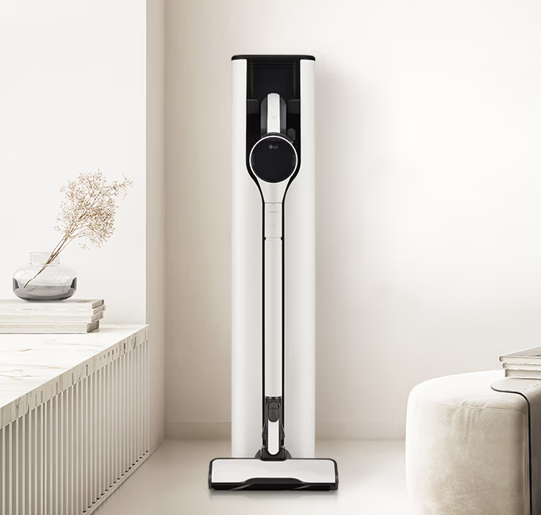
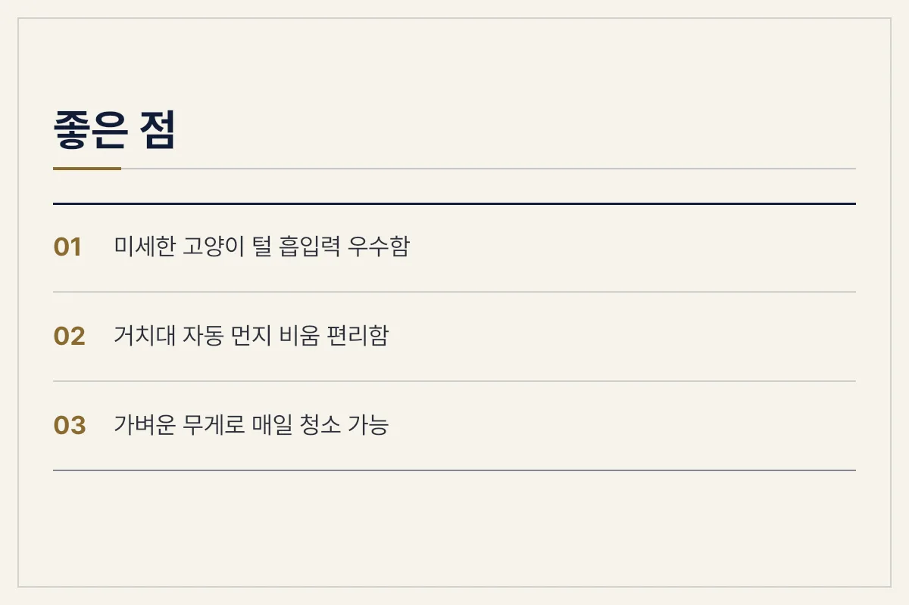
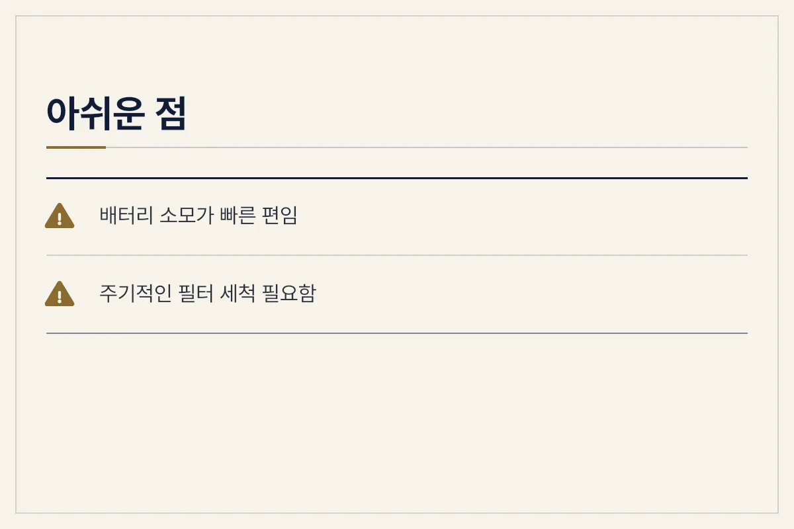
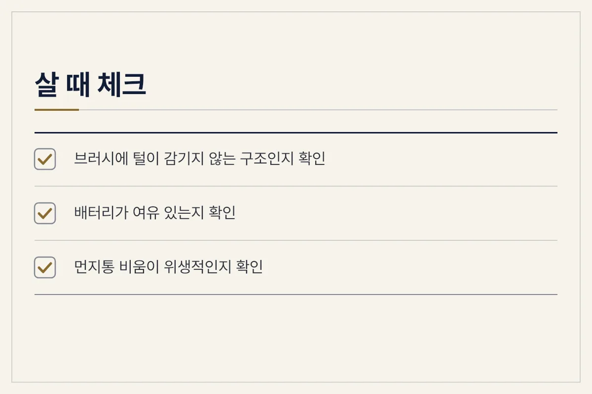
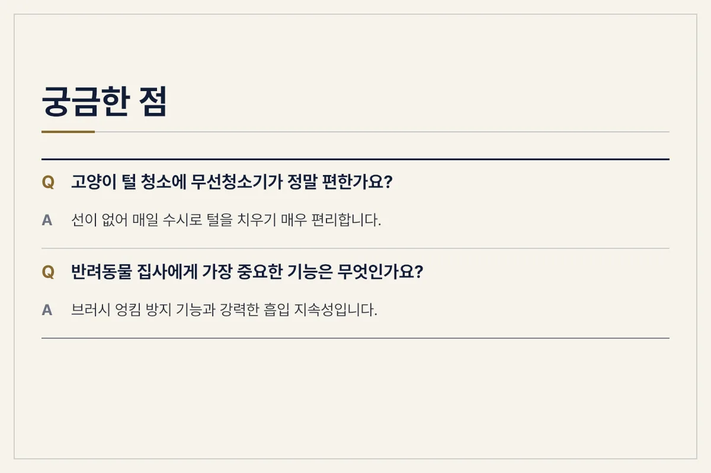

고양이 털 때문에 무선청소기 구입을 고민하고 계시나요? 결론부터 말씀드리면, 하루에도 몇 번씩 날리는 털을 수시로 치우기에는 무선청소기가 필수적이지만 털 특유의 엉킴과 필터 관리는 꾸준히 신경 써야 합니다.

<figure>

<figcaption>거치대에 깔끔하게 보관된 무선청소기 (사진: https://bitl.bz/Wq9kGs)</figcaption>
</figure>

반려동물을 키우는 집에서 가장 흔하게 겪는 문제는 온 집안을 나뒹구는 털과 뿜어져 나오는 각질입니다. 일반적인 빗질 외에도 가구 틈새나 패브릭 소파에 박힌 털을 제거하려면 흡입력이 뒷받침되어야 합니다. 1년 동안 직접 사용하면서 느낀 점은 단순히 흡입력 숫자뿐만 아니라 브러시 구조와 먼지 배출 방식이 실사용 만족도를 크게 좌우한다는 점입니다.

## 반려동물 집사에게 무선청소기가 필수인 이유

유선 청소기와 달리 무선청소기는 전원 코드를 꽂고 뽑는 번거로움이 없어 고양이가 털을 뿜어내는 장소를 즉시 공략할 수 있습니다. 특히 캣타워 주변이나 카펫 위는 털이 쉽게 엉키기 때문에 수시로 지나치며 청소하는 습관이 중요합니다. 

무게가 가볍고 조작이 간편할수록 손목에 무리가 가지 않아 매일 청소기를 돌리는 부담이 줄어듭니다. 또한 다양한 툴을 교체해가며 소파 틈새나 쿠션 위에 쌓인 털을 흡입할 수 있다는 점이 큰 장점입니다.

<figure>

<figcaption>무선청소기 장점 안내</figcaption>
</figure>

## 1년 실사용으로 느낀 장점과 아쉬운 점

1년 동안 사용하면서 체감한 장점은 일상의 편리함입니다. 눈에 보일 때마다 바로 청소할 수 있어 집안 공기가 한결 쾌적해졌습니다. 거치대를 통해 먼지통을 자동으로 비워주는 기능이 있는 경우, 먼지 날림을 최소화할 수 있어 위생적입니다.

반면 아쉬운 점도 분명 존재합니다. 고양이가 털갈이하는 시기에는 흡입한 털이 브러시 롤러에 엉키기 쉽습니다. 이를 주기적으로 가위나 손으로 제거해 주지 않으면 회전 효율이 떨어집니다. 또한 미세한 털과 먼지가 필터에 빠르게 쌓이기 때문에 정기적인 세척과 건조가 필수적입니다.

<figure>

<figcaption>무선청소기 단점 및 주의점</figcaption>
</figure>

## 반려동물 가정을 위한 청소기 선택 및 관리 팁

제품을 고를 때는 흡입력 수치에만 집착하기보다 브러시 구조를 꼼꼼히 살펴보아야 합니다. 털 엉킴 방지 기능이 적용되었는지, 먼지통 분리와 세척이 직관적인지가 실사용에서 훨씬 중요하게 작용합니다.

<figure>

<figcaption>구매 전 체크리스트</figcaption>
</figure>

청소를 마친 후에는 먼지통을 자주 비워주고, 흡입력을 유지하기 위해 필터에 낀 미세 먼지를 털어내야 악취를 예방할 수 있습니다. 털이 많은 동물과 함께 생활할수록 청소기 소모품 관리 주기가 짧아진다는 점을 염두에 두어야 합니다.

<figure>

<figcaption>자주 묻는 질문 코너</figcaption>
</figure>

## FAQ

**고양이 털 청소에 무선청소기가 정말 편한가요?**

선이 없어 매일 수시로 털을 치우기 매우 편리합니다. 다만 배터리 지속 시간 내에 청소를 마쳐야 하는 제약이 있습니다.

**반려동물 집사에게 가장 중요한 기능은 무엇인가요?**

브러시 엉킴 방지 기능과 흡입력을 꾸준히 유지해 주는 먼지 분리 시스템입니다. 이 기능이 부족하면 매번 손으로 털을 떼어내야 하는 번거로움이 생깁니다.

**필터 청소는 얼마나 자주 해야 하나요?**

동물의 털과 비듬은 미세먼지를 유발하므로 2주에서 한 달에 한 번은 필터를 물세척하고 완전히 건조해 사용하는 것이 좋습니다.

**카펫에 박힌 털도 잘 제거되나오?**

전용 브러시 툴을 사용하면 어느 정도 제거되지만, 패브릭 전용 노즐이나 테이프 클리너를 함께 병행하는 것이 더욱 효과적입니다.

**소음 때문에 고양이가 놀라지 않나요?**

작동 초기 소음에 민감할 수 있으나, 저단 모드를 활용하거나 평소 소리에 적응시키는 훈련을 거치면 점차 익숙해집니다.

<figure>

<figcaption>핵심 내용 요약</figcaption>
</figure>

추천 제품은 아래 링크에 걸어 두겠습니다.

[추천 제품 확인하기](https://bitl.bz/Wq9kGs)

최종 확인일: 2026-11-13. 가격과 사양은 판매처와 시기에 따라 달라질 수 있으니 구매 전 공식 판매 페이지에서 다시 확인하세요.
