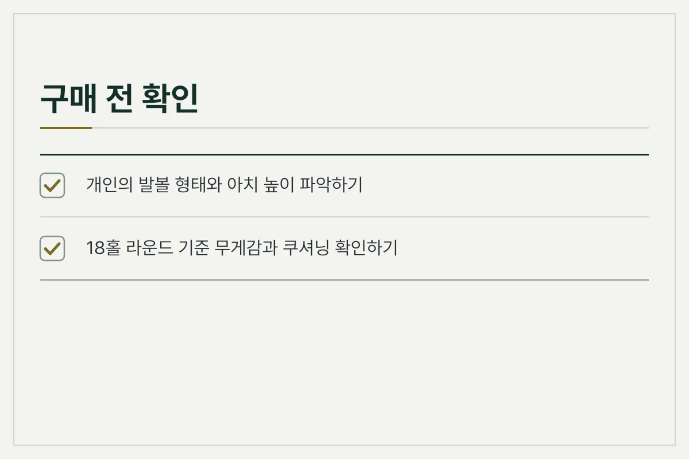
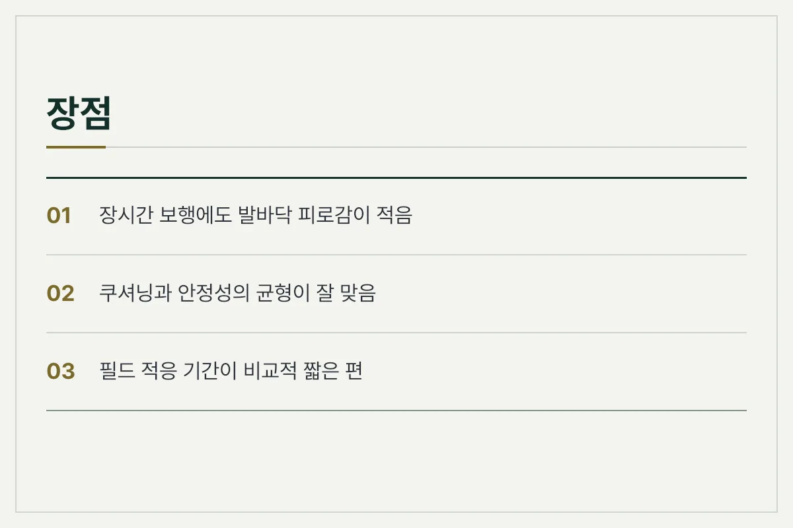
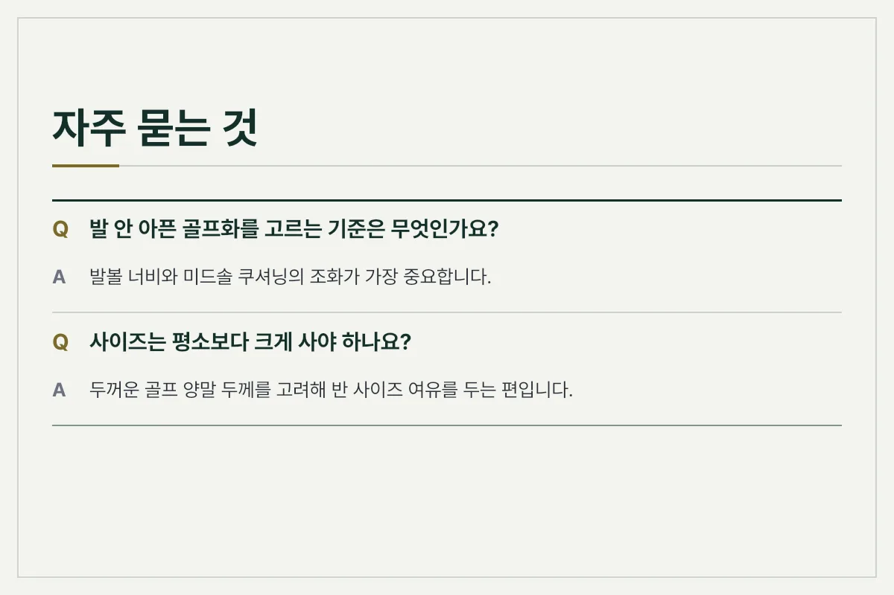
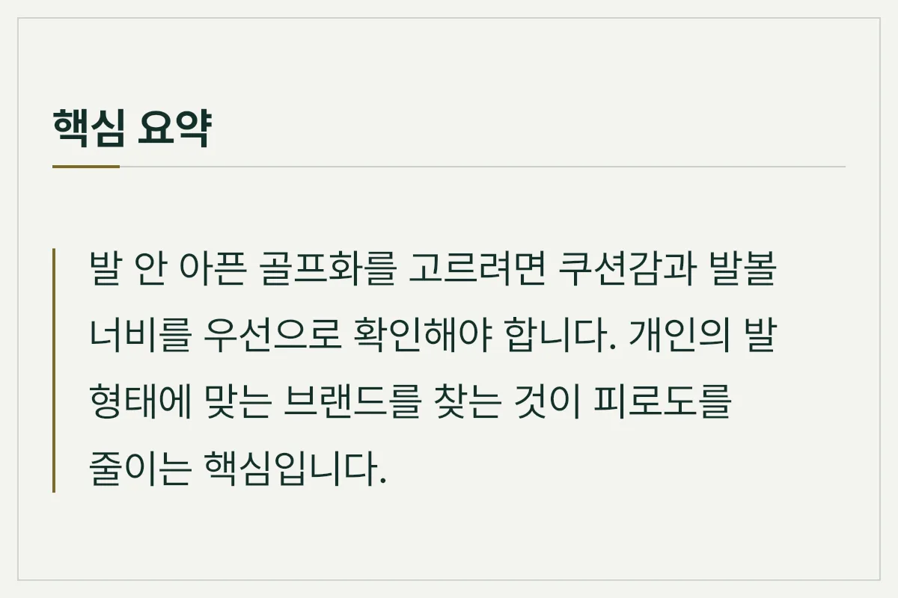

18홀을 돌고 나면 유독 발바닥이 찌릿하고 피로감이 몰려오는 경험은 많은 골퍼들이 공감하는 부분입니다. 스윙 시 체중을 지탱하고 잔디 위를 수 킬로미터 걷다 보니, 디자인만 보고 골프화를 골랐다가 후회하는 경우가 적지 않습니다. 발이 편안해야 스윙 밸런스도 무너지지 않고 끝까지 집중할 수 있습니다.

이번 글에서는 발 통증을 줄이고 정착하기까지 알게 된 골프화 선택 기준과 브랜드별 특징을 정리해 드립니다.

## 발에 맞는 골프화를 고르는 기본 기준

골프화를 고를 때 가장 먼저 고려해야 할 요소는 쿠셔닝과 아치 서포트입니다. 일반 운동화와 달리 골프화는 회전 동작을 지지해야 하므로 밑창의 지오메트리가 다릅니다.

- **미드솔 쿠션감:** 충격을 흡수하는 EVA 소재나 특수 폼 기술이 적용되었는지 확인합니다.
- **발볼의 여유:** 발볼이 좁은 제품을 신으면 발가락이 압박되어 후반 홀에서 통증이 발생합니다.
- **방수와 통기성:** 아침 이슬이나 갑작스러운 날씨 변화에 대응하면서도 내부 습기가 차지 않는 구조가 유리합니다.

<figure>

<figcaption>발 안 아픈 골프화를 고를 때 점검해야 할 핵심 기준들을 정리한 체크리스트입니다.</figcaption>
</figure>

## 주요 골프화 브랜드별 특징 비교

시장에는 다양한 브랜드가 존재하며, 각각 설계 철학에 따라 착화감이 다릅니다.

| 브랜드 유형 | 주요 특징 | 장점 | 고려할 점 |
| :--- | :--- | :--- | :--- |
| 전통 스포츠 브랜드 | 대중적인 족형 반영, 스파이크와 스파이크리스 다양화 | 익숙한 착화감, 뛰어난 범용성 | 모델별 아치 높이 차이 확인 필요 |
| 골프 전문 브랜드 | 스윙 안정성과 지면 반발력 극대화 | 견고한 지지력, 방수 기능 우수 | 초기 착화 시 단단한 느낌 가능 |
| 컴포트 특화 브랜드 | 쿠셔닝과 보행 피로도 저감에 집중 | 장시간 보행 시 발바닥 편안함 | 디자인 선택의 폭이 제한적일 수 있음 |

<figure>

<figcaption>발 안 아픈 골프화를 선택할 때 체감하는 장점과 사전에 알아두어야 할 주의점입니다.</figcaption>
</figure>

## 실사용자가 전하는 피로도 줄이는 관리 팁

아무리 좋은 골프화도 관리 방법에 따라 착화감이 달라질 수 있습니다. 라운드 후에는 인솔을 분리하여 통풍이 잘 되는 곳에서 건조하는 것이 좋습니다. 또한, 스파이크리스 모델의 경우 밑창 마모 상태를 주기적으로 확인해야 미끄러움을 방지할 수 있습니다.

<figure>

<figcaption>골프화를 구매하고 관리할 때 소비자들이 가장 궁금해하는 내용들을 담은 질문과 답변입니다.</figcaption>
</figure>

## 자주 묻는 질문 (FAQ)

**Q. 발 안 아픈 골프화를고르는 기준은 무엇인가요?**

A. 발볼 너비와 미드솔 쿠셔닝의 조화가 가장 중요합니다. 자신의 발 형태가 넓은 편인지 아치가 높은 편인지 먼저 파악하는 것이 좋습니다.

**Q. 사이즈는 평소보다 크게 사야 하나요?**

A. 두꺼운 골프 양말 두께를 고려해 반 사이즈 정도 여유를 두는 편입니다. 다만 브랜드마다 라스트(목형) 차이가 있으므로 직접 신어보고 결정하는 것이 안전합니다.

**Q. 스파이크와 스파이크리스 중 피로도에 더 유리한 것은 무엇인가요?**

A. 무조건 어느 한쪽이 우세하기보다는 지면을 딛는 성향과 주로 플레이하는 구장 환경에 따라 체감 피로도가 달라집니다.

<figure>

<figcaption>발 피로를 줄이기 위한 골프화 선택과 관리 핵심 내용을 압축한 요약문입니다.</figcaption>
</figure>

추천 제품은 아래 링크에 걸어 두겠습니다.

최종 확인일: 2026-11-11. 가격과 사양은 판매처와 시기에 따라 달라질 수 있으니 구매 전 공식 판매 페이지에서 다시 확인하세요.
