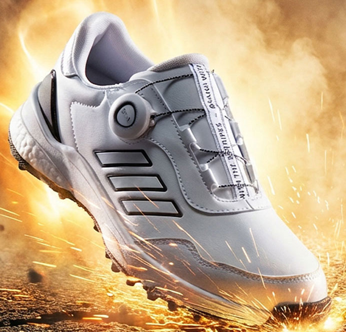
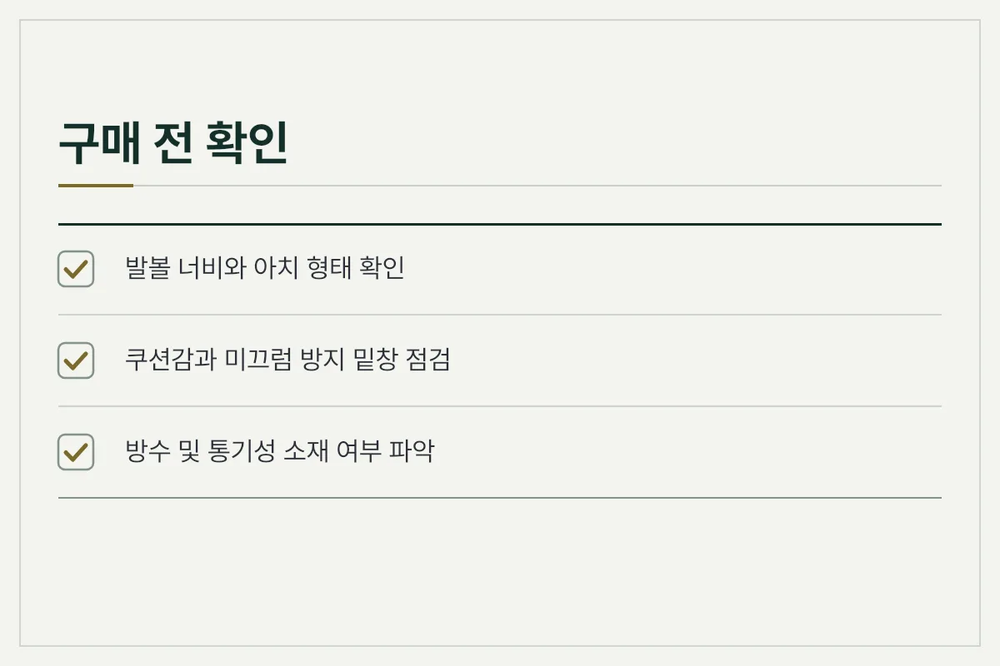
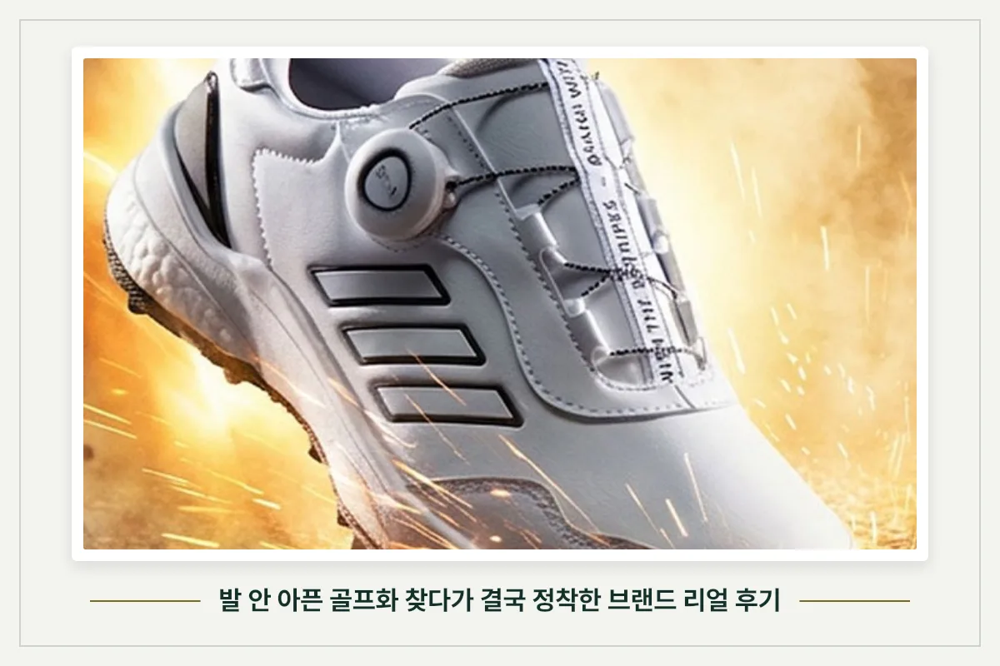
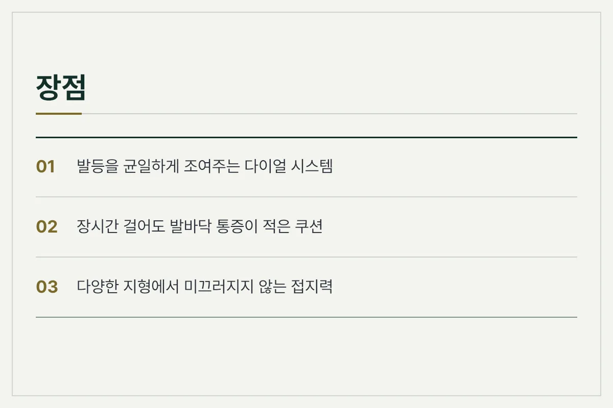
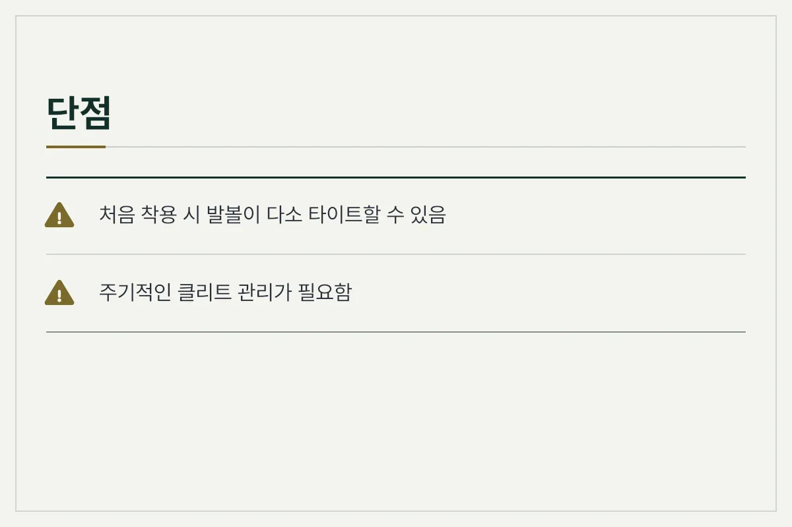
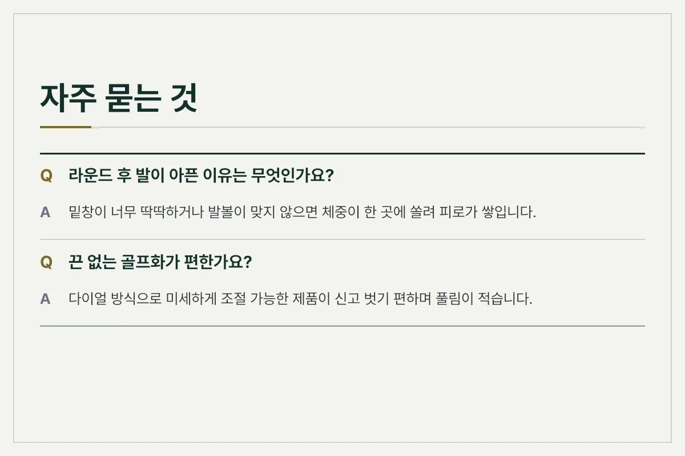
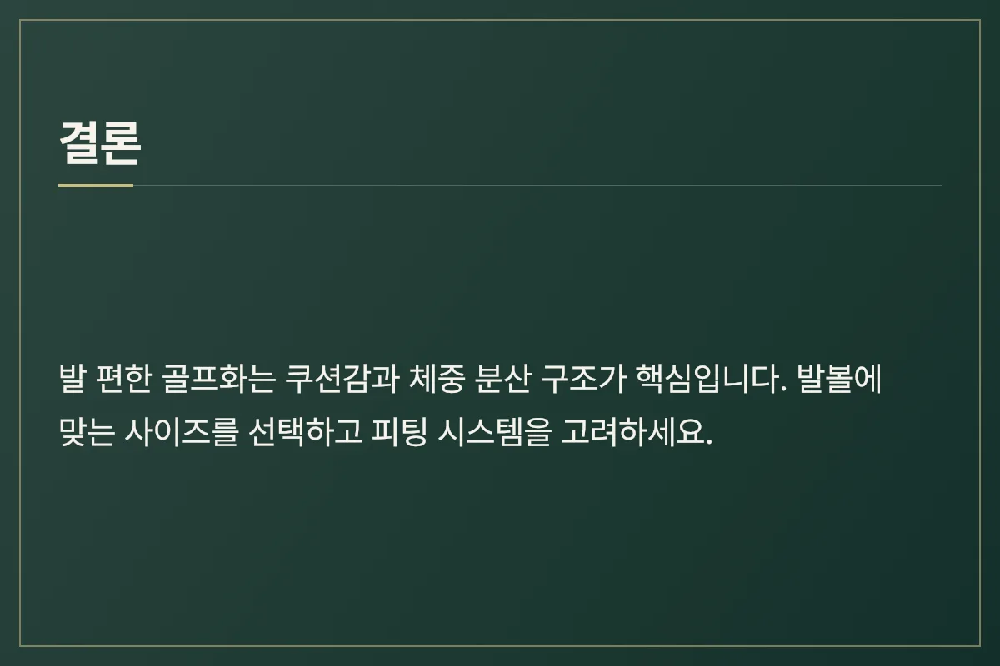

라운드를 돌고 나면 유독 발바닥과 발목이 뻐근하고 아픈 경험, 다들 한 번쯤 있으실 겁니다. 발이 편한 골프화를 고르려면 단순히 브랜드 인지도보다는 밑창의 쿠션감, 발볼의 여유, 그리고 체중을 골고루 분산해 주는 구조를 꼼꼼히 살펴봐야 합니다.

<figure>

<figcaption>다이얼 시스템이 적용된 화이트 컬러 골프화 실물 모습 (사진: https://bitl.bz/DhpRoy)</figcaption>
</figure>

## 골프화 선택 시 가장 먼저 확인해야 할 핵심 요소

장시간 걸어야 하는 필드 특성상 신발의 구조적 특징은 피로도에 큰 영향을 줍니다. 쿠션이 너무 얇으면 지면의 충격이 그대로 전해지고, 반대로 너무 두껍기만 하면 스윙 시 균형을 잡기 어려울 수 있습니다.

<figure>

<figcaption>구매 전 필수 확인 사항 카드</figcaption>
</figure>

*   **미드솔 쿠션:** 충격을 흡수하고 발바닥 전체로 체중을 분산하는 역할
*   **아웃솔 접지력:** 스윙 시 미끄러짐을 방지하고 안정적인 스탠스 유지
*   **피팅 시스템:** 끈 타입과 다이얼 타입 중 발에 맞춰 밀착되는 방식 선택

<figure>

<figcaption>발 안 아픈 골프화 찾다가 결국 정착한 브랜드 리얼 후기 (사진: https://bitl.bz/DhpRoy)</figcaption>
</figure>

## 스파이크리스 vs 스파이크, 나에게 맞는 밑창은?

골프화를 고를 때 가장 많이 고민하는 부분이 바로 밑창의 형태입니다. 각각의 특징을 이해하고 본인의 플레이 스타일에 맞는 방식을 선택하는 것이 중요합니다.

| 구분 | 스파이크리스 골프화 | 스파이크 골프화 |
| :--- | :--- | :--- |
| **주요 특징** | 일상복과 매칭하기 좋고 가벼움 | 잔디나 경사지에서 강력한 고정력 |
| **장점** | 발걸음이 편안하고 활용도가 높음 | 스윙 시 미끄러짐 발생 확률이 낮음 |
| **고려할 점** | 극단적인 미끄러운 지면에서 접지력 저하 가능 | 단단한 바닥에서 발에 피로가 쉽게 쌓일 수 있음 |

<figure>

<figcaption>장점 안내 카드</figcaption>
</figure>

## 발 피로를 줄여주는 실사용 및 관리 팁

아무리 좋은 골프화라도 올바르게 관리하지 않으면 금방 쿠션이 죽거나 불편해질 수 있습니다. 라운드 후 관리 요령을 숙지하면 제품 수명을 늘리는 데 도움이 됩니다.

*   **라운드 후 건조:** 내부 습기를 제거하기 위해 인솔을 분리하여 통풍이 잘 되는 그늘에서 말립니다.
*   **사이즈 여유 확인:** 두꺼운 양말을 신는 것을 고려해 손가락 하나 정도 들어가는 여유를 두는 것이 좋습니다.
*   **정기적 점검:** 밑창 마모 상태나 다이얼 케이블의 이상 유무를 주기적으로 확인합니다.

<figure>

<figcaption>단점 및 주의점 안내 카드</figcaption>
</figure>

## 자주 묻는 질문 (FAQ)

**Q. 일반 운동화를 골프화 대신 신어도 되나요?**

지면을 강하게 지탱해야 하는 골프 스윙 특성상 일반 운동화는 미끄러지기 쉽고 발목 부상의 위험이 있습니다. 안정적인 접지력이 설계된 전용 제품을 착용하는 것을 권장합니다.

**Q. 발볼이 넓은 편인데 어떤 제품을 골라야 하나요?**

발볼이 넓다면 국내 골퍼들의 발형에 맞춰 출시된 와이드 사이즈 제품이나 유연한 니트 소재가 혼합된 디자인을 선택하는 것이 유리합니다.

<figure>

<figcaption>자주 묻는 질문 카드</figcaption>
</figure>

## 요약 및 마무리

<figure>

<figcaption>종합 요약 카드</figcaption>
</figure>

발 안 아픈 골프화를 찾기 위해서는 화려한 디자인보다 발등을 안정적으로 잡아주는 피팅감과 충격을 흡수하는 미드솔의 조화가 우선입니다. 자신의 발 형태를 먼저 파악하고, 라운드 환경에 알맞은 밑창 구조를 선택하여 편안한 플레이를 즐겨보시길 바랍니다.

추천 제품은 아래 링크에 걸어 두겠습니다.

[추천 제품 확인하기](https://bitl.bz/DhpRoy)

최종 확인일: 2026-11-09. 가격과 사양은 판매처와 시기에 따라 달라질 수 있으니 구매 전 공식 판매 페이지에서 다시 확인하세요.
