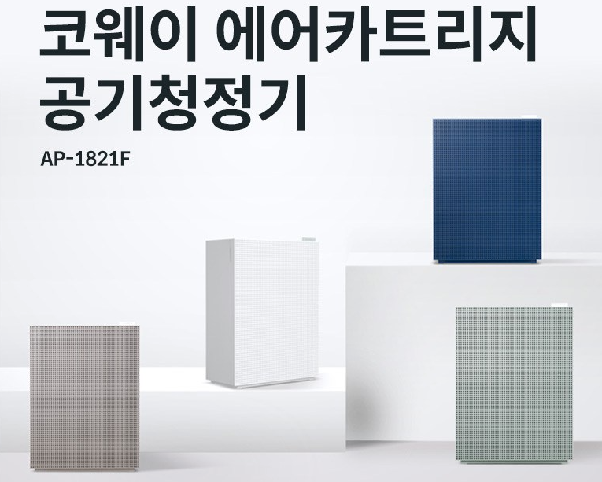
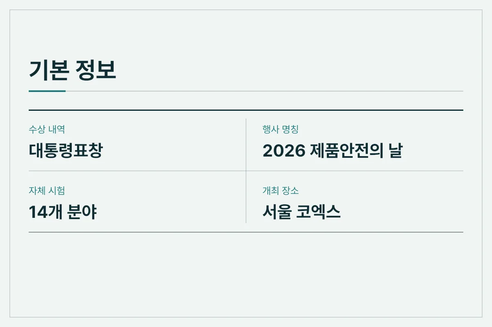
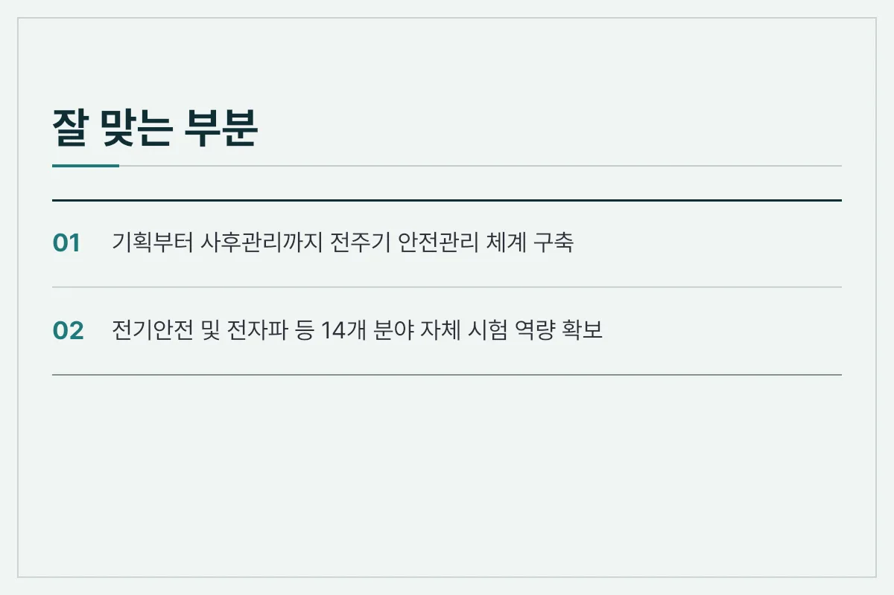
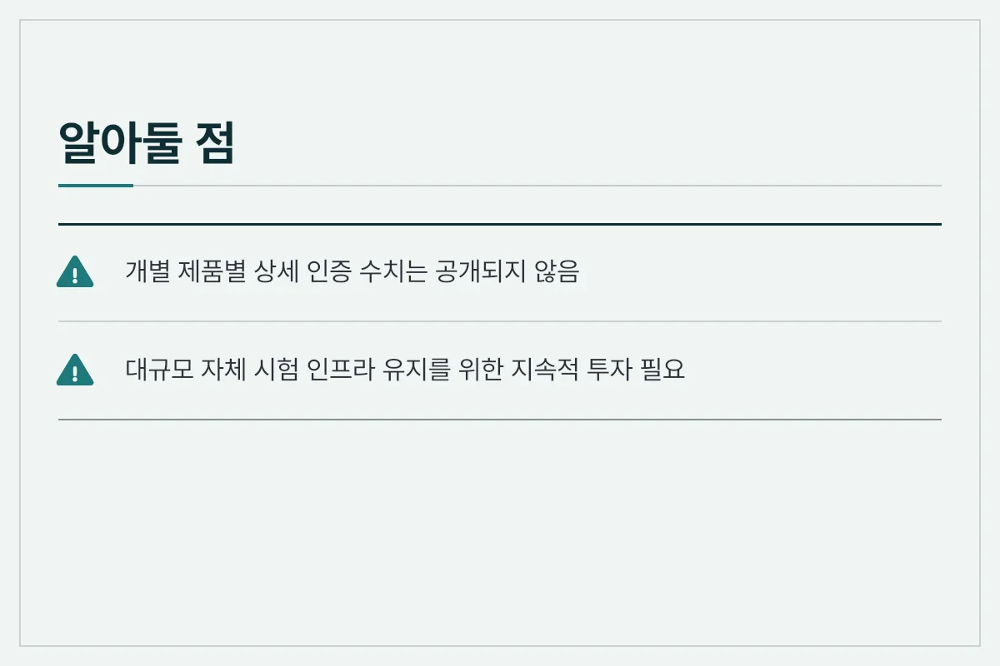
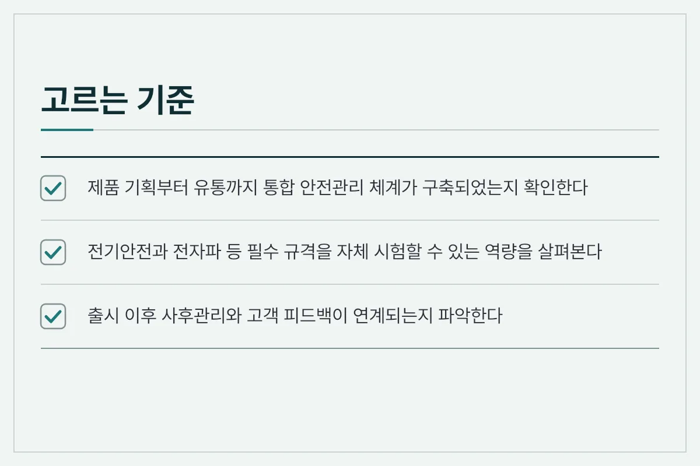
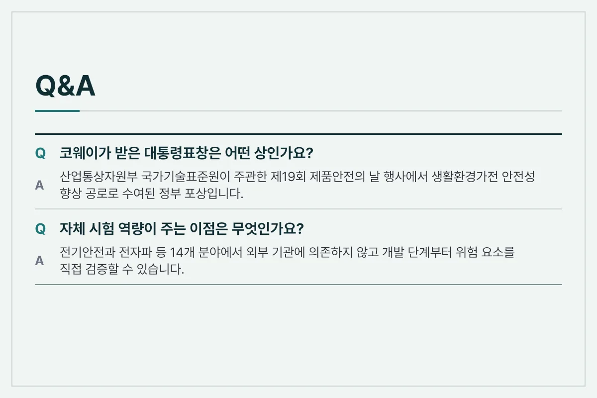
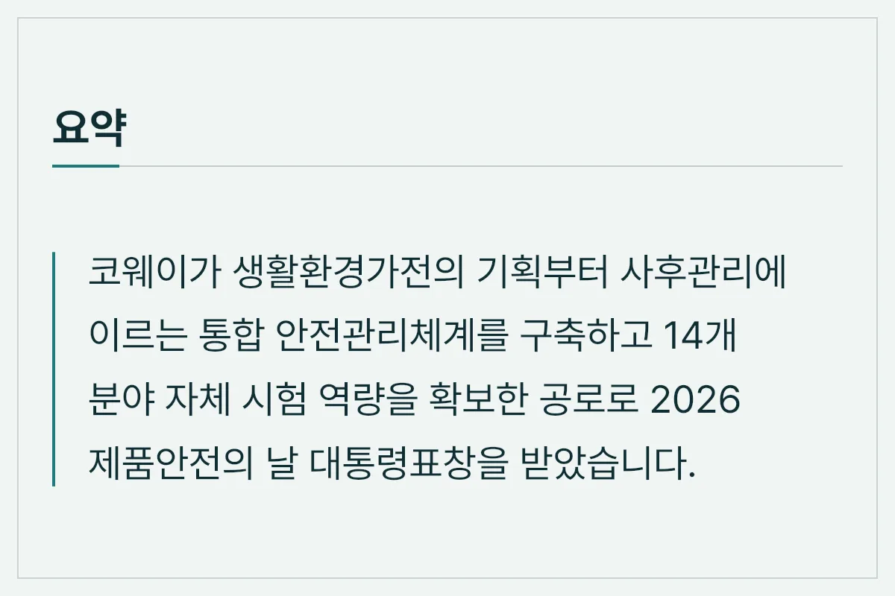

2026년 11월 18일 기준 코웨이가 생활환경가전의 기획과 개발부터 출시 이후 사후관리에 이르는 전 과정에 통합 안전관리체계를 구축한 공로로 '2026 제품안전의 날' 대통령표창을 받았다. 이번 수상은 단순히 완성된 제품의 품질을 검사하는 전통적인 방식을 넘어, 제품 생애주기 전반에 걸쳐 안전성을 끌어올린 체계적인 관리 노력을 정부로부터 공식 인정받았다는 점에서 의미를 가진다.

<figure>

<figcaption>다양한 색상과 디자인을 갖춘 코웨이 공기청정기 제품군 (사진: https://bitl.bz/Qp0pkD)</figcaption>
</figure>

## 제19회 제품안전의 날 대통령표창 수상 배경과 의미

산업통상자원부 국가기술표준원이 주관하는 제품안전의 날 행사는 올해로 19회째를 맞이했다. 코웨이는 지난 11월 17일 서울 삼성동 코엑스에서 열린 이 행사를 통해 생활환경가전의 안전성을 대폭 향상시킨 공로를 인정받아 대통령표창의 영예를 안았다. 

<figure>

<figcaption>코웨이 대통령표창 및 14개 분야 자체 시험 역량 정보</figcaption>
</figure>

이번 평가는 단발성 성과가 아니라 기업이 얼마나 지속 가능한 안전 관리 시스템을 갖추고 있는지를 중점적으로 들여다보았다. 가전제품을 사용하는 소비자의 일상과 직결되는 안전 문제를 체계적으로 예방하기 위해, 제조 공정뿐만 아니라 유통과 사후 관리까지 아우르는 통합 시스템이 평가의 핵심 잣대가 되었다. 특히 가전 제품의 경우 실내 공기를 정화하는 과정에서 모터 구동이나 전기 부품의 안정성이 필수적이므로 이러한 복합적인 요소를 종합적으로 관리하는 역량이 중요하게 작용했다.

## 14개 분야 자체 시험 역량으로 다진 안전성

코웨이가 이번에 높게 평가받은 또 다른 주된 요인은 전기안전, 전자파, 에너지 효율 등을 포함한 총 14개 분야에서 자체적인 시험 역량을 철저하게 확보했다는 점이다. 외부 기관에 의존하던 상당수 시험 과정을 자체 연구 시설과 전문 인력을 통해 정밀하게 검증할 수 있는 기반을 다졌다.

<figure>

<figcaption>코웨이 통합 안전관리체계 구축 및 자체 시험 역량 장점</figcaption>
</figure>

이러한 자체 시험 역량은 제품 개발 초기 단계부터 잠재적인 위험 요소를 사전에 차단하는 데 결정적인 역할을 한다. 규격 인증에 필요한 까다로운 테스트를 내부에서 직접 수행하면서 설계 변경이나 부품 개선이 필요할 때 신속하게 대응할 수 있는 능력을 갖추게 되었다. 외부 시험 기관의 일정에 구애받지 않고 제품 개발 속도와 안전 검증을 동시에 달성할 수 있다는 점도 강점으로 꼽힌다.

## 기획부터 사후관리까지 이어지는 전주기 관리 체계

생활환경가전의 안전 관리는 공장에서 제품이 출고되는 순간 끝나는 것이 아니다. 코웨이는 제품의 아이디어 기획 단계부터 양산, 유통, 그리고 가정에 설치된 이후의 사후관리 단계까지 유기적으로 연결되는 통합 안전관리체계를 운영하고 있다.

<figure>

<figcaption>코웨이 안전관리체계 도입에 따른 주의점 및 한계</figcaption>
</figure>

현장 중심의 모니터링과 고객 피드백이 사후관리 단계에서 그치지 않고 다시 차기 제품 기획과 개발 공정에 피드백되는 선순환 구조가 정착되어 있다. 이를 통해 예상치 못한 안전 이슈를 미연에 방지하고 제품 신뢰도를 높이는 토대를 마련했다. 다만 이러한 전주기 관리 체계를 유지하기 위해서는 지속적인 전문 인력 확충과 대규모 인프라 투자가 뒷받침되어야 하므로 기업 내부의 꾸준한 노력이 요구된다.

## 구매 전 확인해야 할 생활환경가전 안전 기준

공기청정기를 비롯한 생활환경가전을 선택할 때 소비자가 주목해야 할 안전 기준은 명확하다. 단순히 디자인이나 필터 성능만 볼 것이 아니라, 제조사가 제품 생애주기 전반에 걸쳐 어떠한 품질 검증 절차를 거치는지 살펴보는 것이 안전한 소비의 지름길이다.

<figure>

<figcaption>생활환경가전 구매 전 확인 사항 체크리스트</figcaption>
</figure>

- 제품 개발 단계에서 안전성 검증 프로세스가 체계적으로 작동하는지 확인한다.
- 전기안전과 전자파 등 필수 인증을 자체적으로 검증할 수 있는 역량이 있는지 살펴본다.
- 출시 이후 유통 과정과 사후 관리 체계가 안정적으로 구축된 브랜드인지 파악한다.

소비자가 직접 제품 내부의 부품 안전성을 테스트하기는 어렵기 때문에, 정부 포상이나 공식 인증 여부를 참고하는 것이 실질적인 도움이 된다.

## 자주 묻는 질문

**코웨이가 받은 대통령표창은 어떤 행사에서 수여된 것인가요?**

산업통상자원부 국가기술표준원이 주관하여 지난 11월 17일 서울 코엑스에서 개최된 제19회 '2026 제품안전의 날' 행사를 통해 수여되었습니다. 이번 포상은 생활환경가전의 안전성 향상에 기여한 공로를 공식적으로 인정받은 결과입니다.

<figure>

<figcaption>코웨이 제품안전의 날 수상 관련 자주 묻는 질문</figcaption>
</figure>

**코웨이의 안전관리체계가 지닌 차별점은 무엇인가요?**

기획 및 개발부터 출시 이후 사후관리에 이르는 전 생애주기에 걸쳐 통합 안전관리체계를 구축한 점이 핵심입니다. 전기안전과 전자파 등 14개 분야에서 자체 시험 역량을 확보하여 제품 개발 속도와 안전성을 동시에 높이고 있습니다.

**자체 시험 역량이 제품 안전에 미치는 영향은 무엇인가요?**

외부 기관에 의존하지 않고 개발 단계부터 다양한 규격과 안전 기준을 자체적으로 정밀 검증할 수 있습니다. 이를 통해 잠재적 위험 요소를 신속하게 차단하고 소비자가 안심하고 사용할 수 있는 품질 완성도를 확보할 수 있습니다.

<figure>

<figcaption>코웨이 제품안전의 날 대통령표창 수상 내용 요약</figcaption>
</figure>

[추천 제품 확인하기](https://bitl.bz/Qp0pkD)

## 참고한 자료

- [코웨이, '2026 제품안전의 날' 대통령표창 수상… 생활환경가전 안전성...](http://www.ttlnews.com/news/articleView.html?idxno=3163944) — ttlnews.com, 2026-11-18 보도
- [코웨이, '2026 제품안전의 날' 대통령표창 수상](https://www.thepublic.kr/news/articleView.html?idxno=327373) — thepublic.kr, 2026-11-18 보도
- [코웨이, 제품안전 대통령표창 수상···14개 분야 자체 시험 역량 확보](https://www.ziksir.com/news/articleView.html?idxno=153886) — ziksir.com, 2026-11-18 보도
- [코웨이, '2026 제품안전의 날' 대통령표창…제품 전주기 안전관리 인정](http://www.newslock.co.kr/news/articleView.html?idxno=140403) — newslock.co.kr, 2026-11-18 보도
- [코웨이, '2026 제품안전의 날' 대통령표창 수상…통합 안전관리체계 구...](https://www.nextdaily.co.kr/news/articleView.html?idxno=255062) — nextdaily.co.kr, 2026-11-18 보도
- [코웨이, 제품 안전관리 역량 인정…'제품안전의 날' 대통령표창 수상](https://www.e-science.co.kr/news/articleView.html?idxno=140155) — e-science.co.kr, 2026-11-18 보도

2026년 11월 18일 기준 내용입니다. 가격과 사양은 판매처와 시기에 따라 달라질 수 있으니 구매 전에 판매 페이지에서 다시 확인해 주세요.
