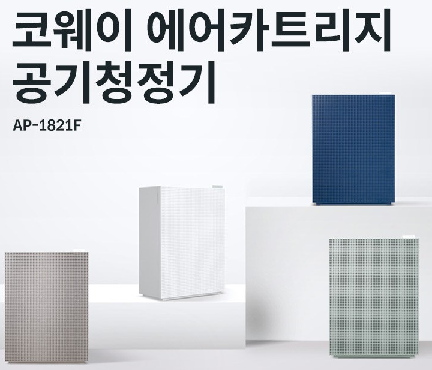
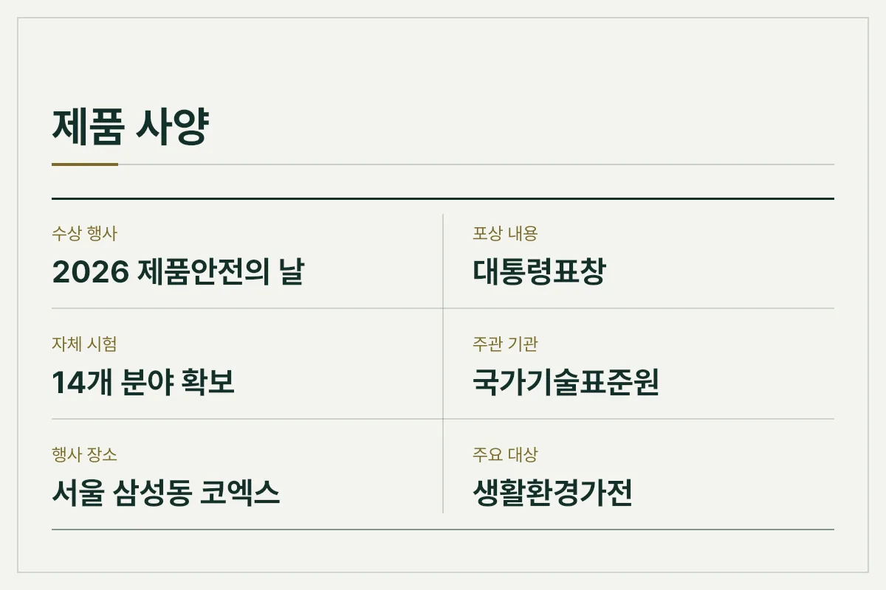
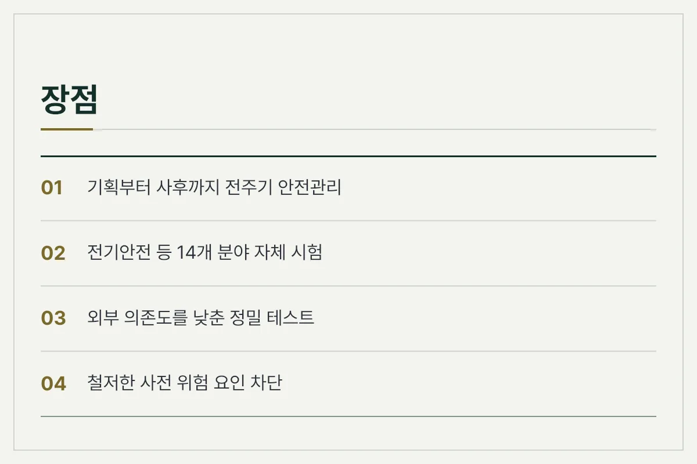
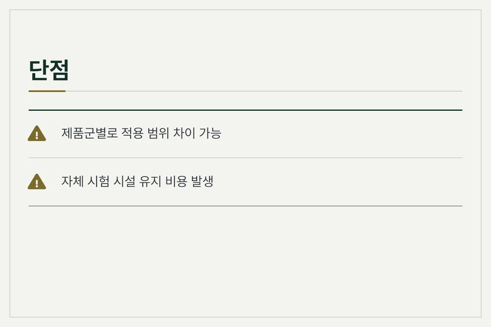
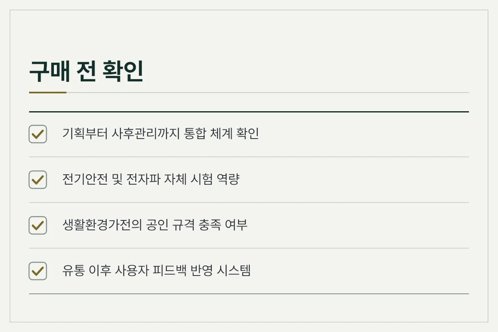
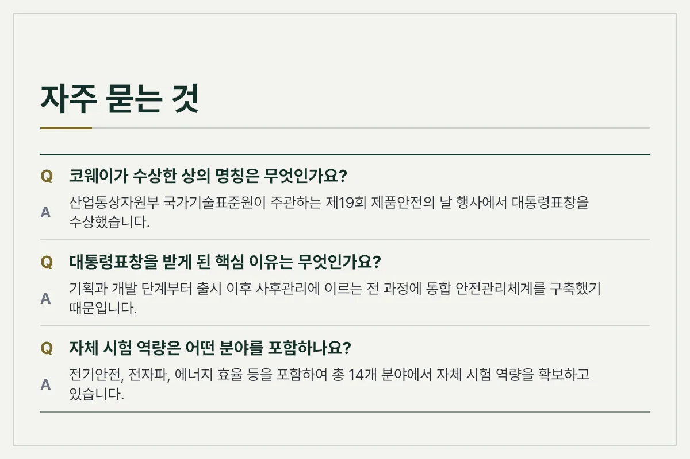
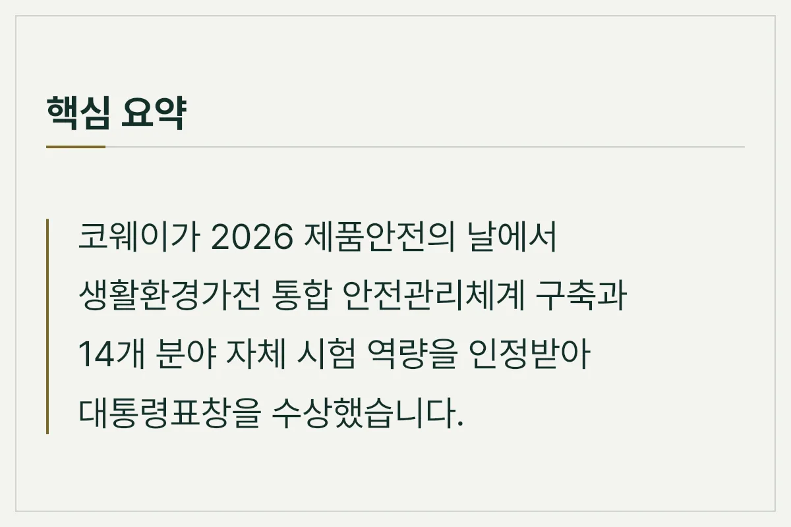

2026년 11월 18일 기준, 코웨이는 생활환경가전의 기획과 개발 단계부터 출시 이후 사후관리에 이르는 전 과정에 통합 안전관리체계를 구축한 공로를 인정받아 '2026 제품안전의 날' 대통령표창을 수상했습니다. 산업통상자원부 국가기술표준원이 주관하는 이번 행사는 생활환경가전의 안전성을 높이고 소비자 권익을 보호하기 위해 마련된 자리로, 코웨이는 엄격한 자체 시험 역량과 체계적인 관리 프로세스를 입증하며 최고 영예를 안았습니다.

<figure>

<figcaption>코웨이 공기청정기 제품군과 디자인 외형 (사진: https://bitl.bz/Qp0pkD)</figcaption>
</figure>

<figure>

<figcaption>코웨이 제품안전의 날 주요 스펙 정보</figcaption>
</figure>

## 대통령표창 수상으로 입증된 생활환경가전 안전관리 체계의 실체

코웨이는 지난 17일 서울 삼성동 코엑스에서 개최된 제19회 '2026 제품안전의 날' 기념식에서 대통령표창을 받았습니다. 넥스트데일리와 넥스트뉴스 등의 보도에 따르면, 이번 수상은 단순히 개별 제품의 성능이 우수하다는 점을 넘어 기업 차원에서 제품 생애주기 전반에 걸친 안전성을 확보했기에 가능했습니다. 서장원 대표 이하 임직원들은 기획 단계에서부터 잠재적 위험 요소를 차단하고, 유통과 사용 과정에서도 소비자가 안심하고 쓸 수 있는 환경을 조성하는 데 주력해 왔습니다. 

생활환경가전은 일상생활 속에서 오랜 시간 가동되는 특성상 전기안전과 전자파 적합성 등 엄격한 기준을 통과해야 합니다. 코웨이는 이러한 요구에 맞춰 제품 개발 초기부터 안전 설계 가이드라인을 적용하고, 실사용 환경에서 발생할 수 있는 여러 변수를 시뮬레이션하여 완성도를 높였습니다. 정부 포상 심사 과정에서도 이러한 전주기 관리 프로세스가 모범적인 사례로 평가받았다는 후문입니다.

<figure>

<figcaption>코웨이 안전관리체계 장점 요약</figcaption>
</figure>

## 전기안전과 전자파 등 14개 분야 자체 시험 역량의 의미

지크시르 등 관련 매체의 보도를 살펴보면, 코웨이는 전기안전, 전자파, 에너지 효율 등을 포함해 총 14개 분야에서 자체적인 시험 역량을 탄탄하게 다져왔습니다. 외부 공인 기관에만 의존하지 않고 기업 부설 연구소와 시험실에서 직접 규격에 부합하는 정밀 테스트를 수행할 수 있다는 뜻입니다. 

이러한 자체 시험 역량은 신제품 출시 속도를 높이면서도 품질의 균일성을 유지하는 핵심 동력으로 작용합니다. 개발 과정에서 문제가 발견되면 즉시 설계 변경과 보완 조치를 취할 수 있어, 시장에 출시되기 전 안전 리스크를 원천적으로 제거하게 됩니다. 소비자는 이 과정을 거쳐 생산된 생활환경가전을 통해 더욱 신뢰도 높은 품질을 경험할 수 있습니다.

<figure>

<figcaption>코웨이 안전관리 기준 주의점 요약</figcaption>
</figure>

## 출시 이후 사후관리까지 이어지는 통합 프로세스

제품이 고객의 집에 설치된 이후에도 안전 관리는 멈추지 않습니다. 코웨이는 유통과 사후관리 단계에 이르는 모든 접점에서 사용 데이터를 수집하고 고객 피드백을 반영하는 체계를 갖추고 있습니다. 

하자 발생 시 신속한 대응뿐만 아니라, 잠재적인 위험 징후를 사전에 파악하여 서비스 엔지니어를 통한 점검이나 부품 교체를 안내하는 시스템이 유기적으로 작동합니다. 이러한 사후관리의 체계화는 단기적인 판매량 증대보다는 장기적인 브랜드 신뢰도를 높이는 데 결정적인 역할을 하며, 이번 대통령표창 수상의 당위성을 뒷받침하는 중요한 근거가 되었습니다.

<figure>

<figcaption>안전관리 기준 구매 전 체크리스트</figcaption>
</figure>

## 자주 묻는 질문

**코웨이가 받은 상의 정확한 명칭과 행사는 무엇인가요?**

코웨이는 지난 17일 서울 삼성동 코엑스에서 열린 제19회 '2026 제품안전의 날' 기념식에서 대통령표창을 수상했습니다. 산업통상자원부 국가기술표준원이 주관하는 이 행사는 제품 안전성에 기여한 공로를 치하하는 자리입니다.

**대통령표창 수상의 핵심 공로는 무엇인가요?**

제품의 기획과 개발 단계부터 출시 이후 사후관리에 이르는 전 과정에 걸쳐 통합 안전관리체계를 구축한 점을 높게 평가받았습니다.

**자체 시험 역량은 어떤 분야를 포함하나요?**

전기안전, 전자파, 에너지 효율 등을 포함해 총 14개 분야에서 자체적으로 시험을 수행할 수 있는 역량을 확보하고 있습니다.

<figure>

<figcaption>자주 묻는 질문 요약</figcaption>
</figure>

## 안전한 생활환경가전을 위한 제언

제품의 안전성은 소비자의 건강과 직결되는 최우선 가치입니다. 코웨이가 이번 대통령표창을 통해 보여준 행보는 단순히 제품을 제조하는 것을 넘어 기획부터 폐기에 이르기까지 기업이 책임지는 구조가 얼마나 중요한지 보여줍니다. 앞으로도 이러한 엄격한 자체 시험 역량과 통합 안전관리체계가 업계 전반으로 확산되어 소비자들의 선택 기준이 한층 높아지기를 기대합니다.

<figure>

<figcaption>코웨이 안전관리 기준 핵심 요약</figcaption>
</figure>

[추천 제품 확인하기](https://bitl.bz/Qp0pkD)

## 참고한 자료

- [코웨이, '2026 제품안전의 날' 대통령표창 수상… 생활환경가전 안전성...](http://www.ttlnews.com/news/articleView.html?idxno=3163944) — ttlnews.com, 2026-11-18 보도
- [코웨이, '2026 제품안전의 날' 대통령표창 수상](https://www.thepublic.kr/news/articleView.html?idxno=327373) — thepublic.kr, 2026-11-18 보도
- [코웨이, 제품안전 대통령표창 수상···14개 분야 자체 시험 역량 확보](https://www.ziksir.com/news/articleView.html?idxno=153886) — ziksir.com, 2026-11-18 보도
- [코웨이, '2026 제품안전의 날' 대통령표창…제품 전주기 안전관리 인정](http://www.newslock.co.kr/news/articleView.html?idxno=140403) — newslock.co.kr, 2026-11-18 보도
- [코웨이, '2026 제품안전의 날' 대통령표창 수상…통합 안전관리체계 구...](https://www.nextdaily.co.kr/news/articleView.html?idxno=255062) — nextdaily.co.kr, 2026-11-18 보도
- [코웨이, 제품 안전관리 역량 인정…'제품안전의 날' 대통령표창 수상](https://www.e-science.co.kr/news/articleView.html?idxno=140155) — e-science.co.kr, 2026-11-18 보도

2026년 11월 18일 기준 내용입니다. 가격과 사양은 판매처와 시기에 따라 달라질 수 있으니 구매 전에 판매 페이지에서 다시 확인해 주세요.
