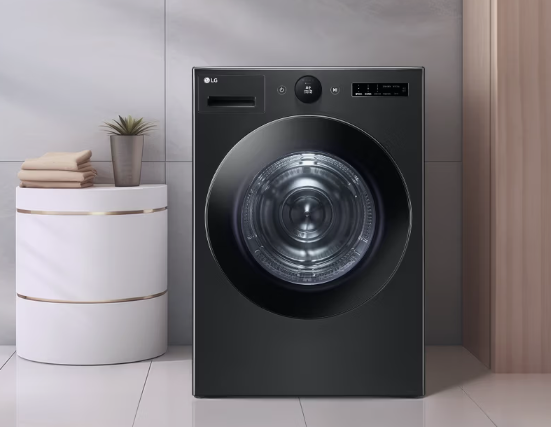
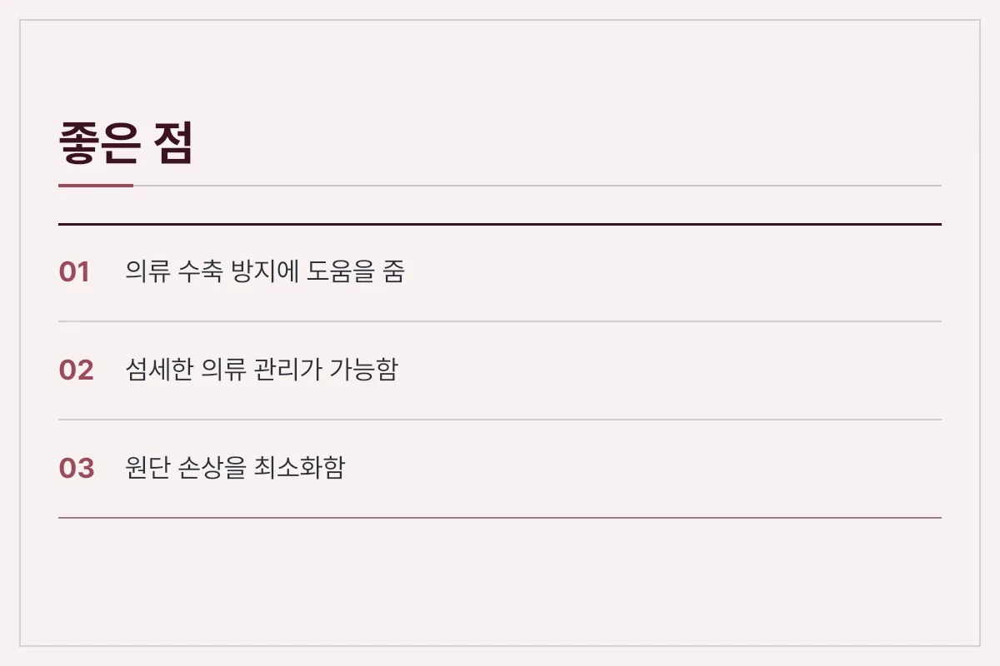
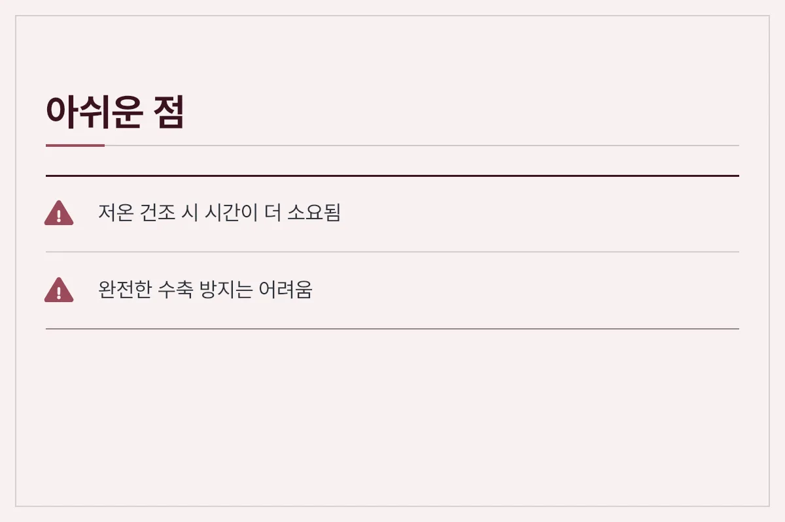
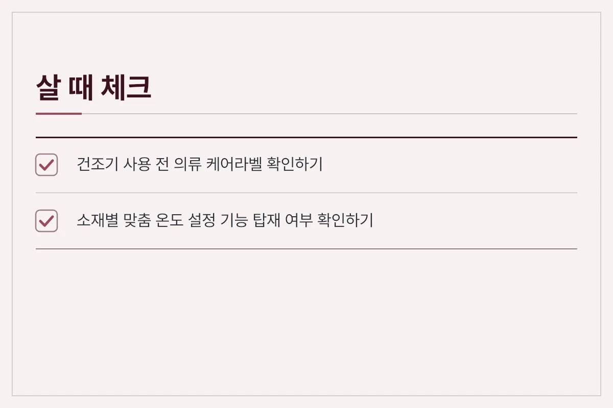
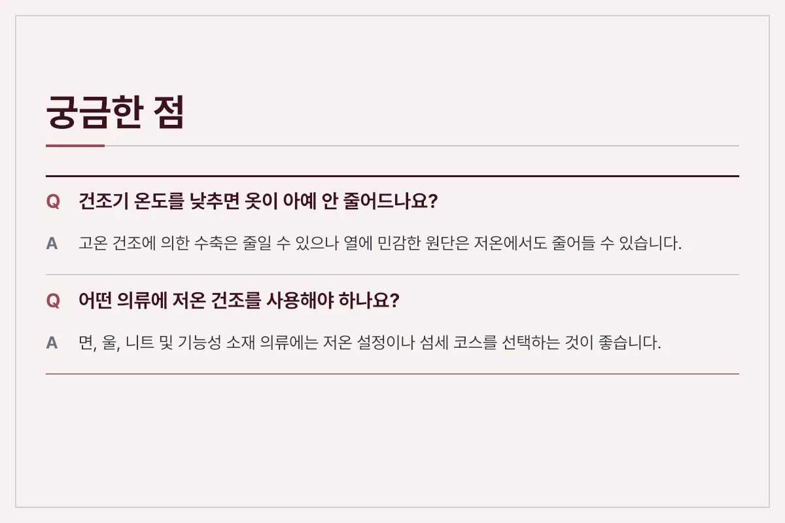
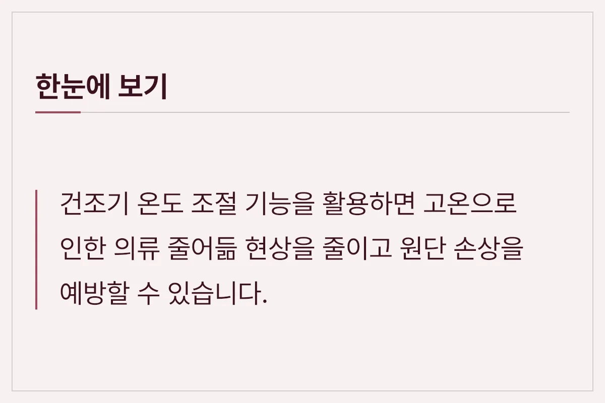

건조기를 사용할 때 옷이 줄어드는 문제를 해결하려면 세탁물의 소재에 맞춰 건조 온도를 다르게 설정하는 것이 핵심입니다. 고온 열풍은 섬유를 수축시키는 주원인이므로, 온도 조절 기능이 있는 건조기를 활용하거나 저온 코스를 선택하면 수축 현상을 효과적으로 예방할 수 있습니다.

<figure>

<figcaption>검은색 외관과 원형 도어가 적용된 건조기 본체 (사진: https://bitl.bz/Vp2bB9)</figcaption>
</figure>

## 의류 수축을 막는 건조기 온도 조절의 중요성

의류가 줄어드는 이유는 대부분 고온의 바람과 드럼 회전 과정에서 섬유 조직이 변형되기 때문입니다. 면, 울, 혼방 소재 등은 열에 특히 민감하게 반응하므로 고온 건조 시 크기가 크게 줄어들 수 있습니다. 따라서 제품에 탑재된 온도 조절 기능을 통해 의류에 맞는 적절한 온도를 설정하는 것이 중요합니다.

<figure>

<figcaption>건조기 온도 조절의 주요 장점 정리</figcaption>
</figure>

## 소재별 올바른 건조 온도 설정 기준

대부분의 의류는 표준 코스보다 저온 혹은 섬세 코스를 이용할 때 원단 변형을 줄일 수 있습니다. 특히 수축률이 높은 면 티셔츠나 니트류는 낮은 온도로 설정하여 서서히 말리는 방식이 안전합니다. 세탁물 케어라벨에 적힌 건조 기호와 권장 온도를 미리 확인하는 습관이 필요합니다.

| 구분 | 표준 건조 (고온) | 저온 건조 (섬세) |
| :--- | :--- | :--- |
| 주요 대상 | 수건, 두꺼운 면바지, 침구류 | 니트, 울, 얇은 면 티셔츠, 기능성 의류 |
| 장점 | 빠른 건조 시간 | 원단 수축 및 손상 최소화 |
| 주의점 | 고온으로 인한 수축 가능성 | 표준 코스보다 소요 시간 증가 |

<figure>

<figcaption>저온 건조 이용 시 고려해야 할 점</figcaption>
</figure>

## 옷 줄어듦을 줄이는 실사용 가이드

온도 조절 외에도 건조기 사용 습관을 바꾸면 의류 변형을 추가로 막을 수 있습니다. 완전히 젖은 상태에서 바로 고온 건조기에 넣기보다는 탈수를 충분히 거치거나 자연건조를 병행하는 방법이 효과적입니다. 또한 건조기용 유연제나 드라이시트를 사용할 때도 과도한 열이 가해지지 않도록 주의해야 합니다.

<figure>

<figcaption>건조기 온도 조절 관련 확인 기준</figcaption>
</figure>

## 자주 묻는 질문 (FAQ)

**Q. 건조기 온도를 낮추면 옷이 아예 안 줄어드나요?**

A. 고온 건조에 의한 수축은 대폭 줄일 수 있으나 열이나 수분에 민감한 일부 원단은 저온에서도 미세하게 줄어들 수 있습니다.

**Q. 어떤 의류에 저온 건조를 사용해야 하나요?**

A. 면, 울, 니트 및 기능성 소재처럼 열에 취약한 의류에는 저온 설정이나 섬세 코스를 선택하는 것이 안전합니다.

**Q. 표준 코스와 저온 코스는 어떤 차이가 있나요?**

A. 표준 코스는 높은 온도로 빠르게 건조하며, 저온 코스는 낮은 온도로 천천히 건조하여 섬유 변형 가능성을 낮춰줍니다.

<figure>

<figcaption>자주 묻는 질문과 답변 요약</figcaption>
</figure>

## 요약

건조기 온도 조절 기능은 고온으로 인한 의류 줄어듦과 원단 손상을 줄이는 핵심적인 방법입니다. 세탁물 소재에 맞는 온도를 선택하고 올바른 코스를 활용하면 옷의 수명을 늘리는 데 도움이 됩니다.

<figure>

<figcaption>건조기 온도 조절 기능 활용 요약</figcaption>
</figure>

추천상품은 아래 링크에 걸어 두겠습니다.

[추천 제품 확인하기](https://bitl.bz/Vp2bB9)

최종 확인일: 2026-11-18. 가격과 사양은 판매처와 시기에 따라 달라질 수 있으니 구매 전 공식 판매 페이지에서 다시 확인하세요.
