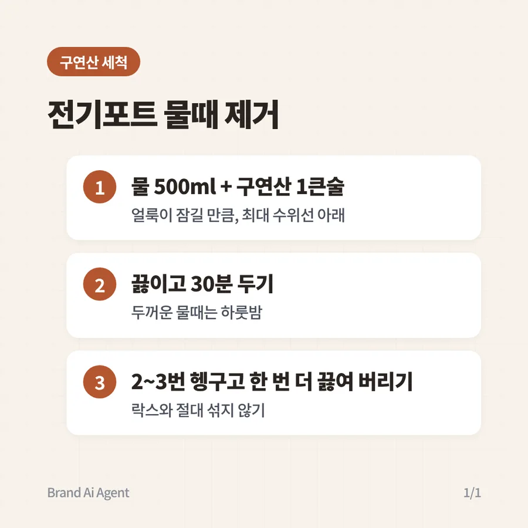
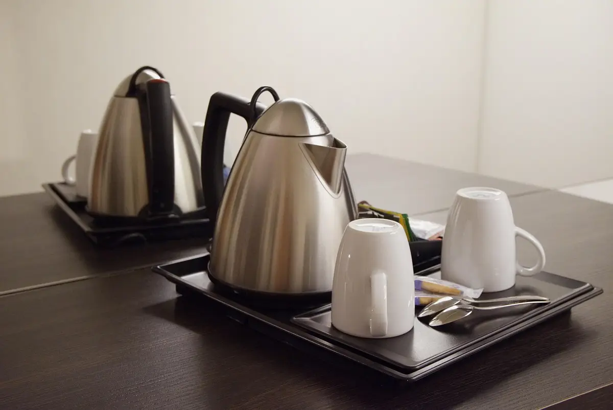

전기포트 바닥에 낀 하얀 물때는 **물 500ml에 구연산 1큰술을 넣어 끓이고, 전원을 끈 채 30분 둔 뒤 2~3번 헹구면** 대부분 풀립니다. 위키트리 2026년 11월 보도가 정리한 순서이고, 필립스 고객지원도 전기주전자 석회질을 구연산 성분의 제거제나 식초로 없애라고 안내합니다.

## 전기포트 하얀 물때의 정체

전기포트 안쪽의 하얀 가루나 얼룩은 수돗물 속 칼슘·마그네슘 같은 미네랄이 가열되면서 바닥과 벽에 굳은 것입니다. 필립스는 이를 석회질이라고 부릅니다. 구연산은 산성이라 이 미네랄 층을 녹여 냅니다.

물때를 그냥 두면 손해도 있습니다. 필립스 고객지원은 정기적으로 석회질을 없애면 내부를 깨끗하게 유지하고, 물 끓이는 시간이 줄어 에너지를 아끼며, 포트 수명이 늘고 조기 고장 위험이 줄어든다고 설명합니다.

## 구연산 세척 순서

위키트리 보도가 정리한 순서는 다음과 같습니다.

1. 플러그를 뽑고 포트가 완전히 식은 상태에서 시작합니다.
2. 물로 한 번 헹궈 떨어지는 물때 조각을 흘려보냅니다.
3. 얼룩이 잠길 만큼 물을 붓고 **물 500ml당 구연산 1큰술**을 넣어 녹입니다. 최대 수위선은 넘기지 않습니다.
4. 끓인 뒤 전원을 끄고 **약 30분** 둡니다.
5. 용액을 버리고 남은 조각은 부드러운 스펀지로 살살 닦습니다.
6. 맑은 물로 2~3번 헹굽니다.
7. 깨끗한 물을 한 번 끓여 버린 뒤 다시 사용합니다.

끓인 직후 용액은 뜨거우니 조금 식힌 뒤 버리는 편이 안전합니다. 1년 넘게 닦지 않아 물때가 두껍다면 같은 용액을 채워 하룻밤 두었다가 헹구는 방법도 소개돼 있습니다. 구연산은 식품용으로 파는 가루를 쓰면 됩니다.

[관련 링크 확인하기](https://bitl.bz/j5hXud)

## 식초로 할 때: 필립스 안내 방법

구연산이 없다면 식초를 써도 됩니다. 필립스 고객지원이 안내하는 식초 세척 순서는 다음과 같습니다.

1. 포트 최대 용량의 4분의 3쯤 물을 채워 끓입니다.
2. 전원이 꺼지면 식초를 최대 용량까지 넣습니다.
3. 하룻밤 둡니다.
4. 내용물을 버리고 안쪽을 깨끗이 헹굽니다.
5. 깨끗한 물을 채워 끓인 뒤 버리고 다시 헹굽니다.
6. 석회질이 남아 있으면 같은 과정을 반복합니다.

위키트리 보도는 물 3에 식초 1을 섞어 끓인 뒤 20분 두는 더 짧은 방법도 소개했습니다. 식초는 냄새가 남기 쉬워 구연산보다 헹굼을 더 꼼꼼히 하고, 마지막에 물만 끓여 버리는 과정을 꼭 거치는 것이 좋습니다. 레몬즙은 물을 절반쯤 채우고 2큰술을 넣어 끓인 뒤 20분 두는 방식이 소개됐습니다.

## 얼마나 자주 해야 하나: 수질에 따라 다릅니다

| 사용하는 물 | 세척 주기 (필립스 안내) |
| --- | --- |
| 연수 (경도 18dH 이하) | 3개월에 한 번 |
| 경수 (경도 18dH 이상) | 1개월에 한 번 |

필립스 기준은 하루 최대 5번 정도 쓰는 평균적인 경우이고, 하루 5번 넘게 쓰면 더 자주 해야 합니다. 우리 집 수돗물 경도는 지역 수도 사업소에 문의하면 알 수 있습니다.

이 글에서 권하는 판단 기준은 간단합니다. 경도를 모른다면 **한 달에 한 번 바닥과 주둥이 안쪽을 들여다보고, 하얀 층이 보이기 시작하면 바로 세척**하는 것입니다. 위키트리 보도도 물때를 일찍 잡을수록 훨씬 쉽게 풀린다고 설명합니다.

## 하면 안 되는 것 4가지

- **구연산과 락스를 섞기:** 산성인 구연산이 염소계 표백제와 만나면 유독가스가 생길 수 있습니다. 같은 날 연달아 쓰지 않는 것이 안전합니다.
- **금속 수세미·연마제 쓰기:** 안쪽에 생긴 긁힘은 다음 물때가 더 잘 달라붙는 자리가 되고, 가열판도 상할 수 있습니다.
- **본체를 물에 담그기:** 바깥은 꼭 짠 천으로 닦습니다. 통째로 담그거나 식기세척기에 넣으면 전자 부품이 손상될 수 있습니다.
- **설명서와 다른 방법 고집하기:** 위키트리 보도에 따르면 어떤 제조사는 권장한 방법 외의 석회 제거를 쓰지 말라고 안내합니다. 내 제품 설명서에 세척법이 있다면 그 방법이 우선입니다.

거름망이 달린 제품이라면 빼서 흐르는 물에 씻어 다시 끼우세요. 유리, 세라믹, 스테인리스 포트 모두 같은 방법으로 세척할 수 있다는 것이 위키트리 보도의 설명입니다. 가습기 물통 물때도 같은 원리라 [가습기 세척 방법](/p/humidifier-cleaning-citric-acid-guide/)의 구연산 비율을 참고할 수 있습니다.

## 자주 묻는 질문

**전기포트 구연산은 얼마나 넣나요?**

널리 쓰이는 배합은 물 500ml에 구연산 1큰술입니다. 물을 1L 채우면 2큰술이 됩니다. 제품 설명서에 다른 양이 적혀 있다면 그 기준을 따르세요.

**구연산 세척 후 바로 물 끓여 마셔도 되나요?**

맑은 물로 2~3번 헹군 뒤 깨끗한 물을 한 번 끓여 버리고 쓰면 구연산 맛과 냄새가 정리됩니다.

**식초와 구연산 중 무엇이 나은가요?**

필립스는 둘 다 쓸 수 있다고 안내합니다. 식초는 냄새가 남기 쉬워 헹굼을 더 많이 해야 하므로, 냄새가 신경 쓰인다면 구연산이 편합니다.

**물때가 한 번에 안 지워지면 어떻게 하나요?**

힘으로 문지르지 말고 용액에 두는 시간을 늘리거나 같은 과정을 한 번 더 반복합니다. 두꺼운 물때는 하룻밤 두는 방법이 있습니다.

**베이킹소다로도 되나요?**

베이킹소다는 산이 아니라 두꺼운 물때보다 바닥에 얇게 낀 가벼운 물때에 맞습니다. 하얀 석회질에는 구연산이나 식초가 더 맞습니다.

## 핵심 요약

- 위키트리 2026년 11월 보도에 따르면 전기포트 물때는 물 500ml에 구연산 1큰술을 넣어 끓이고 30분 둔 뒤 2~3번 헹구면 대부분 제거됩니다.
- 필립스 고객지원은 전기주전자 석회질을 연수 사용 시 3개월에 한 번, 경수 사용 시 1개월에 한 번 제거하라고 안내합니다.
- 전기포트 세척에 구연산과 락스(염소계 표백제)를 함께 쓰면 유독가스가 생길 수 있어 섞어 쓰지 않아야 합니다.

## 참고한 자료

- [전기주전자 석회질 제거 방법 (PDF)](https://www.philips.co.kr/c-dam/b2c/suj/master/supporthome/documents/KR_SecondSupport_3.pdf) — 필립스코리아 고객지원, 확인일 2026-11-28
- [전기포트 '구연산' 세척법, 물 양과 끓이는 순서·헹굼 횟수](https://www.wikitree.co.kr/articles/1176028) — 위키트리, 2026-11-19 보도, 확인일 2026-11-28
- 사진 일부: Pixabay (무료 이용 허가 이미지)

정보 기준일: 2026-11-28. 세척 방법은 제품마다 다를 수 있으니 내 전기포트 설명서를 함께 확인하세요.
