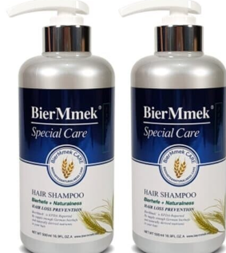
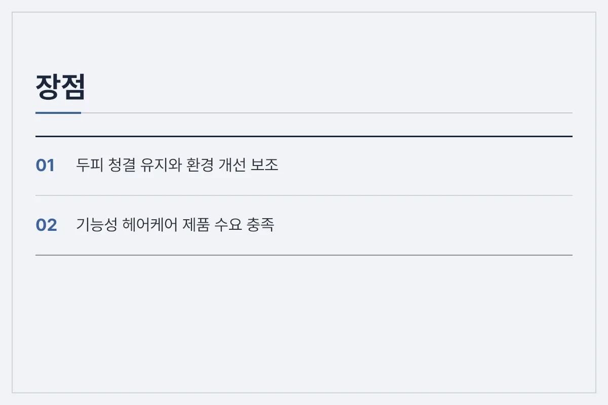
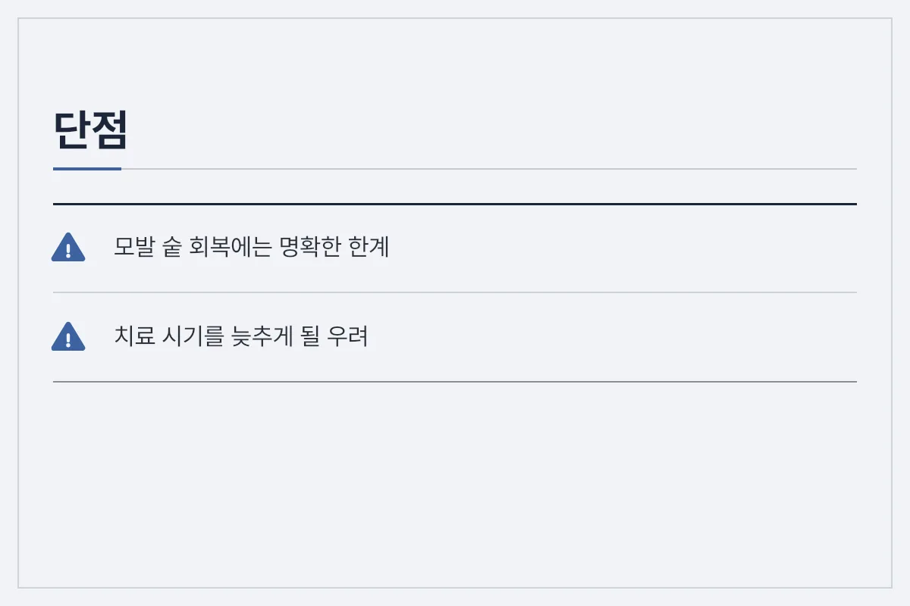
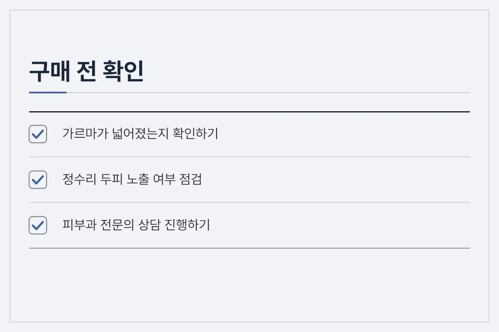
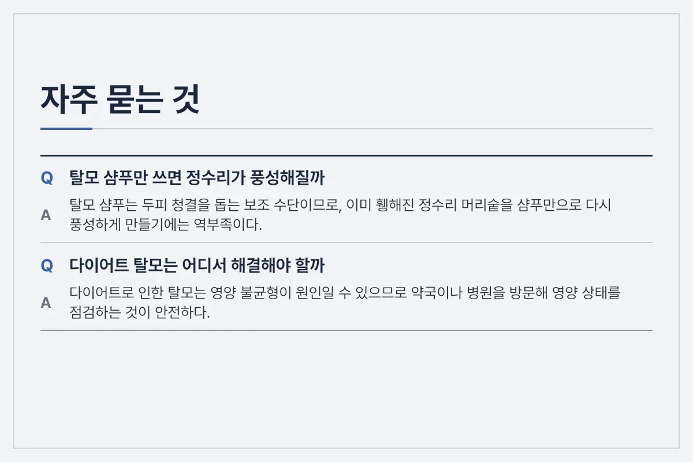
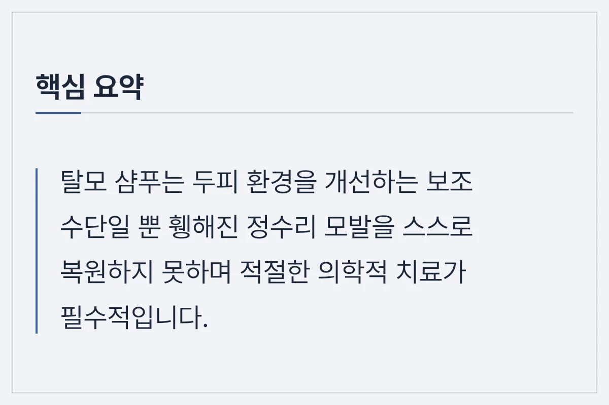

2026년 11월 18일 기준, 탈모 샴푸만 꾸준히 사용한다고 해서 이미 휑해진 정수리 모발 숱이 다시 풍성해지지는 않습니다. 시중에 판매되는 세정제나 화장품류는 어디까지나 두피 청결을 유지하고 환경을 개선하는 보조적 수단에 불과하기 때문입니다.

<figure>

<figcaption>기능성 헤어케어 제품으로 소개되는 탈모 샴푸 용기의 형태 (사진: https://bitl.bz/PNNDQ6)</figcaption>
</figure>

## 두피 환경 개선과 세정의 한계

마트나 온라인 쇼핑몰에는 모발 건강을 내세운 다양한 샴푸와 두피 앰플, 맥주효모 제품들이 끝없이 진열되어 있습니다. 2026년 11월 17일 약업신문 보도에 따르면, 소비자들이 가르마가 평소보다 넓어지거나 정수리 두피가 더 드러나는 것을 느낄 때 가장 먼저 손을 뻗는 제품이 바로 이러한 홈케어 용품들입니다. 

하지만 미디어파인 2026년 11월 18일 기사에서는 검증되지 않은 민간요법이나 두피 토닉, 기능성 샴푸에만 오랫동안 의존하다가 오히려 탈모 치료 시기를 놓치는 사례를 강력하게 경고합니다. 화장품 유형으로 분류되는 세정제는 모발의 생성 주기를 근본적으로 바꾸거나 이미 소실된 모낭을 되살리는 의학적 효능을 담보하기 어렵습니다. 따라서 샴푸의 세정력이나 일시적인 청량감에만 기댄 채 방치하면 탈모 진행 속도를 늦추기 어려워집니다.

<figure>

<figcaption>장점</figcaption>
</figure>

## 글로벌 시장의 변화와 기능성 수요

세계적으로 남성형 탈모 치료 시장은 규모가 점차 커지는 추세이며 관련 산업의 지형도 변화하고 있습니다. 글로벌 남성형 탈모 치료 시장은 GMI 기준 2025년 32억 달러에서 2035년 68억 달러로 연평균 7.9% 성장할 것으로 전망됩니다. 

이러한 흐름 속에서 단순한 샴푸나 기능성 제품 위주의 관리에서 벗어나 병원 진료와 의약품 처방 중심의 수요로 옮겨가는 양상이 뚜렷하게 나타납니다. 코트라 자료에 따르면 튀르키예 등 해외 시장에서도 일반 세정용 제품을 넘어 두피 진단 기반 케어와 저자극 탈모 예방 관리 같은 명확한 효능을 찾는 소비자가 꾸준히 늘고 있습니다. 아울러 K-뷰티 수출 통계에서도 샴푸 품목이 높은 성장세를 보이며 기능성 헤어케어 전반의 저변이 확대되고 있음을 보여줍니다.

<figure>

<figcaption>단점</figcaption>
</figure>

## 체중 감량과 다이어트 탈모의 실태

무리한 다이어트나 영양 불균형으로 인해 모발이 급격히 빠지는 다이어트 탈모 환자들도 현장에서 쉽게 찾아볼 수 있습니다. 약국가와 뷰티 업계에서는 탈모 증상 완화를 내세운 고기능성 샴푸와 캡슐 트리트먼트, 헤어라인 앰플을 함께 구성한 4주짜리 임상 프로그램을 선보이기도 합니다. 

실제로 보도된 뷰티업계의 사용자 만족도 조사에서는 참가자들의 전반적인 제품 만족도가 높게 집계되었으며, 탈모 증상 완화에 만족한다는 응답률도 상당한 수치를 기록했습니다. 그러나 이는 어디까지나 세정 후 일시적인 두피 보습이나 모발 부드러움에 대한 주관적인 평가일 뿐, 모발 밀도가 줄어든 두피에 새 모발이 돋아나게 만드는 근본적인 치료 결과를 의미하지는 않습니다.

<figure>

<figcaption>구매 전 확인</figcaption>
</figure>

## 온라인 구독 처방과 과잉 판매의 허점

최근 널리 확산하는 온라인 구독형 처방 서비스에서는 탈모치료제를 처방하는 과정에서 비타민이나 탈모 샴푸를 끼워 파는 경우가 많습니다. 메디칼투데이 2026년 11월 18일 보도에 따르면, 연구진은 탈모 환자에게 함께 판매되는 부가 제품들의 효과가 충분한 의학적 근거로 뒷받침되지 않을 수 있다고 지적합니다. 

의학적 근거가 부족한 홈케어 제품에만 의존하는 사이, 남성형 탈모나 휴지기 탈모의 진행 속도는 빨라질 수밖에 없습니다. 샴푸를 바꾸는 선에서 그치지 않고, 증상이 지속되거나 염증이 동반된다면 곧바로 피부과나 모발 전문 병원을 찾아야 하는 이유가 바로 여기에 있습니다.

<figure>

<figcaption>자주 묻는 것</figcaption>
</figure>

## 자주 묻는 질문

**탈모 샴푸만 쓰면 정수리가 풍성해질까**

탈모 샴푸는 두피 청결을 돕는 보조 수단이므로, 이미 휑해진 정수리 머리숱을 샴푸만으로 다시 풍성하게 만들기에는 역부족이다. 증상이 의심된다면 병원 진료와 전문 치료를 병행하는 편이 바람직하다.

**다이어트 탈모는 어디서 해결해야 할까**

다이어트로 인한 탈모는 영양 불균형이 원인일 수 있으므로 약국이나 병원을 방문해 영양 상태를 점검하는 것이 안전하다. 샴푸 교체만으로는 체내 영양 부족 문제를 해결하기 어렵다.

<figure>

<figcaption>핵심 요약</figcaption>
</figure>

## 요약

탈모 샴푸와 홈케어 제품은 두피 환경을 깨끗하게 유지하는 데 도움을 주지만, 휑해진 정수리 머리숱을 복원하는 데는 뚜렷한 한계가 존재합니다. 탈모 증세가 나타날 때는 세정제 교체에만 머무르지 말고 정확한 진단에 따른 전문 치료를 받는 것이 중요합니다.

<figure>

<figcaption>만족도 응답: 탈모 완화 94%</figcaption>
</figure>

[추천 제품 확인하기](https://bitl.bz/PNNDQ6)

## 참고한 자료

- [검증 안 된 민간요법·두피 토닉 의존… 정수리 탈모 치료 시기 늦추는...](https://www.mediafine.co.kr/news/articleView.html?idxno=95521) — mediafine.co.kr, 2026-11-18 보도
- [​​​​​​​태광, 日 탈모의료시장 진출](http://www.smedaily.co.kr/news/articleView.html?idxno=366315) — smedaily.co.kr, 2026-11-18 보도
- ['다이어트 탈모' 영양부터 점검…해법은 약국에 있다](https://www.kpanews.co.kr/news/articleView.html?idxno=549067) — kpanews.co.kr, 2026-11-17 보도
- [김지은의 셀프미용 두피 타입 진단법 세 가지로 샴푸 고르기](https://www.gokorea.kr/news/articleView.html?idxno=885550) — gokorea.kr, 2026-11-17 보도
- [튀르키예 샴푸 시장 동향](http://dream.kotra.or.kr/kotranews/cms/news/actionKotraBoardDetail.do?SITE_NO=3&MENU_ID=190&CONTENTS_NO=2&bbsGbn=254&bbsSn=254&pNttSn=245053) — dream.kotra.or.kr, 2026-11-17 보도
- [K-뷰티 3대 수출 시장 분석① 미국 스킨케어가 수출 견인…샴푸 414% 급...](https://www.thebk.co.kr/news/articleView.html?idxno=312816) — thebk.co.kr, 2026-11-17 보도

2026년 11월 18일 기준 내용입니다. 가격과 사양은 판매처와 시기에 따라 달라질 수 있으니 구매 전에 판매 페이지에서 다시 확인해 주세요.
