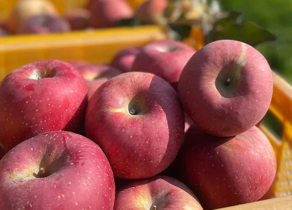
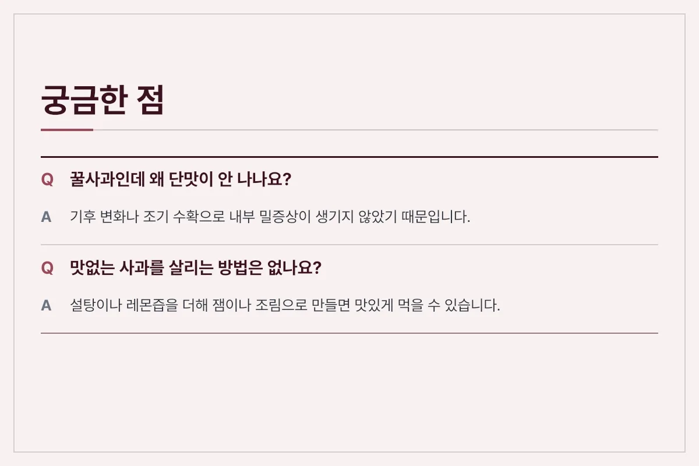
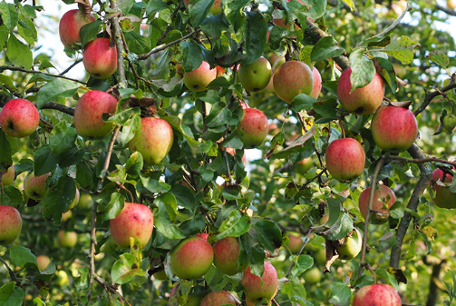
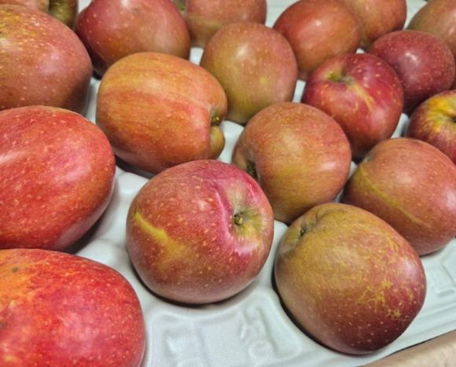
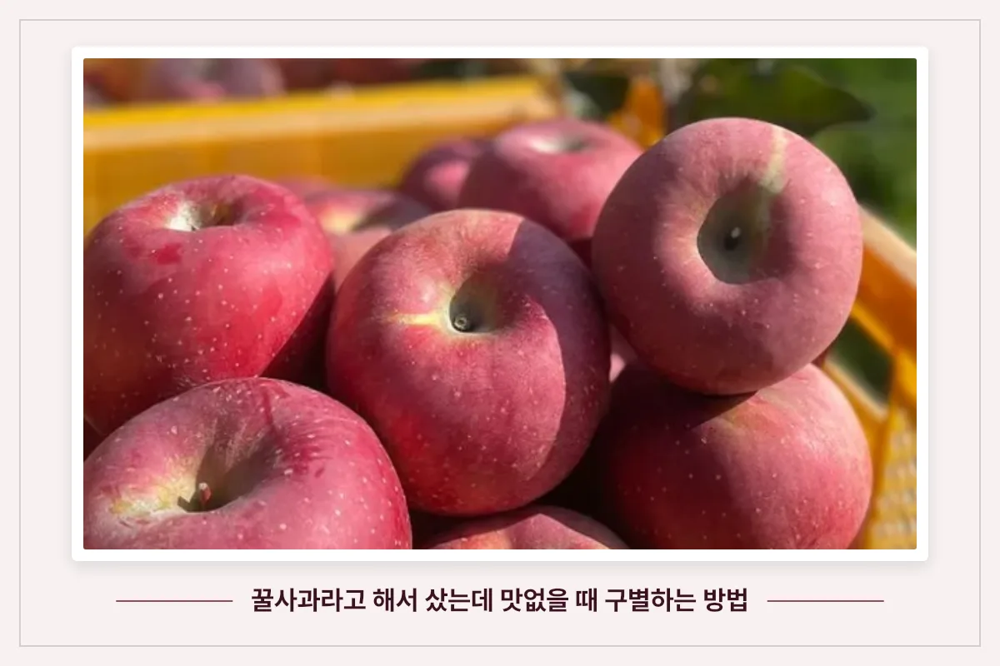

기대하고 산 사과가 막상 먹어보니 단맛은 없고 밍밍하거나 푸석할 때가 있습니다. 꿀사과라는 설명만 믿고 샀다가 실망했다면, 사과의 상태를 파악하고 그에 맞는 조리법을 찾는 것이 현명합니다. 맛없는 사과가 발생하는 원인과 이를 구별하는 기준, 그리고 버리지 않고 맛있게 먹는 실용적인 방법을 알아봅니다.

<figure>

<figcaption>수확된 붉은 사과들이 상자 안에 모여 있는 모습 (사진: https://bitl.bz/oFcLwn)</figcaption>
</figure>

## 맛없는 사과가 되는 원인과 특징

사과가 꿀사과로 불리는 이유는 내부의 밀증상(꿀박힘) 때문이지만, 모든 사과가 당도가 높은 것은 아닙니다. 일조량이 부족하거나 너무 일찍 수확한 경우, 혹은 후숙 과정이 잘못되면 당도가 오르지 못하고 전분이 그대로 남게 됩니다. 이로 인해 식감이 푸석해지거나 수분이 빠져나가 아삭한 맛이 사라집니다.

<figure>

<figcaption>사과 숙성 과정 카드</figcaption>
</figure>

## 맛있는 사과와 맛없는 사과 구별 기준

구매 전이나 집에서 잘라본 뒤 사과의 상태를 비교해보면 왜 맛이 없는지 원인을 추정할 수 있습니다. 외관과 단면의 특징을 기준으로 비교한 내용은 다음과 같습니다.

| 구별 기준 | 당도가 높은 사과 | 당도가 낮은 사과 |
| :--- | :--- | :--- |
| 꼭지 상태 | 싱싱하고 푸른빛이 도는 꼭지 | 마르고 갈색으로 변한 꼭지 |
| 표면 질감 | 껍질이 팽팽하고 매끄러운 느낌 | 거칠거나 끈적이는 유분이 도는 상태 |
| 과육 단면 | 단단하고 수분이 꽉 찬 과육 | 푸석하고 멍이 들거나 퍽퍽한 조직 |

<figure>

<figcaption>좋은 점</figcaption>
</figure>

## 실패한 사과를 살리는 구별 및 활용 가이드

생으로 먹기 어려운 사과는 억지로 먹기보다 조리 과정을 거치면 색다른 맛을 낼 수 있습니다. 열을 가하면 사과의 신맛과 단맛이 조화를 이루어 디저트나 반찬의 재료로 훌륭하게 변신합니다.

### 샐러드와 샌드위치 재료 활용

푸석한 식감은 샐러드나 샌드위치 속에 넣으면 단점을 보완할 수 있습니다. 마요네즈나 요거트 소스에 버무리면 퍽퍽함이 줄어들고 아삭한 식감만 가볍게 즐길 수 있습니다.

### 설탕을 더한 사과잼 만들기

당도가 부족한 사과는 잼을 만들 때 설탕과 레몬즙을 적당히 섞어주면 감칠맛이 살아납니다. 펙틴 성분이 풍부해 별도의 첨가물 없이도 걸쭉한 농도를 쉽게 맞출 수 있습니다.

<figure>

<figcaption>아쉬운 점</figcaption>
</figure>

### 고기 요리의 연육 작용

사과에 포함된 천연 효소는 단백질을 부드럽게 만드는 성질이 있습니다. 갈비나 불고기 양념을 만들 때 갈아 넣으면 고기의 잡대를 잡고 식감을 부드럽게 만들어 줍니다.

<figure>

<figcaption>궁금한 점</figcaption>
</figure>

## 자주 묻는 질문 (FAQ)

**Q. 꿀사과인데 왜 단맛이 전혀 안 나나요?**

A. 기후 변화나 조기 수확으로 인해 내부의 당분이 제대로 축적되지 못했기 때문입니다. 겉모습만으로는 당도를 완벽히 판별하기 어렵습니다.

**Q. 푸석해진 사과를 다시 아삭하게 만들 수 있나요?**

A. 한 번 푸석해진 과육은 수분이 빠져나간 상태이므로 생과일로 되돌리기 어렵습니다. 조리용으로 용도를 바꾸는 것이 좋습니다.

**Q. 맛없는 사과를 보관할 때 주의할 점은 무엇인가요?**

A. 다른 과일과 함께 두면 에틸렌 가스를 배출해 주변 과일을 빨리 익게 만들 수 있습니다. 반드시 밀폐 용기에 담아 냉장 보관해야 합니다.

<figure>

<figcaption>정리하면</figcaption>
</figure>

<figure>

<figcaption>나뭇가지에 매달려 있는 사과와 초록 잎들의 모습 (사진: https://bitl.bz/oFcLwn)</figcaption>
</figure>

<figure>

<figcaption>트레이에 정렬되어 있는 사과들의 모습 (사진: https://bitl.bz/oFcLwn)</figcaption>
</figure>

<figure>

<figcaption>꿀사과라고 해서 샀는데 맛없을 때 구별하는 방법 (사진: https://bitl.bz/oFcLwn)</figcaption>
</figure>

[추천 제품 확인하기](https://bitl.bz/oFcLwn)

최종 확인일: 2026-11-09. 가격과 사양은 판매처와 시기에 따라 달라질 수 있으니 구매 전 공식 판매 페이지에서 다시 확인하세요.
