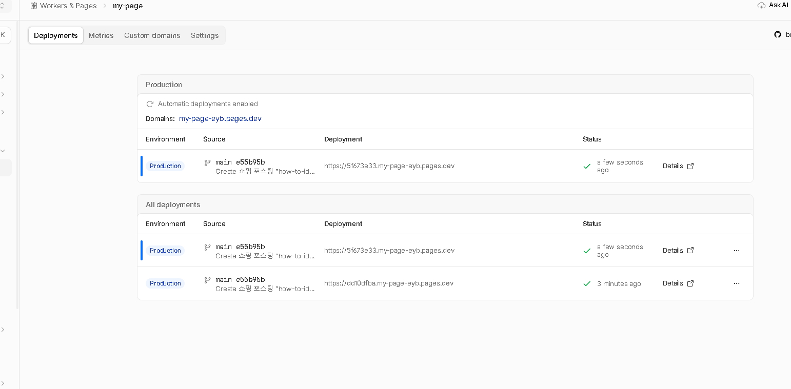
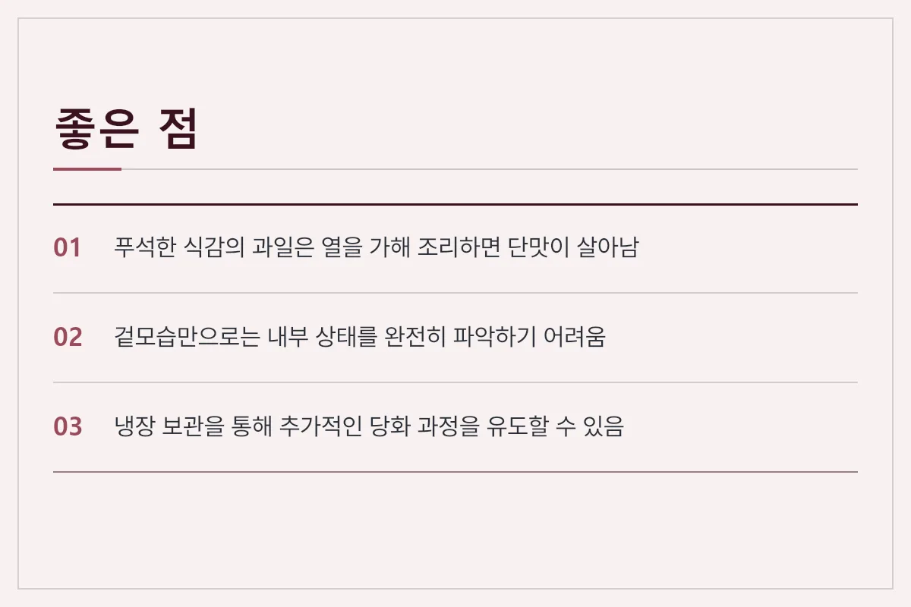
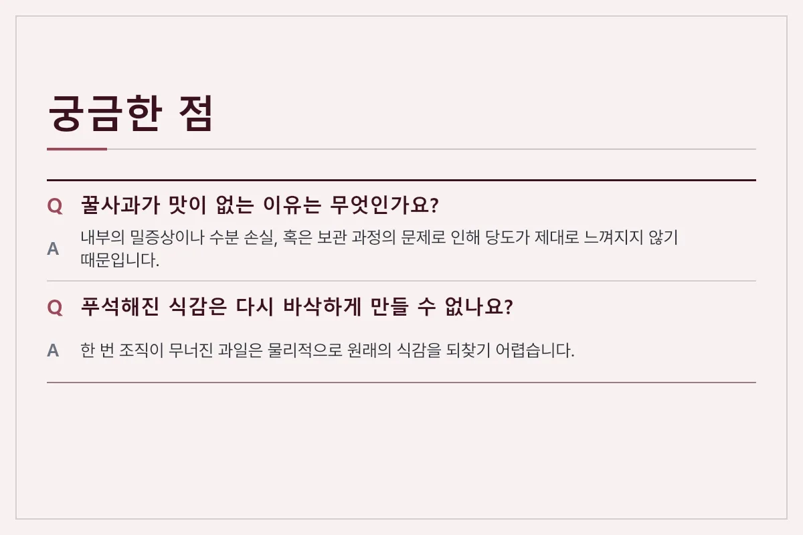

마트나 시장에서 꿀사과라는 설명을 믿고 구매했는데, 막상 깎아보니 푸석하거나 단맛이 거의 나지 않아 실망하는 경우가 있습니다. 꿀사과가 맛이 없을 때는 내부 조직의 상태를 확인하고, 생으로 먹는 대신 다른 방식으로 활용하는 것이 좋습니다. 겉보기에는 번지르르하지만 실제 맛이 떨어지는 원인과 이를 구별하고 대처하는 기준을 살펴봅니다.

<figure>

<figcaption>구매한 사과의 내부 상태를 직접 잘라 확인하는 과정 (사진: wdwd)</figcaption>
</figure>

## 사과가 꿀사과인데도 맛이 없는 원인

사과 단면에 투명한 꿀심이 박혀 있어 흔히 꿀사과라고 부르지만, 막상 먹어보면 밍밍하거나 푸석한 경우가 있습니다. 이는 사과 내부가 과도하게 익었거나 수분이 빠져나가면서 당도가 고르게 퍼지지 않았기 때문입니다. 

특히 수확 시기가 지나서 내부가 변질되기 시작하면 겉보기엔 당도가 높을 것 같아 보여도 실제 씹을 때 느껴지는 단맛과 식감이 크게 떨어집니다. 보관 과정에서 냉장고 안의 온도가 적절하지 않았거나 너무 오래 방치된 경우에도 이러한 현상이 발생합니다.

<figure>

<figcaption>체크리스트</figcaption>
</figure>

## 맛없는 과일 상태 구별 및 대처 기준

맛이 없는 사과를 판별할 때는 껍질의 질감과 꼭지의 신선도를 함께 살펴봐야 합니다. 

| 구별 기준 | 정상적인 상태 | 맛이 변질되거나 떨어진 상태 |
| :--- | :--- | :--- |
| 표면 질감 | 매끄럽고 단단함 | 끈적이거나 푸석한 느낌 |
| 꼭지 상태 | 싱싱하고 초록빛을 띰 | 갈색으로 마르고 시듦 |
| 과육 단면 | 촘촘하고 수분감이 가득함 | 푸석하거나 바람이 든 느낌 |

표면이 지나치게 번들거리고 만졌을 때 물렁하다면 이미 내부 조직이 무너졌을 확률이 높습니다. 이럴 때는 생으로 깎아 먹기보다는 열을 가하는 요리에 사용하는 편이 좋습니다.

<figure>

<figcaption>장점</figcaption>
</figure>

## 맛없는 과일 활용 팁과 보관 주의점

푸석하고 단맛이 부족한 과일은 설탕이나 시나몬 가루를 더해 조림이나 잼, 혹은 샐러드 소스로 활용하면 맛의 단점을 보완할 수 있습니다. 열을 가해 조리하면 부드러운 식감과 함께 단맛이 응축되어 버려지는 양을 줄일 수 있습니다.

사과를 보관할 때는 다른 과일과 섞이지 않도록 밀폐하여 냉장 보관하는 것이 수분 손실을 막는 데 도움이 됩니다. 다만 이미 맛이 크게 떨어진 상태라면 후숙을 통해 맛이 좋아지기는 어렵기 때문에 빠르게 소비하는 것이 좋습니다.

<figure>

<figcaption>자주 묻는 질문</figcaption>
</figure>

## 자주 묻는 질문

**Q. 꿀사과라고 샀는데 단맛이 전혀 안 나요.**

A. 내부의 밀증상이 과도하게 진행되었거나 수분이 빠져나간 경우 단맛이 느껴지지 않을 수 있습니다. 이럴 때는 생식보다는 요리용으로 활용하는 것을 권장합니다.

**Q. 푸석해진 식감을 다시 아삭하게 만들 수 있나요?**

A. 한 번 조직이 무너진 과일은 물리적으로 원래의 식감을 되찾기 어렵습니다. 얇게 썰어 샐러드나 베이킹 재료로 사용하는 편이 좋습니다.

**Q. 보관할 때 다른 과일과 함께 두어도 되나요?**

A. 사과에서 나오는 에틸렌 가스가 다른 과일의 후숙을 촉진하므로, 가급적 단독으로 밀폐하여 보관하는 것이 좋습니다.

<figure>

<figcaption>요약</figcaption>
</figure>

꿀사과가 기대에 못 미칠 때는 무리하게 생으로 먹기보다 상태에 맞는 조리법을 선택하는 것이 현명합니다. 표면 상태와 보관 환경을 미리 점검하여 식재료를 알뜰하게 활용해 보세요. 추천 상품은 아래 링크에 걸어 두겠습니다.

[추천 제품 확인하기](https://www.microsoft.com/ko-kr/education?icid=CNavMSCOML0_Studentsandeducation)

최종 확인일: 2026-11-09. 가격과 사양은 판매처와 시기에 따라 달라질 수 있으니 구매 전 공식 판매 페이지에서 다시 확인하세요.
