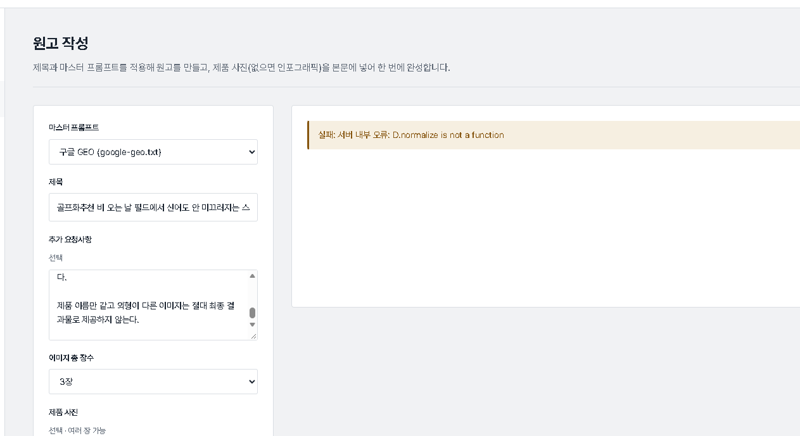

꿀사과라는 설명을 믿고 구매했으나 막상 맛이 싱겁거나 푸석할 때, 이를 해결하는 방법은 과일을 생으로 먹는 방식을 바꾸거나 열을 가해 풍미를 끌어올리는 것입니다. 단맛이 부족한 사과는 설탕과 버터를 활용한 조리법에 잘 어울리며, 푸석한 식감을 보완하려면 수분을 더해주는 드레싱이나 샐러드 형태로 가공하는 것이 좋습니다.

<figure>

<figcaption>싱겁고 맛없는 사과는 조리용으로 활용하는 것이 좋아요 (사진: swqdw)</figcaption>
</figure>

## 맛없는 사과를 살리는 요리 활용법

당도가 떨어지고 식감이 푸석해진 사과는 생과로 소비하기보다 열을 가하는 요리에 사용하는 편이 효과적입니다. 설탕과 레몬즙을 넣고 졸이면 사과 고유의 향이 살아나며, 빵에 곁들이기 좋은 잼이나 조림으로 변신합니다. 또한 샐러드에 얇게 썰어 넣을 때는 마요네즈나 요거트 기반의 소스와 버무리면 푸석한 식감이 눈에 띄지 않게 됩니다.

<figure>

<figcaption>맛없는 사과를 조리하여 활용하는 기준</figcaption>
</figure>

## 실패 없는 사과 보관 및 선별 기준

사과를 오래 보관하려면 수분이 날아가지 않도록 하나씩 신문지나 랩으로 밀봉하여 냉장고 채소칸에 넣는 것이 안전합니다. 특히 사과에서 방출되는 에틸렌 가스는 주변 과일의 숙성을 빠르게 만들기 때문에 반드시 단독으로 밀폐 보관해야 합니다. 앞으로 사과를 고를 때는 표면이 너무 매끄러운 것보다는 약간 거칠고 꼭지 주변에 싱그러운 향이 감도는 것을 고르는 편이 실패 확률을 줄이는 방법입니다.

<figure>

<figcaption>맛없는 사과 활용의 장점과 주의점</figcaption>
</figure>

<figure>

<figcaption>맛없는 사과 활용에 대한 자주 묻는 질문</figcaption>
</figure>

## 자주 묻는 질문

**맛없는 사과도 그냥 생으로 먹을 수 있나요?**

설탕이나 꿀을 곁들이거나 샐러드 드레싱으로 무쳐 먹으면 식감을 보완할 수 있어요.

**사과를 보관할 때 다른 과일과 두면 안 되나요?**

사과에서 나오는 에틸렌 가스가 다른 과일의 숙성을 촉진해 쉽게 무르게 만들어요.

<figure>

<figcaption>맛없는 사과 구별과 활용법 핵심 요약</figcaption>
</figure>

맛없는 사과는 생과일로 소비하기보다 조림이나 잼, 샐러드 등의 요리 재료로 활용하면 버리지 않고 맛있게 즐길 수 있습니다. 추천 상품은 아래 링크에 걸어 두겠습니다.

[추천 제품 확인하기](https://bitl.bz/DhpRoy)

최종 확인일: 2026-11-09. 가격과 사양은 판매처와 시기에 따라 달라질 수 있으니 구매 전 공식 판매 페이지에서 다시 확인하세요.
