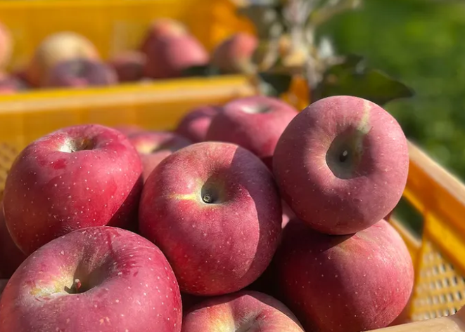
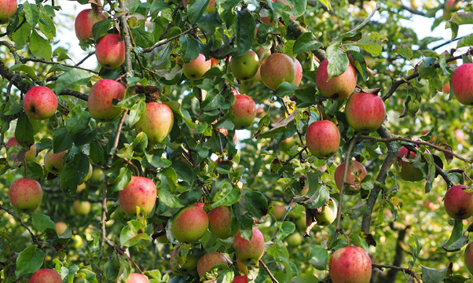
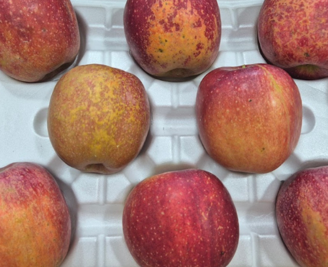
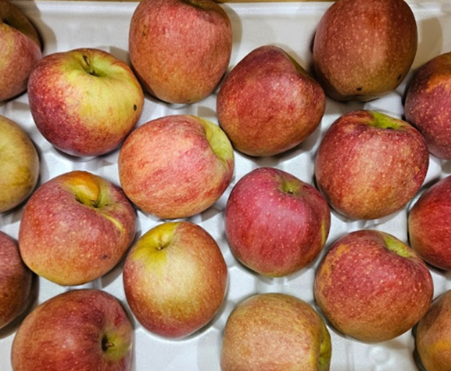

꿀사과라는 말을 믿고 박스로 구매했는데 막상 먹어보니 밍밍하거나 단맛이 느껴지지 않아 실망한 경험이 누구나 한 번쯤 있을 거예요. 사과 속 투명한 부위가 많으면 무조건 달 것이라고 생각하기 쉽지만, 실제로는 보관 방법이나 품종 특성에 따라 맛의 차이가 크게 납니다. 맛없는 사과가 발생하는 원인과 이를 구별하고 대처하는 방법을 차근차근 살펴보겠습니다.

<figure>

<figcaption>농장에서 수확해 상자에 담아둔 사과들의 생생한 모습 (사진: https://bitl.bz/oFcLwn)</figcaption>
</figure>

## 사과 속 투명한 부위의 진실

사과를 쪼갰을 때 속이 투명하게 비치는 현상을 흔히 꿀이라고 부르지만, 정확한 명칭은 밀증 현상입니다. 기온이 급격히 떨어지는 시기에 사과가 스스로를 보호하기 위해 솔비톨이라는 성분을 축적하면서 생기는 자연스러운 현상이에요. 

하지만 이 밀증이 생겼다고 해서 무조건 당도가 압도적으로 높은 것은 아닙니다. 수확 시기가 지나 과숙성되었거나 수분이 빠져나가기 시작한 사과는 밀증이 있어도 퍽퍽하고 밍밍한 맛이 날 수 있어요. 따라서 투명한 부위만 보고 구매하기보다는 전체적인 단단함과 향을 함께 확인하는 것이 중요합니다.

<figure>

<figcaption>초록색 잎사귀 사이로 잘 익은 붉은 사과들이 열려 있는 풍경 (사진: https://bitl.bz/oFcLwn)</figcaption>
</figure>

## 맛없는 사과와 맛있는 사과 비교

사과를 고를 때와 맛을 구별할 때 참고할 수 있는 기준을 비교해 보겠습니다.

| 구분 | 맛있는 사과 | 맛없는 사과 |
| :--- | :--- | :--- |
| 표면 질감 | 거칠거칠하고 단단함 | 매끈하지만 탄력이 부족함 |
| 꼭지 상태 | 초록빛이 돌고 싱싱함 | 갈색으로 말라 비틀어짐 |
| 두드린 소리 | 맑고 탱탱한 소리가 남 | 둔탁하고 멍든 소리가 남 |

<figure>

<figcaption>좋은 점</figcaption>
</figure>

## 맛없는 사과를 살리는 구체적인 대처법

이미 구매한 사과가 맛이 없다면 생으로 먹기보다는 조리 과정을 거치는 것이 좋습니다. 

첫째로, 얇게 썰어 설탕과 레몬즙을 넣고 약불에 오래 졸여 사과잼이나 콤포트를 만들어 보세요. 열을 가하면 사과의 신맛은 날아가고 단맛이 응축되어 토스트나 요거트에 곁들이기 좋은 훌륭한 디저트가 됩니다.

둘째로, 샐러드나 카레, 고기 요리에 활용하는 방법입니다. 고기를 재울 때 갈아 넣으면 연화 작용을 도와 부드럽게 만들어주며, 샐러드에 얇게 채 썰어 넣으면 아삭한 식감을 살려줍니다.

<figure>

<figcaption>흰색 포장 용기 안에 들어 있는 사과들의 표면 질감 (사진: https://bitl.bz/oFcLwn)</figcaption>
</figure>

## 올바른 보관과 후숙 요령

사과를 오랫동안 아삭하게 먹기 위해서는 보관 환경이 가장 중요합니다. 사과에서 나오는 에틸렌 가스는 다른 과일이나 채소의 숙성을 촉진하므로 반드시 단독으로 밀폐 포장해야 해요.

김치냉장고처럼 온도가 낮고 일정한 곳에 비닐봉지에 밀봉하여 보관하면 수분 손실을 최소화할 수 있습니다. 만약 신맛이 너무 강하다면 실온에서 하루 이틀 정도 서늘한 곳에 두어 가볍게 후숙 과정을 거치면 신맛이 줄어들고 부드러운 식감을 느낄 수 있습니다.

<figure>

<figcaption>사과 보관 및 활용 체크리스트</figcaption>
</figure>

<figure>

<figcaption>상자에 담겨 있는 여러 개의 붉은 사과 모습 (사진: https://bitl.bz/oFcLwn)</figcaption>
</figure>

## 자주 묻는 질문

**Q. 꿀사과인데 왜 단맛이 나지 않나요?**

A. 사과 속 투명한 꿀 밀증은 당도가 높다는 뜻이지만 품종 특성이나 보관 상태에 따라 전체적인 당도가 낮게 느껴질 수 있어요.

**Q. 맛없는 사과를 살리는 방법이 있나요?**

A. 생으로 먹기 힘들 때는 설탕과 계피를 넣고 조여 잼이나 콤포트로 만들면 맛있게 먹을 수 있어요.

**Q. 사과를 오래 보관하려면 어떻게 해야 하나요?**

A. 다른 과일과 닿지 않도록 개별 밀봉하여 온도가 낮은 김치냉장고에 넣어야 수분이 빠지는 것을 막을 수 있어요.

<figure>

<figcaption>사과 관련 자주 묻는 질문 요약</figcaption>
</figure>

사과 속 밀증 현상은 자연스러운 현상이지만, 전체적인 신선도와 보관 상태에 따라 맛이 크게 달라질 수 있습니다. 밍밍한 사과를 마주했다면 당황하지 말고 조리용으로 활용하거나 알맞은 후숙을 통해 맛있게 즐겨보세요.

<figure>

<figcaption>본문 내용 요약 카드</figcaption>
</figure>

[추천 제품 확인하기](https://bitl.bz/oFcLwn)

최종 확인일: 2026-11-09. 가격과 사양은 판매처와 시기에 따라 달라질 수 있으니 구매 전 공식 판매 페이지에서 다시 확인하세요.
