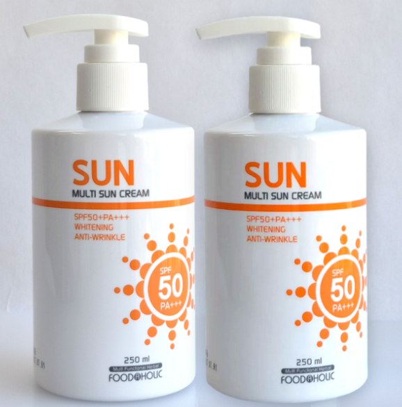

요즘 K뷰티 위조 화장품은 용기와 포장은 물론 **제조번호(LOT 번호)까지 똑같이 찍어 낼 만큼** 정교해서, 겉모습만으로 진짜와 가짜를 가리기가 매우 어렵습니다(코스인코리아 보도). 그래서 선크림처럼 매일 피부에 바르는 제품은 **어디서 사느냐**가 가장 확실한 구별법입니다. 브랜드 공식몰이나 공식 지정 판매처에서 사고, 오픈마켓에서는 판매자가 누구인지 꼭 확인하세요. 아래에 가품이 팔리는 방식과 확인·신고 방법을 정리했습니다.

<figure>

<figcaption>흰색 용기에 주황색 SUN 로고가 인쇄된 펌프형 선크림 제품 (사진: https://bitl.bz/eRCENf)</figcaption>
</figure>

## 위조 화장품, 얼마나 많을까

- **차단 건수 급증:** 식약처가 인용한 지식재산처 자료에 따르면 K-브랜드 위조 화장품 차단 건수는 2023년 1만 6,774건 → 2024년 2만 3,494건 → 2025년 **3만 6,116건**으로 늘었습니다(코스모닝 보도).
- **세계적 규모:** OECD 2024년 보고서 기준 한국 기업의 지식재산권을 침해한 위조상품은 약 **97억 달러(약 11조 원)**이고, 세관 압류액 기준으로 화장품이 **10%**를 차지해 전자제품, 섬유·의류에 이어 3위입니다.
- **해외 확산:** 중국산 가품이 아시아를 넘어 루마니아 공항 세관에서도 국내 브랜드 크림 위조 의심품 100여 점이 압류됐습니다.

## 가품은 이렇게 팔린다

코스인코리아에 따르면 위조품 판매자들은 오픈마켓에 **제3자 판매자 계정**을 만든 뒤, 브랜드 공식몰이나 공식 판매처의 **제품 사진과 상세 설명을 그대로 복사**해 정품 판매처처럼 꾸밉니다. 주문이 들어오면 중국 등에서 만든 위조품을 보냅니다.

한 바이오화장품 브랜드는 국내 대형 온라인 플랫폼에서 자사 제품을 정교하게 베낀 중국산 가품을 확인했고, 결국 **오픈마켓과 비공식 판매 채널 판매를 중단**하고 공식 지정 판매처 중심으로 유통 방식을 바꿨습니다. 가품은 정품 원료를 쓰지 않았고 제조 환경이나 품질 검사도 거치지 않아 **성분과 안전성을 확인할 수 없다**는 게 가장 큰 문제입니다.

## 정품을 사는 가장 확실한 방법

1. **브랜드 공식몰 또는 공식 지정 판매처에서 사기:** 브랜드 홈페이지에 공식 판매처 목록이 있는지 확인하세요.
2. **오픈마켓에서는 판매자 확인:** 같은 상품 페이지라도 판매자가 여럿일 수 있습니다. 브랜드 공식 스토어인지, 판매자 정보가 분명한지 보세요.
3. **지나치게 싼 가격 의심:** 정가보다 터무니없이 싸다면 한 번 더 확인하세요.
4. **해외직구는 더 조심:** 식약처는 2026년부터 해외직구 화장품 안전검사 대상에 위조 의심 제품을 넣었습니다. 위해 우려가 있으면 통관이 보류될 수 있습니다.

## 겉모습으로 확인할 수 있는 것 (참고용)

정교한 가품은 육안으로 구별하기 어렵지만, 이미 산 제품이 의심된다면 평소 쓰던 정품과 나란히 놓고 비교해 볼 수 있습니다.

- **인쇄:** 글씨가 번지거나 흐릿한지, 글꼴·줄바꿈이 이상한지
- **용기 마감:** 이음새가 거칠거나 뚜껑이 헐겁게 맞는지
- **제형과 향:** 평소와 색, 질감, 향이 확연히 다른지

다만 **제조번호나 바코드가 정상으로 보인다고 정품이라는 보장은 없습니다.** 가품이 LOT 번호까지 똑같이 찍은 사례가 있기 때문입니다. 확실히 하려면 브랜드 고객센터에 사진과 구매처를 보내 확인을 요청하세요.

## 위조품이 의심되면 여기에 신고하세요

- **지식재산처 '지식재산침해 원스톱 신고상담센터':** 위조상품이나 지식재산 침해 의심 사례를 신고할 수 있습니다.
- **브랜드 고객센터:** 제품 사진, 구매처, 주문 내역을 보내 정품 여부를 문의하세요.
- **구매한 플랫폼:** 판매자 신고와 환불 절차를 함께 진행하세요.

쓰던 중 피부에 붉은 기, 가려움 같은 이상이 생겼다면 바로 사용을 멈추세요.

## 정부는 어떻게 대응하고 있나

- **4자 업무협약:** 2026년 6월 16일 관세청, 식약처, 지식재산처, 대한화장품협회가 위조 화장품 대응 업무협약을 맺었습니다. 반기마다 민관 협의체를 열어 유통 정보를 공유하고 온라인 모니터링을 함께하기로 했습니다(taxtimes.co.kr 보도).
- **통관 단계 차단:** 관세청은 협약 기관의 위험 정보를 받아 국경에서 해외 위조품을 미리 막고, 주요 수출국 관세당국과 협력을 넓히겠다고 밝혔습니다.
- **판매자 처벌 근거 마련:** 식약처는 위조 화장품 판매자 처벌과 회수·폐기 명령의 법적 근거를 명확히 하고, 대한화장품협회에 업계용 '위조화장품 제보 센터'를 운영한다고 밝혔습니다(코스인코리아).

정부 대응이 강화되고 있지만, 온라인에서 이미 팔리고 있는 가품을 소비자가 모두 피하기는 어렵습니다. 결국 **공식 판매처에서 사는 습관**이 가장 확실한 예방책입니다.

## 자주 묻는 질문

**Q. 바코드나 제조번호가 맞으면 정품인가요?**

A. 그렇지 않을 수 있습니다. 코스인코리아 보도에 따르면 제조번호(LOT)까지 똑같이 표시한 가품이 발견됐습니다. 구매처와 판매자를 확인하는 게 더 확실합니다.

**Q. 대형 온라인몰에서 샀는데도 가품일 수 있나요?**

A. 있습니다. 제3자 판매자가 공식 판매처의 사진과 설명을 베껴 정품처럼 꾸미는 수법이 확인됐습니다. 브랜드 공식 스토어인지 판매자 정보를 확인하세요.

**Q. 위조 화장품을 쓰면 어떤 문제가 있나요?**

A. 정품 원료를 쓰지 않고 제조 환경이나 품질 검사를 거치지 않아 성분과 안전성을 알 수 없습니다. 이상이 생기면 사용을 멈추고 전문의와 상담하세요.

**Q. 선크림은 왜 특히 조심해야 하나요?**

A. 선크림은 매일 얼굴에 넓게 바르는 제품이라, 성분과 안전성을 알 수 없는 가품을 쓰면 피부 문제가 생길 위험이 큽니다. 자외선 차단 효과도 보장되지 않습니다.

[추천 제품 확인하기](https://bitl.bz/eRCENf)

## 참고한 자료

- [아시아 넘어 동유럽으로 번진 K-뷰티 위조화장품... 온라인 타고 중국산 짝퉁 유통](https://www.cosinkorea.com/mobile/article.html?no=58051) — 코스인코리아닷컴, 2026-08-11 보도, 확인일 2026-11-26
- [식약처·지재처·관세청, 해외직구 위조 의심 화장품 안전검사](https://cosmorning.com/mobile/article.html?no=52761) — 코스모닝, 2026-05-12 보도, 확인일 2026-11-26
- ["K-뷰티 짝퉁 뿌리 뽑는다" 관세청·식약처 등 4자 MOU 체결](https://taxtimes.co.kr/news/article.html?no=275558) — taxtimes.co.kr, 2026-06-16 보도, 확인일 2026-11-26
- 사진 일부: Pixabay (무료 이용 허가 이미지)

정보 기준일: 2026-11-26. 가격과 판매처 정보는 바뀔 수 있으니 구매 전 브랜드 공식 안내를 확인하세요.
