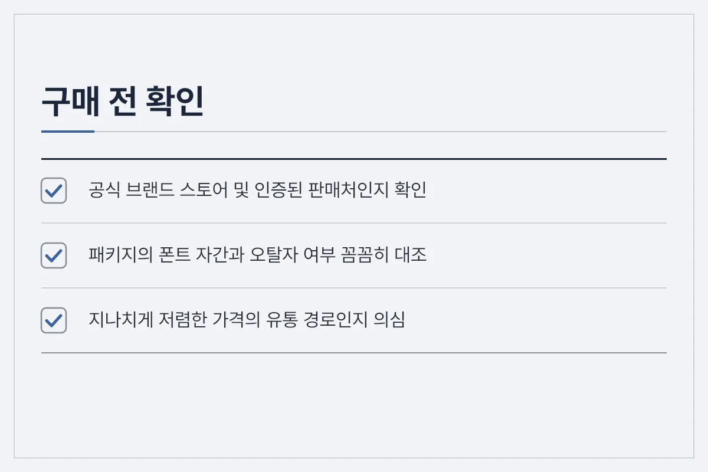
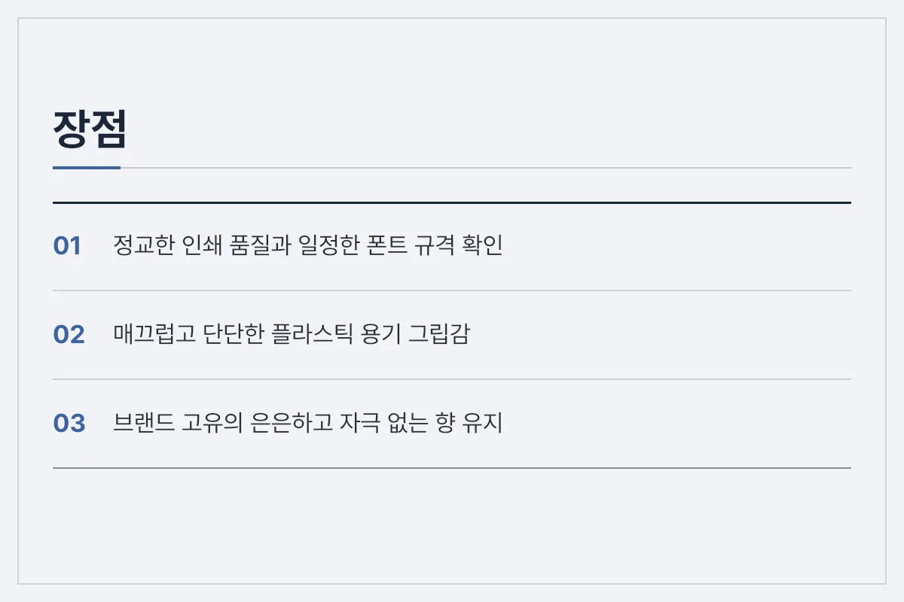
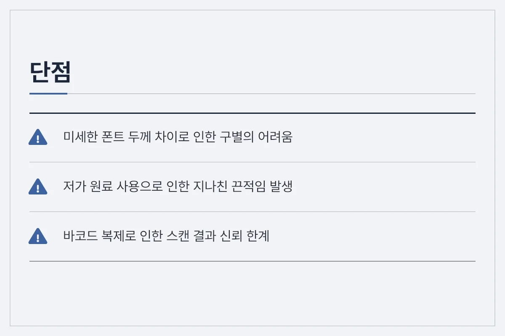
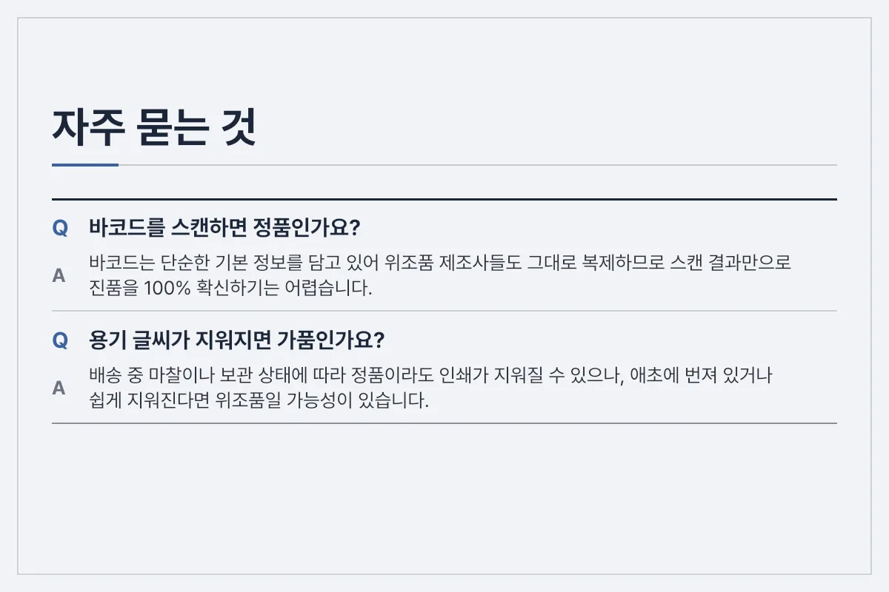
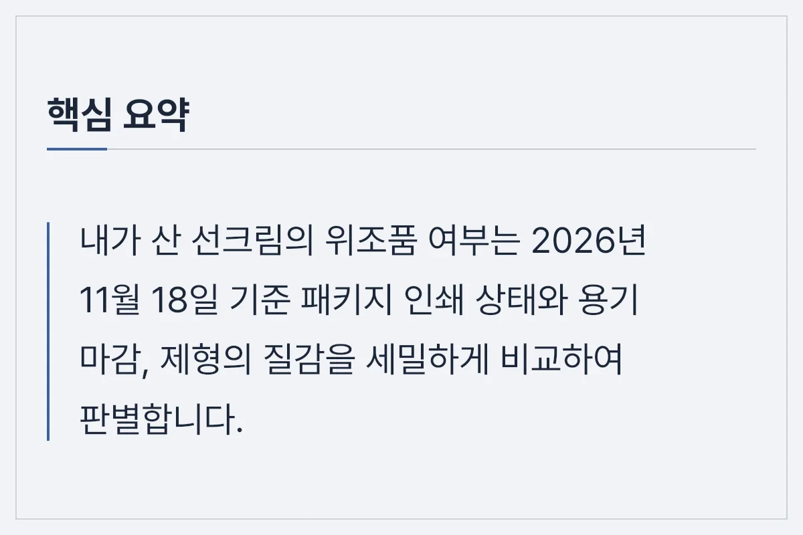

내가 산 선크림이 위조품인지 확인하려면 2026년 11월 18일 기준으로 패키지 인쇄 품질과 용기의 마감 상태, 그리고 제형의 특성을 세밀하게 대조해야 합니다. 글로벌 시장에서 K뷰티 인기가 높아짐에 따라 정교하게 만들어진 모조품 유통 사례가 꾸준히 보고되므로, 구매한 제품의 디테일을 꼼꼼히 살펴보는 과정이 필수적입니다.

<figure>

<figcaption>흰색 용기에 주황색 SUN 로고가 인쇄된 펌프형 선크림 제품 (사진: https://bitl.bz/eRCENf)</figcaption>
</figure>

## 정품과 위조품을 나누는 결정적인 외관 차이

위조품은 언뜻 보기에는 정품과 구별하기 어렵지만, 자세히 관찰하면 인쇄의 선명도나 색감에서 미세한 차이를 드러냅니다. 정품은 브랜드 로고와 제품 설명 글자가 번짐 없이 깔끔하게 인쇄되어 있으며, 폰트의 간격과 크기가 일정한 규격을 따릅니다. 반면 짝퉁 선크림의 경우 글자 테두리가 미세하게 뭉개지거나, 정품에 쓰인 색상과 미묘하게 다른 톤의 잉크를 사용하여 조잡한 느낌을 주기도 합니다. 

용기 재질의 완성도 역시 중요한 구별 포인트입니다. 정품 제조사들은 매끄럽고 단단한 플라스틱 용기를 사용하여 그립감이 좋고 이음새가 깔끔합니다. 그러나 위조품은 원가를 아끼기 위해 거친 플라스틱 사출 흔적이 남거나 뚜껑과 본체가 아귀가 잘 맞지 않아 헐거울 때가 많습니다. 펌프나 캡을 열고 닫을 때 느껴지는 밀폐력의 차이도 정품 판별에 도움을 줍니다. 시중에서 유통되는 많은 제품들이 외형적으로 유사해 보이지만, 이러한 미세한 디테일의 차이가 가품을 걸러내는 결정적인 단서가 됩니다.

<figure>

<figcaption>패키지 인쇄와 용기 마감 상태를 대조하는 구별 기준</figcaption>
</figure>

## 패키지와 라벨에서 찾아내는 진품의 단서

제품 상자와 본체 라벨에 표기된 문구와 기호를 살펴보면 위조품 여부를 가늠할 수 있습니다. 정품은 각국 수출입 규격에 맞추어 성분명과 주의사항이 오탈자 없이 정확하게 기재되어 있습니다. 특히 영문이나 한글 폰트의 자간이 어색하지 않고, 바코드와 제조번호가 선명하게 각인되어 있습니다. 

위조품 제작자들은 정품의 디자인을 그대로 스캔하여 복사하는 경우가 많아 언뜻 완벽해 보이지만, 미세한 폰트의 두께 차이나 줄바꿈 오류를 범하기 쉽습니다. 또한, 정품 인증을 위한 홀로그램 스티커나 특수 마크가 부착된 경우, 위조품은 홀로그램의 입체감이 떨어지거나 빛의 각도에 따른 색상 변화가 자연스럽지 않은 특징을 보입니다. 이러한 패키지 요소들은 소비자가 정품과 위조품을 판별할 때 가장 먼저 직관적으로 확인할 수 있는 부분이므로, 평소에 익숙한 제품의 디자인과 비교하는 습관이 큰 도움이 됩니다.

<figure>

<figcaption>정교한 인쇄 품질과 우수한 밀폐력을 자랑하는 정품 특징</figcaption>
</figure>

## 텍스처와 향으로 확인하는 성분의 차이

패키지를 구별하기 어렵다면 제형의 질감과 향, 사용감을 직접 비교해 볼 수 있습니다. 정품 선크림은 피부에 부드럽게 펴 발리며 백탁 현상이 적거나 의도된 제형 특성에 맞는 자연스러운 마무리감을 선사합니다. 반면에 짝퉁 제품은 저가 원료를 사용하기 때문에 끈적임이 지나치게 심하거나 유분이 분리되는 현상이 발생하기도 합니다. 

향의 측면에서도 차이가 두드러집니다. 정품은 브랜드 고유의 은은하고 자극 없는 향을 유지하거나 무향 원칙을 철저히 지킵니다. 하지만 위조품은 화학약품 냄새가 강하게 나거나 지나치게 인위적인 싸구려 향료 냄새가 코를 찌르는 경우가 많습니다. 피부에 직접 바르는 화장품 특성상 이러한 이질적인 제형은 피부 트러블을 유발할 수 있으므로 사용을 즉시 멈추어야 하며, 제형의 점성과 향을 세심히 관찰하는 태도가 필요합니다.

<figure>

<figcaption>미세한 인쇄 차이로 인한 구별의 어려움과 성분 불확실성</figcaption>
</figure>

## 유통 경로와 가격으로 의심해 보는 지혜

시중 가격보다 터무니없이 저렴한 가격에 판매되는 제품은 위조품일 확률을 염두에 두어야 합니다. 공식 브랜드 스토어나 공인된 대리점이 아닌 비인가 오픈마켓이나 개인 간 거래 플랫폼에서 유통되는 제품은 가품일 위험이 큽니다. 제조 원가와 유통 마진을 고려했을 때 상식적으로 성립하기 힘든 할인율을 제시한다면 일단 의심하는 것이 안전합니다.

안전한 소비를 위해서는 처음부터 공식 인증된 판매처를 통해 구매하는 습관이 중요합니다. 만약 이미 제품을 구매했다면 제조사에 직접 문의하여 해당 판매처가 공식 파트너인지 확인하는 절차가 필요합니다. 의심스러운 점이 발견된 제품은 아깝더라도 피부 건강을 위해 사용을 중단하는 결단이 요구되며, 출처가 불분명한 유통 채널 이용을 자제하는 것이 바람직합니다.

<figure>

<figcaption>가품 여부를 확인하는 과정에서 궁금한 점을 정리한 질답</figcaption>
</figure>

## 자주 묻는 질문

**Q. 바코드를 스마트폰 앱으로 스캔했을 때 정품이라고 나오면 진짜인가요?**

A. 바코드는 단순히 제품의 기본 정보를 담고 있는 코드일 뿐이므로 위조품 제조사들도 정품 바코드를 그대로 복제하여 인쇄합니다. 따라서 바코드 스캔 결과만으로 진품을 100% 확신하기는 어렵습니다.

**Q. 해외 직구로 산 제품인데 용기 글씨가 지워지면 가품인가요?**

A. 배송 과정에서 다른 물품들과 마찰을 빚거나 유통 중 보관 상태에 따라 정품이라도 용기 인쇄가 일부 지워질 수 있습니다. 다만 인쇄 상태가 애초에 번져 있거나 지우개로 문지른 것처럼 쉽게 지워진다면 위조품일 가능성을 배제할 수 없습니다.

**Q. 짝퉁 선크림을 구별하는 가장 확실한 방법은 무엇인가요?**

A. 개인이 외관만 보고 100% 판별하기는 어려우므로, 평소에 쓰던 제품과 제형, 향, 튜브 마감 상태를 나란히 두고 대조하는 것이 가장 현실적입니다. 의심스러운 부분이 있다면 공식 고객센터에 사진을 첨부하여 진품 여부를 문의하는 방법이 좋습니다.

<figure>

<figcaption>패키지 인쇄와 제형 비교를 통한 정품 확인 가이드</figcaption>
</figure>

추천 제품 밑에 링크로 들어가서 구매 해주시면 됩니다! 

[추천 제품 확인하기](https://bitl.bz/eRCENf)

2026년 11월 18일 기준 내용입니다. 가격과 사양은 판매처와 시기에 따라 달라질 수 있으니 구매 전에 판매 페이지에서 다시 확인해 주세요.
