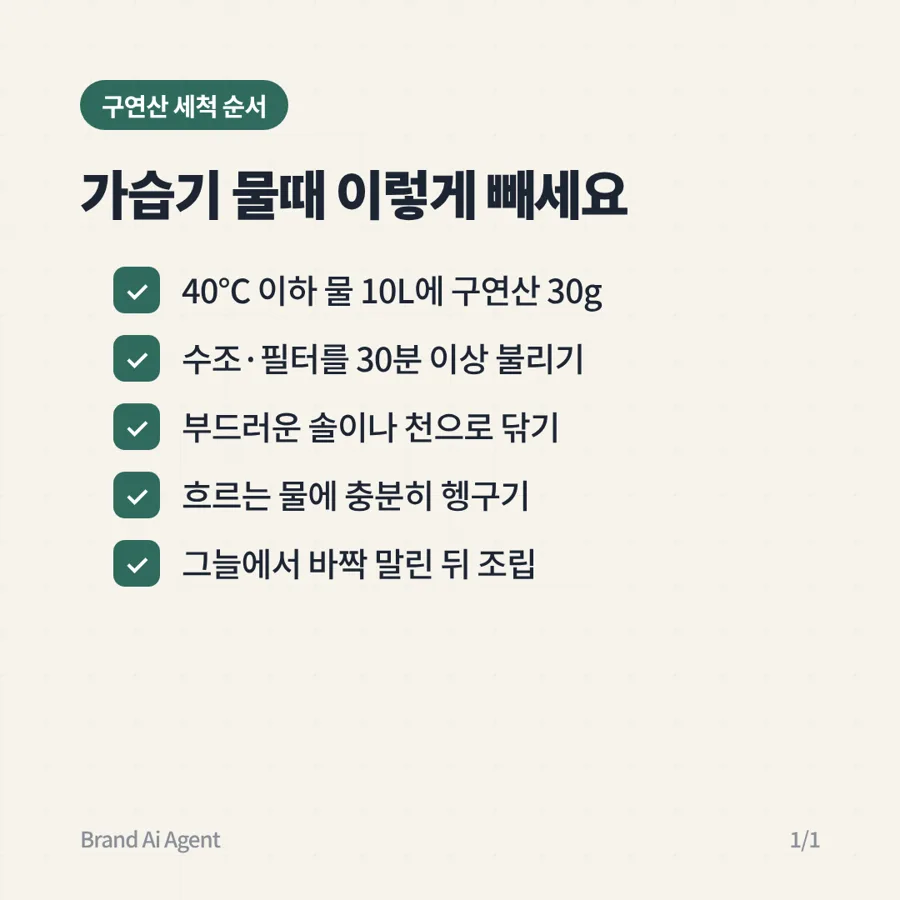

가습기는 **물을 매일 새로 갈고**, 물때가 생기면 **구연산 희석액에 30분 이상 불렸다가 닦은 뒤 그늘에서 완전히 말리는 것**이 기본 세척 방법입니다. LG전자 고객지원 안내는 40℃ 이하 미지근한 물 10L에 구연산 30g을 녹여 쓰라고 제시합니다. 락스와 가습기 살균제는 쓰지 않습니다.

## 가습기 물때와 냄새가 생기는 이유

가습기 물통과 필터에 생기는 하얀 가루는 대부분 석회질입니다. LG전자는 수돗물이 증발하면서 물속 칼슘·마그네슘 같은 미네랄만 남아 필터 겉면에 붙는 자연스러운 현상이라고 설명합니다.

퀴퀴하거나 비릿한 냄새는 원인이 다릅니다. LG전자 안내에 따르면 가습 기능을 쓸 때 나는 냄새는 대부분 수조나 필터에 남은 물이 오염됐거나, 청소 뒤 덜 마른 습기로 세균이 번식했기 때문입니다. 물때는 구연산으로 녹이고, 냄새는 물 관리와 건조로 막는다고 나눠서 보면 됩니다.

## 구연산 세척 순서

LG전자 고객지원 페이지에 나온 순서를 정리하면 다음과 같습니다.

1. **희석액 만들기:** 40℃ 이하 미지근한 물 10L에 구연산 30g을 녹입니다. 뜨거운 물은 필터를 변형시킬 수 있습니다.
2. **불리기:** 수조, 내부 필터, 가습 필터(수분 디스크)를 30분 이상 담가 둡니다. 냄새가 심한 가습공기청정기는 1~2시간 이상 담가 두라고 안내합니다.
3. **닦기:** 부드러운 솔이나 천, 스펀지로 살살 닦습니다.
4. **헹구기:** 흐르는 물에 구연산 성분이 남지 않게 충분히 헹굽니다.
5. **말리기:** 통풍이 잘 되는 그늘에서 물기가 없도록 바짝 말린 뒤 조립합니다.

진동자가 있는 초음파식은 바닥의 진동자 부분에도 물때가 잘 낍니다. 위키트리 보도는 구연산물을 적신 키친타월을 진동자 위에 30분~1시간 올려 불린 뒤 닦는 방법을 소개했습니다. 방식별 구조 차이는 [가습기 방식별 차이 정리](/p/humidifier-type-comparison-guide/)에서 볼 수 있습니다.

구연산은 마트나 생활용품점에서 가루 형태로 쉽게 구할 수 있습니다. 한 번 세척에 30g 정도 쓰므로, 1~2주마다 세척한다면 소포장 하나로 한 겨울을 충분히 쓸 수 있습니다.

[관련 링크 확인하기](https://bitl.bz/j5hXud)

## 구연산이 없을 때: 식초 비율

LG전자는 구연산이 없다면 식초를 물과 1:10 비율로 섞어도 비슷한 세척 효과를 볼 수 있다고 안내합니다. 위키트리는 백식초를 물과 1:4로 섞는 방법을 소개해, 자료마다 비율이 다릅니다.

이 글에서는 **제조사 안내인 1:10부터 쓰고, 물때가 두꺼울 때만 진하게** 쓰는 쪽을 권합니다. 어느 비율이든 세척 뒤 식초 냄새가 남지 않도록 여러 번 헹궈야 합니다.

## 물 교체와 세척 주기

| 할 일 | 주기 | 근거 |
| --- | --- | --- |
| 물 새로 갈기 | 매일 | 서울시 안내(2011) |
| 구연산 세척 | 1~2주에 1회 | 위키트리 보도 |
| 자연기화식 기본 청소 | 주 1회 | LG전자 안내 |

서울시 하이서울뉴스(2011)는 가습기 안에 물이 남아 있어도 하루가 지난 물은 새 물로 바꾸고, 물통에 물을 5분의 1쯤 넣고 흔들어 두 번 이상 헹군 뒤 새 물을 넣으라고 안내했습니다. 매일 물을 갈 때 이 헹굼만 해도 물때가 두껍게 굳는 속도가 늦어집니다.

## 수돗물과 정수기 물, 무엇을 넣을까

자료마다 관점이 다릅니다. LG전자는 **수돗물 사용을 권장**합니다. 정수기 물은 염소 같은 소독 성분이 제거돼 있어 수돗물보다 세균이 빨리 번식하고 물이 쉽게 변질될 수 있다는 이유입니다. 반면 위키트리는 물때의 원인이 수돗물 속 미네랄이라 정수기 물이나 증류수를 쓰면 물때가 줄어든다고 소개했습니다.

정리하면 **수돗물은 물때가 생기는 대신 세균 번식에 상대적으로 강하고, 정수기 물은 물때가 덜 생기는 대신 빨리 상할 수 있습니다.** 물을 매일 갈기 어렵다면 제조사 권장대로 수돗물을 쓰고, 물때는 구연산 세척으로 관리하는 편이 안전합니다. 제품 설명서에 권장 물이 따로 적혀 있다면 그 기준이 우선입니다.

## 쓰면 안 되는 세정제

- **락스:** 위키트리 보도는 성분이 완전히 제거되지 않으면 가동할 때 유해 가스가 나올 수 있어 쓰지 않는 것이 좋다고 전했습니다.
- **가습기 살균제:** 과거 가습기 살균제 성분으로 심각한 폐 질환이 발생한 사건이 있었습니다. 물에 섞는 살균제는 쓰지 않습니다.
- **세제 선택:** 서울시 안내(2011)는 세제를 쓸 경우 중성세제인지 표시를 확인하고, 세제가 남지 않게 세 번 이상 헹구라고 했습니다. 당시 안내에는 산성 세제를 피하라는 내용도 있었는데, 지금 제조사들은 물때 제거용으로 구연산을 안내하고 있어 **내 제품 설명서의 세척 방법을 먼저 확인**하는 것이 가장 정확합니다.

## 새 가습기를 고를 때 세척 관점에서 볼 것

세척이 번거로우면 결국 물 교체와 건조를 건너뛰게 됩니다. 가습기를 새로 고른다면 물통 입구가 손이 들어갈 만큼 넓은지, 수조와 필터를 공구 없이 분리할 수 있는지, 진동자나 필터처럼 물때가 끼는 부품에 손이 닿는지를 먼저 보세요. 방식별 장단점은 [가습기 방식별 차이 정리](/p/humidifier-type-comparison-guide/)에 있습니다.

[추천 제품 확인하기](https://bitl.bz/UK0aHQ)

## 자주 묻는 질문

**가습기는 얼마나 자주 세척해야 하나요?**

물은 매일 새로 갈고 물통을 헹구는 것이 기본입니다. 구연산 세척은 1~2주에 한 번 정도가 적당하고, 자연기화식은 LG전자 기준으로 주 1회 기본 청소를 권합니다.

**구연산은 물에 얼마나 넣나요?**

LG전자 안내 기준으로 40℃ 이하 미지근한 물 10L에 구연산 30g입니다. 작은 그릇이라면 물 1L에 3g으로 줄이면 같은 비율입니다.

**가습기에서 비린내가 나면 어떻게 하나요?**

수조나 필터의 오염, 또는 덜 마른 습기로 인한 세균 번식이 주된 원인입니다. 구연산 희석액에 불려 세척한 뒤 그늘에서 완전히 말리고, 물을 매일 갈아 주세요.

**식초로 세척해도 되나요?**

됩니다. LG전자는 식초를 물과 1:10으로 섞어 쓰면 비슷한 효과를 볼 수 있다고 안내합니다. 냄새가 남지 않게 충분히 헹구세요.

**필터에 하얀 가루가 붙었는데 계속 써도 되나요?**

석회질이라면 구연산 희석액에 30분 불려 닦으면 다시 쓸 수 있습니다. LG전자는 필터가 조금 변형됐어도 작동 소음이 없다면 사용해도 된다고 안내합니다.

**여름에 넣어 둘 때는 어떻게 하나요?**

분해할 수 있는 부품을 모두 분리해 완전히 말린 뒤 보관합니다. 물기가 남으면 곰팡이가 피기 쉽습니다.

## 핵심 요약

- LG전자 고객지원 안내에 따르면 가습기 물때는 40℃ 이하 물 10L에 구연산 30g을 녹인 희석액에 부품을 30분 이상 불린 뒤 닦고, 그늘에서 완전히 말려 제거합니다.
- 가습기 물은 남아 있더라도 하루가 지나면 새 물로 바꾸는 것이 서울시 안내(2011)의 기준이며, 매일 물통을 헹구면 물때가 덜 쌓입니다.
- 가습기 세척에는 락스와 가습기 살균제를 쓰지 않고, 구연산이 없을 때는 LG전자 안내대로 식초를 물과 1:10으로 섞어 쓸 수 있습니다.

## 참고한 자료

- [가습기 비릿한 냄새가 날 때 해결 방법](https://www.lge.co.kr/support/solutions-1319083597504) — LG전자 고객지원, 2026-02-03 게시, 확인일 2026-11-27
- [가습 기능 사용 시 냄새가 나는 이유와 해결 방법](https://www.lge.co.kr/support/solutions-20150234154387) — LG전자 고객지원, 2026-02-04 게시, 확인일 2026-11-27
- [가습기 필터에 석회질이 생겼을 때](https://www.lge.co.kr/support/solutions-20150134304443) — LG전자 고객지원, 2026-05-18 게시, 확인일 2026-11-27
- [겨울 가습기 물때 제거 방법](https://www.wikitree.co.kr/articles/1172483) — 위키트리, 확인일 2026-11-27
- [가습기 안심하고 사용하는 법](https://mediahub.seoul.go.kr/archives/187490) — 서울시 하이서울뉴스, 2011-11-11, 확인일 2026-11-27

정보 기준일: 2026-11-27. 세척 방법은 제품 구조에 따라 다를 수 있으니 내 가습기 사용설명서를 함께 확인하세요.
