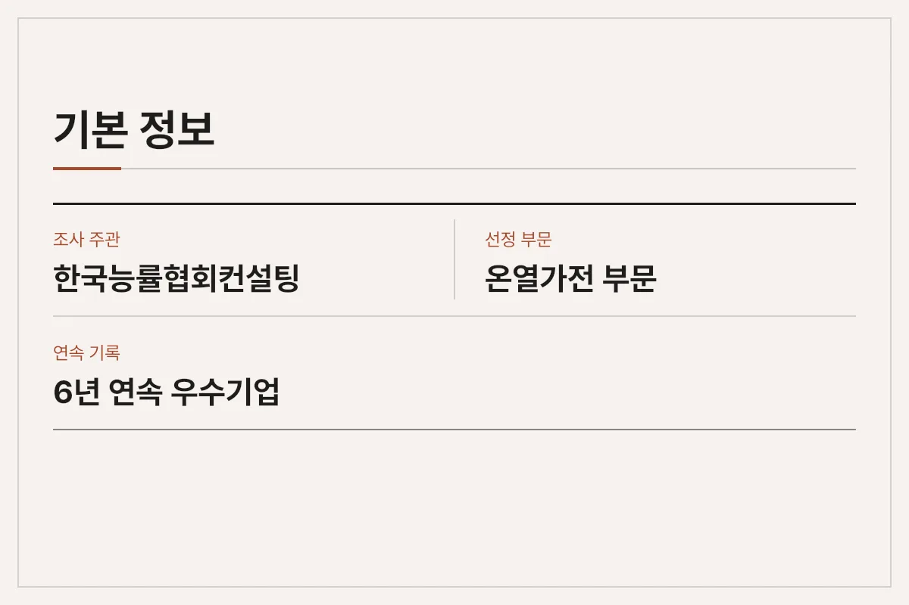

귀뚜라미가 한국능률협회컨설팅(KMAC)이 발표한 **'2026년 한국의 소비자보호지수(KCPI)'**에서 온열가전 부문 **6년 연속 우수기업**으로 선정됐습니다. 온열가전 부문 조사 기업 가운데 우수등급은 귀뚜라미가 유일했습니다(전자신문·가스신문 보도). 다만 KCPI는 **소비자 보호 품질**을 평가하는 지표라, 제품 성능 순위와는 다릅니다. 실제로 매트를 고를 때는 한국소비자원 비교시험 결과처럼 성능 자료를 함께 보는 게 좋습니다.

<figure>

<figcaption>한국능률협회컨설팅이 발표한 2026년 KCPI 온열가전 부문 선정 결과 요약</figcaption>
</figure>

## KCPI는 무엇을 평가하나

한국의 소비자보호지수(KCPI)는 기업의 **소비자 보호 품질에 대해 소비자가 체감하는 수준**을 평가하는 지표입니다. 2026년에는 국내 **40개 산업군 278개 기업**을 대상으로 조사했습니다. 귀뚜라미는 소비자 보호 관련 세부 항목에서 고른 점수를 받았다고 밝혔습니다.

즉 KCPI 우수기업이라는 건 **상담, 교환·환불, A/S 같은 소비자 보호 체계**에 대한 평가가 좋았다는 뜻입니다. 매트의 온도 성능이나 전기요금을 비교한 결과는 아닙니다.

## 귀뚜라미 카본매트, 무엇이 달라졌나

보도에 따르면 귀뚜라미는 2020년 보일러 업계 처음으로 '3세대 카본매트'를 내놨고, 올해는 **'2027년형 3세대 카본매트 AI 온돌'**을 선보였습니다.

- **AI 수면 제어 시스템:** 사용자가 선호하는 수면 온도와 사용 시간을 분석해 매트 온도를 자동 조절
- **AI 척척 온도 시스템:** 자리를 비우면 절전 운전으로 바꾸고, 돌아오면 원래 모드로 복귀
- **성능 검증:** 한국기계전기전자시험연구원(KTC)에서 수면 적정 온도 적용 정확도, 수면시간 산출 정확도, 이탈·복귀 감지 정확도 시험을 마쳤다고 밝힘

## 소비자원 시험에서 받은 결과

한국소비자원이 2025년 12월 공개한 탄소매트 10개 제품 비교시험에는 귀뚜라미 'KDM-921'도 포함됐습니다(경북매일 보도).

| 항목 | 귀뚜라미 KDM-921 | 10개 제품 범위 |
| --- | --- | --- |
| 위치별 온도 편차 | 0.4도 (가장 균일) | 0.4~10.5도 |
| 20도→35도 발열 시간 | 49분 (가장 느림) | 12~49분 |
| 머리 쪽 열선 | 없음 (베개 열 축적 방지 구조) | 4개 제품이 이 구조 |

매트 전체가 고르게 따뜻한 건 장점이지만, 데워지는 데는 시간이 오래 걸렸습니다. 자기 전에 미리 켜 두는 습관이 있다면 큰 문제가 아니지만, 바로 따뜻해지길 원한다면 발열 속도를 따져 보세요. 머리 쪽에 열선이 없는 구조이니 **머리·발 방향 표시**도 꼭 확인해야 합니다.

<figure>

<figcaption>귀뚜라미 온열가전 부문 KCPI 6년 연속 우수기업 선정의 주요 장점</figcaption>
</figure>

## 탄소매트 고를 때 볼 점

소비자원 시험 결과를 바탕으로 정리한 기준입니다. 자세한 내용은 [탄소매트 고르는 기준](/p/carbon-electric-mat-buying-guide/)에 정리했습니다.

1. **최고 온도와 취침 온도:** 제품마다 최고 표면온도가 39~64도로 달랐습니다. 잘 때는 37도 이하가 권고됩니다.
2. **온도 편차:** 위치에 따라 최대 10도 넘게 차이 나는 제품도 있었습니다.
3. **발열 속도:** 저가형은 빨리 데워지지만 얇아서 패드를 깔고 쓰는 게 좋습니다.
4. **전기요금:** 최대 온도로 하루 8시간씩 한 달 써도 2,200~4,300원 수준으로 차이가 크지 않았습니다.
5. **세탁 조건과 KC 인증:** 세탁 횟수 제한 등 조건이 제품마다 다릅니다.

## 어떤 매트든 지켜야 할 안전 수칙

브랜드와 관계없이 전기매트류는 겨울마다 사고가 반복됩니다. 세계일보가 전한 소방청 국가화재정보센터 집계에 따르면 2021~2023년 전기장판·전기난로 화재가 1,403건 발생해 21명이 숨지고 142명이 다쳤습니다. 한국소비자원이 2017~2019년 전기장판 화상 902건을 분석한 결과에서는 2도 화상이 63.1%였습니다.

- **켜기 전 점검:** 전선 피복 손상, 매트의 심한 접힘 자국이 있으면 쓰지 않기
- **라텍스 매트리스 위 사용 금지:** 열이 빠져나가지 못해 과열 위험
- **잘 때는 타이머:** 밤새 고온으로 켜 두지 않기
- **보관은 접지 않고:** 오래 접어 두면 열선이 손상되기 쉬움
- **영유아·노인·당뇨·피부질환자:** 소비자원은 탄소매트 사용을 피하라고 권고

AI 자동 온도 조절처럼 편의 기능이 있어도 이런 기본 수칙은 똑같이 지켜야 합니다.

## 자주 묻는 질문

**KCPI 우수기업이면 제품 성능도 가장 좋은가요?**

꼭 그렇지는 않습니다. KCPI는 소비자 보호 품질에 대한 체감 수준을 평가합니다. 제품 성능은 소비자원 비교시험 같은 별도 자료로 확인하세요.

**귀뚜라미 카본매트는 빨리 따뜻해지나요?**

소비자원 시험에서 KDM-921은 20도에서 35도까지 49분이 걸려 10개 제품 중 가장 느렸습니다. 대신 위치별 온도 편차는 0.4도로 가장 균일했습니다.

**머리 쪽이 안 따뜻한데 고장인가요?**

KDM-921을 포함한 일부 제품은 라텍스·메모리폼 베개에 열이 쌓이지 않도록 머리 쪽 20cm 이상에 열선을 넣지 않았습니다. 방향 표시를 확인하고 베개를 그쪽에 두세요.

**AI 온도 조절 기능이 있으면 전기요금이 줄어드나요?**

귀뚜라미는 자리를 비우면 절전 운전으로 바뀌어 불필요한 에너지 소비를 줄인다고 설명합니다. 다만 소비자원 시험에서 탄소매트의 한 달 전기요금은 최대 온도로 하루 8시간 써도 2,200~4,300원 수준이라, 절약되는 금액 자체는 크지 않을 수 있습니다. 편의와 안전 기능으로 보는 게 맞습니다.

**귀뚜라미 매트는 어디서 사고 A/S를 받나요?**

가스신문 보도에 따르면 전국 귀뚜라미보일러 대리점, 온라인 쇼핑몰, 홈쇼핑에서 판매하고, 직영몰 '귀뚜라미몰'에서 교환·A/S 안내를 제공합니다. 사기 전에 보증 기간과 A/S 방법을 확인해 두세요.

[추천 제품 확인하기](https://bitl.bz/s6ta9A)

## 참고한 자료

- [귀뚜라미, KCPI 6년 연속 우수기업 선정](https://www.etnews.com/20261119000139) — 전자신문, 2026-11-19 보도, 확인일 2026-11-26
- [귀뚜라미, 'KCPI' 6년 연속 우수기업 선정](https://www.gasnews.com/news/articleView.html?idxno=127797) — 가스신문, 2026-11-19 보도, 확인일 2026-11-26
- [작년 전기장판 그냥 쓰면 위험…3초 점검만 해도 사고 확 준다](https://www.segye.com/newsView/20251127518563) — 세계일보, 2025-11-28 보도, 확인일 2026-11-26
- [탄소전기매트 10개 제품 비교···최대온도·발열속도 '천차만별'](https://kbmaeil.com/article/20251212500134) — 경북매일, 2025-12-12 보도 (한국소비자원 발표), 확인일 2026-11-26
- 사진 일부: Pixabay (무료 이용 허가 이미지)

정보 기준일: 2026-11-26. 제품 사양과 가격은 바뀔 수 있으니 구매 전 제조사·판매처 페이지에서 다시 확인해 주세요.
