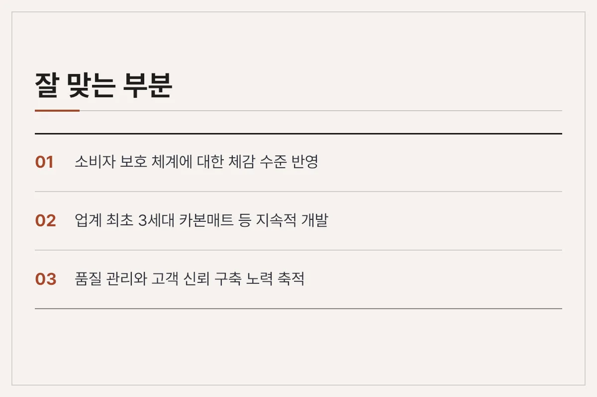
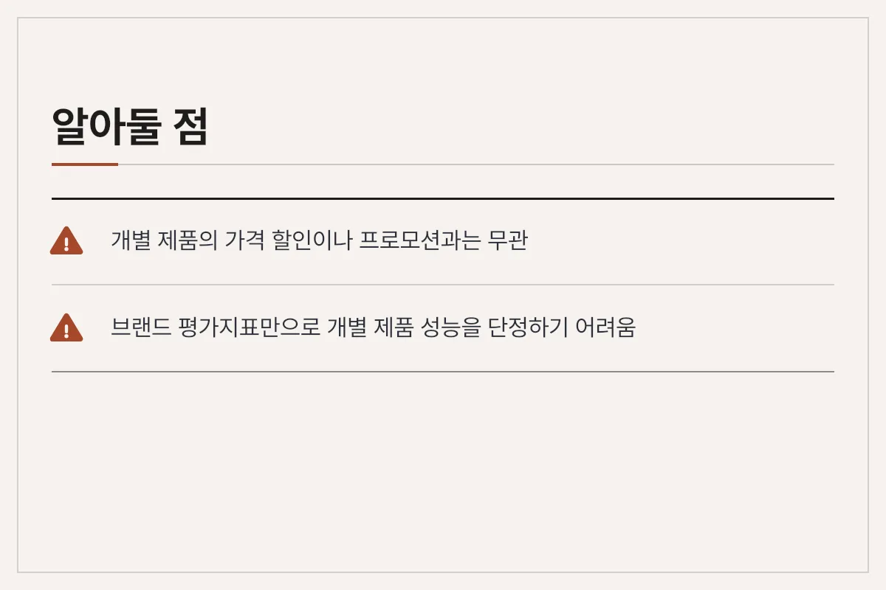
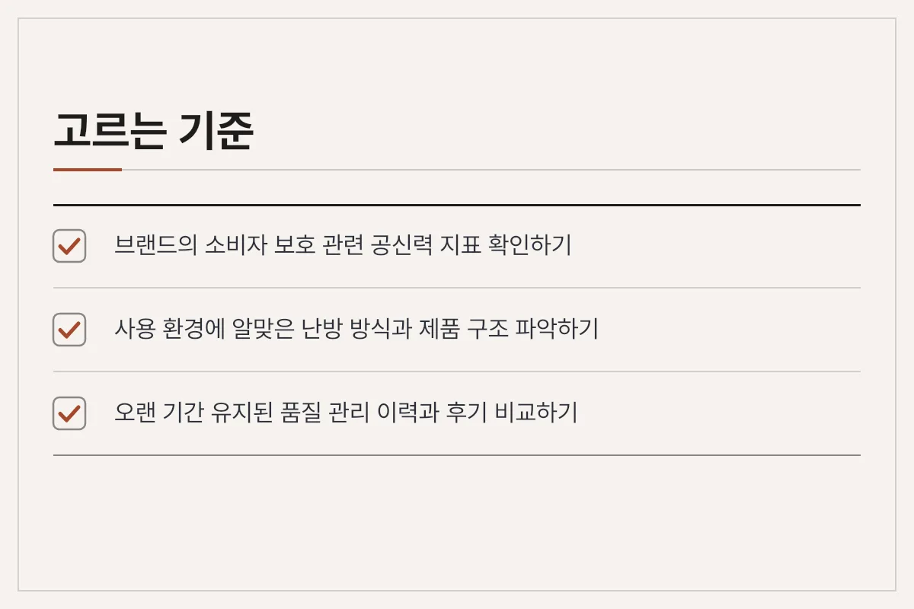
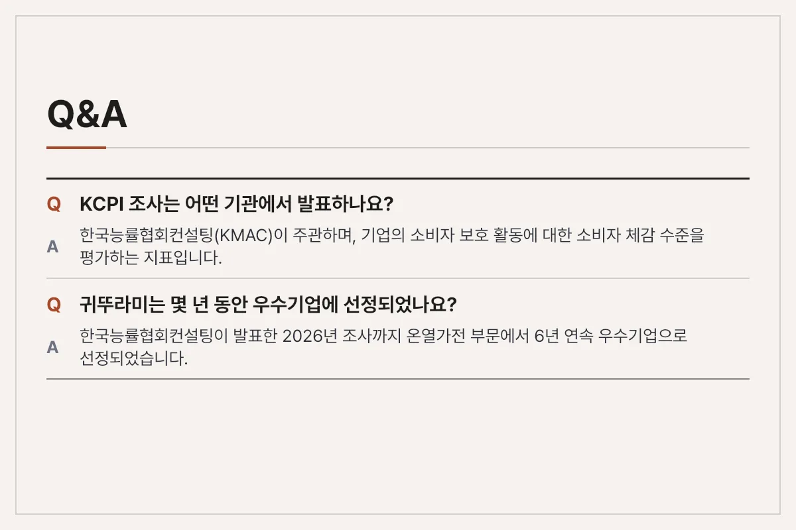
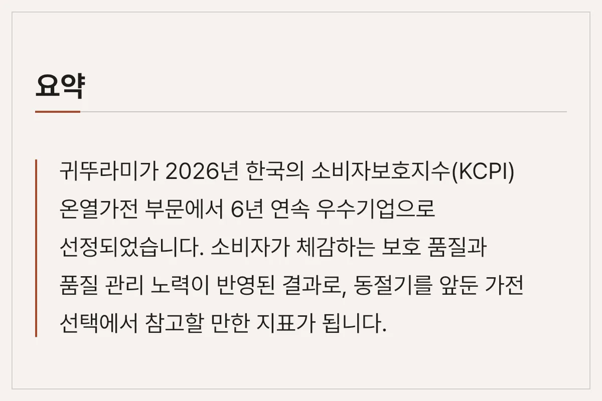

2026년 11월 21일 기준, 귀뚜라미는 한국능률협회컨설팅(KMAC)이 발표한 '2026년 한국의 소비자보호지수(KCPI)' 조사에서 온열가전 부문 6년 연속 우수기업으로 선정되었습니다. 한국금융경제신문, 헤럴드경제, 파이낸셜뉴스 등 다수의 매체 보도에 따르면 이번 평가는 기업이 제공하는 상품과 서비스에 대해 소비자들이 실제로 체감하는 보호 품질 수준을 가늠하는 지표로 활용되며, 올해는 국내 40개 산업군의 278개 기업을 대상으로 조사가 진행되었습니다.

<figure>

<figcaption>한국능률협회컨설팅이 발표한 2026년 KCPI 온열가전 부문 선정 결과 요약</figcaption>
</figure>

## 한국의 소비자보호지수 평가 방식과 의미

한국능률협회컨설팅이 주관하는 KCPI는 기업이 제품을 생산하고 유통하는 과정에서 소비자의 권익을 보호하기 위해 어떤 시스템을 갖추고 있는지 종합적으로 들여다봅니다. 단순한 매출 규모나 인지도 평가를 넘어, 소비자가 일상 속에서 체감하는 신뢰도와 사후 관리의 완성도에 무게를 두는 것이 특징입니다. 메트로소울 등의 보도 내용을 살펴보면, 귀뚜라미는 업계 최초로 3세대 카본매트를 선보이는 등 시장의 변화에 발맞춘 제품 라인업을 구축해 왔습니다. 이러한 기술적 시도가 소비자 보호 품질 평가에서도 긍정적인 요인으로 작용했을 거라는 분석이 나옵니다.

<figure>

<figcaption>귀뚜라미 온열가전 부문 KCPI 6년 연속 우수기업 선정의 주요 장점</figcaption>
</figure>

## 6년 연속 선정 배경에 담긴 품질 관리의 흐름

기업이 특정 부문에서 수년 동안 연속으로 우수기업 타이틀을 유지하는 일은 단기간의 마케팅이나 일회성 이벤트만으로는 달성하기 어렵습니다. 전자신문과 아시아경제 등의 보도에 따르면, 귀뚜라미는 제조 공정 전반의 품질 관리와 고객 지원 부문에서 꾸준한 점검을 이어왔습니다. 특히 겨울철에 수요가 집중되는 온열가전의 특성상 제품의 내구성과 안전성은 소비자 만족도를 좌우하는 핵심 요소입니다. 6년이라는 기간 동안 이름이 오르내린 배경에는 사후 관리 체계와 소비자의 피드백을 제품 개선에 반영하려는 노력이 뒷받침되어 있었다고 볼 수 있습니다.

<figure>

<figcaption>소비자보호지수 선정 결과와 온열가전 선택 시 참고할 주의사항</figcaption>
</figure>

## 온열가전 구매 시 고려해야 할 실질적인 기준

객관적인 지표가 브랜드 선택의 든든한 나침반이 되어주기는 하지만, 개별 제품을 고를 때는 각 가정의 생활 패턴과 주거 환경을 세밀하게 따져보아야 합니다. 가스신문 등의 보도에서 다룬 바와 같이 대외적인 평가 지표는 기업의 전반적인 소비자 보호 역량을 보여주므로 안심하고 접근할 수 있는 근거가 되지만, 실제 설치할 공간의 면적이나 전력 소비량, 매트의 소재나 조작 방식 등은 소비자가 직접 비교해야 할 부분입니다. 브랜드의 공신력과 개별 제품의 스펙을 균형 있게 저울질하는 지혜가 필요한 이유입니다.

<figure>

<figcaption>귀뚜라미 온열가전 및 소비자보호지수 우수기업 관련 구매 전 확인 기준</figcaption>
</figure>

## 동절기 난방 가전 시장의 변화와 전망

매년 찬바람이 불어오는 시기가 되면 다양한 온열가전이 시장에 선보이며 소비자의 선택을 기다립니다. 소비자뉴스 등의 보도에서 언급된 것처럼 기업들은 단순히 온도를 높이는 기능을 넘어, 사용자의 안전을 지키고 에너지를 효율적으로 관리할 수 있는 기술을 속속 도입하고 있습니다. 귀뚜라미가 이번 조사에서 온열가전 부문 우수기업으로 이름을 올린 것도 이러한 시장의 흐름 속에서 소비자의 신뢰를 꾸준히 다져온 결과물로 풀이됩니다. 앞으로도 가전 시장에서는 소비자의 목소리에 얼마나 귀를 기울이는지가 브랜드의 지속 가능성을 결정짓는 중요한 잣대가 될 전망입니다.

<figure>

<figcaption>2026년 귀뚜라미 KCPI 6년 연속 우수기업 선정과 관련된 자주 묻는 질문</figcaption>
</figure>

이번 KCPI 선정 소식은 기업의 대외적인 성과를 보여주는 지표인 동시에, 소비자들이 어떤 기준으로 가전제품을 선택하고 신뢰를 보내는지 보여주는 단면입니다. 쌀쌀해지는 날씨 속에서 난방 기구를 새로 들일 계획이라면, 이와 같은 공신력 있는 평가 결과와 제품별 특성을 꼼꼼히 비교해 보고 현명한 결정을 내리시기를 바랍니다.

<figure>

<figcaption>2026년 11월 기준 귀뚜라미의 한국의 소비자보호지수 온열가전 부문 6년 연속 우수기업 선정 요약</figcaption>
</figure>

[추천 제품 확인하기](https://bitl.bz/s6ta9A)

## 참고한 자료

- [귀뚜라미, KCPI 온열가전 부문 6년 연속 우수등급](https://www.kfenews.co.kr/news/articleView.html?idxno=668488) — kfenews.co.kr, 2026-11-20 보도
- [귀뚜라미 ‘소비자보호지수’ 6년 연속 우수기업](https://biz.heraldcorp.com/article/10943929?ref=naver) — biz.heraldcorp.com, 2026-11-20 보도
- [귀뚜라미, 'KCPI' 6년 연속 우수기업 선정](https://www.gasnews.com/news/articleView.html?idxno=127797) — gasnews.com, 2026-11-19 보도
- [귀뚜라미, 한국의 소비자보호지수 6년 연속 우수기업 선정](https://biz.heraldcorp.com/article/10942383?ref=naver) — biz.heraldcorp.com, 2026-11-19 보도
- [귀뚜라미, KCPI 6년 연속 우수기업 선정](https://www.etnews.com/20261119000139) — etnews.com, 2026-11-19 보도
- [귀뚜라미, 6년 연속 '한국의 소비자보호지수' 우수기업 선정](https://view.asiae.co.kr/article/2026111910072256439) — view.asiae.co.kr, 2026-11-19 보도

2026년 11월 21일 기준 내용입니다. 가격과 사양은 판매처와 시기에 따라 달라질 수 있으니 구매 전에 판매 페이지에서 다시 확인해 주세요.
