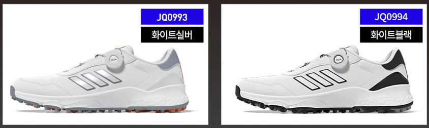
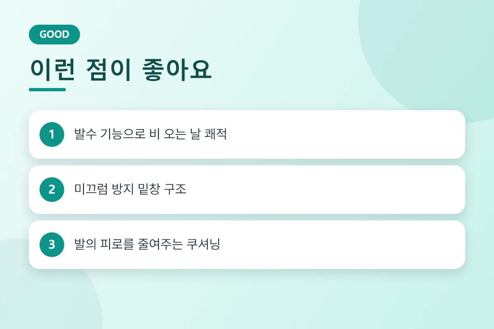
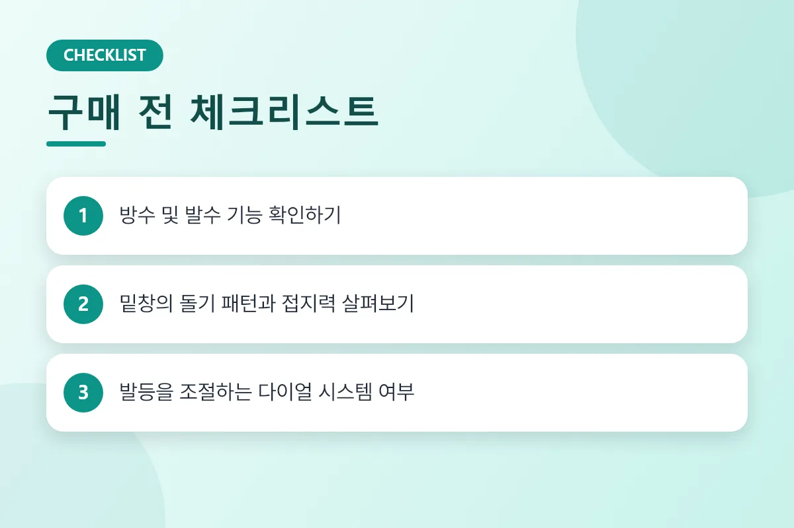
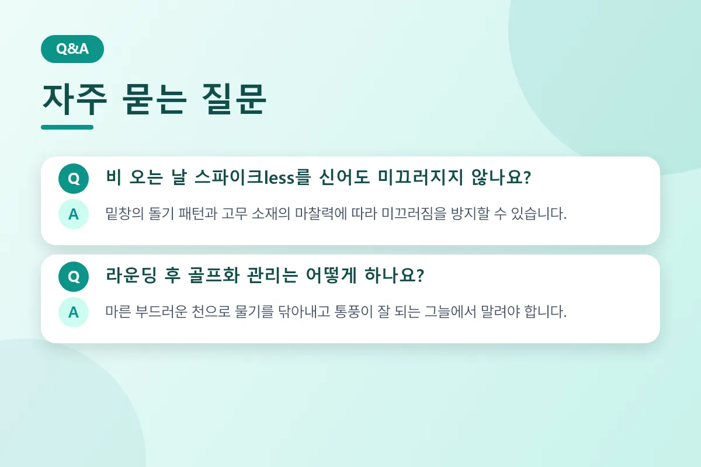
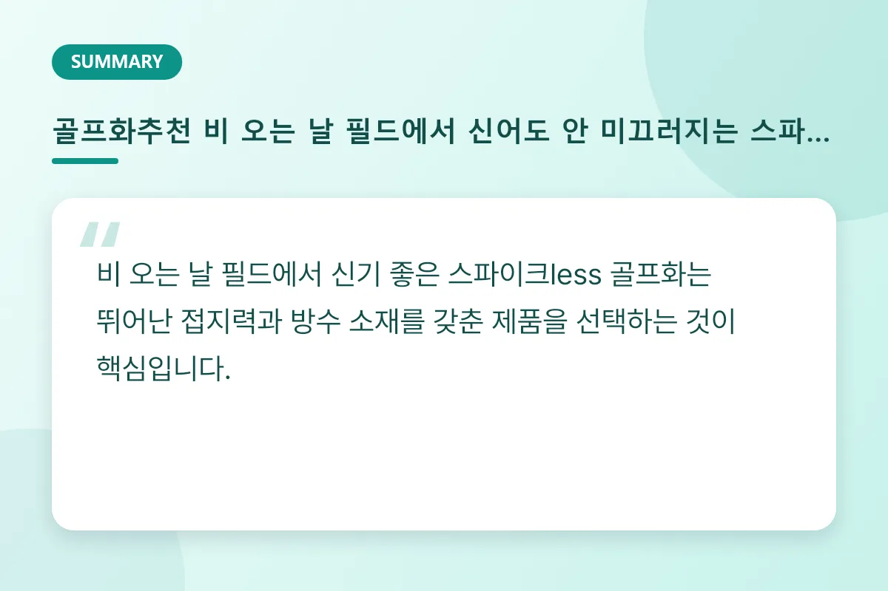

비 오는 날 라운딩을 앞두고 미끄러질까 걱정하는 골퍼분들이 많습니다. 스파이크less 골프화 중에서도 방수 기능이 뛰어나고 밑창 접지력이 우수한 제품을 선택한다면 빗길 필드에서도 안정적인 스윙이 가능합니다.

<figure>

<figcaption>다양한 컬러와 접지력을 갖춘 스파이크less 골프화 모델 (사진: https://bitl.bz/DhpRoy)</figcaption>
</figure>

## 비 오는 날 스파이크less 골프화를 골라야 하는 이유

전통적인 스파이크 골프화는 잔디를 깊게 파고들어 접지력을 높이지만, 빗길이나 진흙이 낀 환경에서는 오히려 불편함을 줄 수 있습니다. 반면 현대의 고성능 스파이크less 골프화는 바닥면에 특수 고무 돌기와 홈 패턴을 적용하여 평지와 경사면 모두에서 우수한 마찰력을 발휘합니다. 

특히 방수 코팅이나 고기능성 방수 멤브레인을 적용한 제품은 빗물이 신발 내부로 스며드는 것을 막아주어 장시간의 라운딩에도 발을 쾌적하게 유지해 줍니다. 갑작스러운 소나기나 이슬이 맺힌 이른 아침 라운딩에서도 발의 찝찝함을 최소화할 수 있습니다.

<figure>

<figcaption>방수 기능과 접지력의 장단점을 한눈에 보여주는 인포그래픽 카드</figcaption>
</figure>

## 빗길 라운딩을 위한 골프화 선택 핵심 기준

1. **방수 및 발수 코팅 여부**: 갑피 소재가 방수 처리가 되어 있는지, 물방울이 스며들지 않고 흘러내리는지 확인해야 합니다.
2. **밑창 접지력(Traction)**: 고무 돌기의 높낮이와 다방향 패턴이 복합적으로 설계되어 미끄러짐을 효과적으로 분산하는지 살펴봅니다.
3. **편리한 피팅 시스템**: 젖은 손으로도 쉽게 조이고 풀 수 있는 다이얼 조절 시스템이 적용된 제품이 실사용 시 매우 편리합니다.

<figure>

<figcaption>방수, 접지력, 피팅 시스템을 점검하는 구매 가이드 카드</figcaption>
</figure>

## 비교 및 스펙 확인

| 구분 | 스파이크 골프화 | 스파이크less 골프화 |
| :--- | :--- | :--- |
| **접지력** | 잔디 파고드는 고정력 우수 | 다방향 돌기를 통한 면 접지력 |
| **착화감** | 단단하고 묵직한 느낌 | 일상화처럼 가볍고 편안함 |
| **활용도** | 필드 전용 | 필드 및 연습실 겸용 가능 |
| **관리 편의성** | 스파이크 징 교체 및 청소 필요 | 물기 닦아내기 등 관리 용이 |

<figure>

<figcaption>비 오는 날 골프화 관리법과 미끄러짐에 대한 궁금증을 해결하는 FAQ 카드</figcaption>
</figure>

## 자주 묻는 질문 (FAQ)

**비 오는 날 스파이크less를 신어도 정말 안 미끄러지나요?**

밑창의 돌기 패턴과 고무 소재의 마찰력이 우수한 제품을 선택하면 빗길에서도 충분한 접지력을 유지할 수 있습니다. 다만 잔디가 매우 진흙탕인 환경에서는 주의가 필요합니다.

**라운딩 후 젖은 골프화는 어떻게 관리해야 하나요?**

라운딩 직후 마른 천으로 외부의 물기와 이물질을 닦아내고, 신발 안쪽에 신문지나 제습제를 넣어 통풍이 잘 되는 그늘에서 자연 건조하는 것이 좋습니다.

**평소 신는 사이즈로 구매하면 되나요?**

브랜드와 디자인에 따라 발볼 너비가 다를 수 있으므로, 두꺼운 골프 양말을 신는 것을 고려해 여유를 두거나 매장 실착 후 구매하는 것을 권장합니다.

<figure>

<figcaption>방수와 접지력을 모두 갖춘 스파이크less 골프화 선택의 핵심을 요약한 카드</figcaption>
</figure>

## 마무리 및 추천 제품 안내

비 오는 날의 라운딩은 장비의 선택에 따라 스코어와 피로도가 크게 달라질 수 있습니다. 완벽한 방수 기능과 미끄럼 방지 밑창을 갖춘 스파이크less 골프화로 언제나 쾌적하고 안정적인 스윙을 완성해 보시길 바랍니다. 

추천 제품은 아래 링크에 걸어 두겠습니다.

#골프화추천 #스파이크less골프화 #골프화방수 #빗길골프화 #골프장비 #골프웨어 #라운딩준비물 #골프화고르는법 #스포츠화 #골프용품

[추천 제품 확인하기](https://bitl.bz/DhpRoy)

최종 확인일: 2026-11-09. 가격과 사양은 판매처와 시기에 따라 달라질 수 있으니 구매 전 공식 판매 페이지에서 다시 확인하세요.
