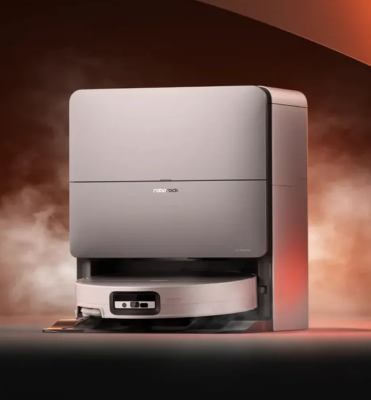

로보락이 2026년 상반기 국내 가정용 **진공 물걸레 청소기** 시장에서 소매판매액 기준 점유율 **14.3%**로 1위를 기록했습니다. 글로벌 시장조사기관 유로모니터 인터내셔널 조사이며, 같은 기간 국내 시장 전체 소매판매액은 **1,488억 원**이었습니다(블로터 보도). 로봇청소기에 이어 진공 물걸레 청소기에서도 판매액 1위를 한 셈입니다. 다만 **많이 팔렸다는 것과 우리 집에 맞는 제품이라는 건 다른 문제**이니, 아래 기준으로 함께 따져 보세요.

<figure>

<figcaption>로보락의 주요 청소가전 제품 및 도킹 스테이션 외형 (사진: https://kr.roborock.com/?utm_source=naver&amp;utm_medium=cpc&amp;utm)</figcaption>
</figure>

## 진공 물걸레 청소기란

먼지를 빨아들이면서 동시에 물걸레로 바닥을 닦는 청소기입니다. 따로 청소기를 돌리고 걸레질을 할 필요가 없어, 바닥 청소를 한 번에 끝내고 싶은 집에서 많이 찾습니다. 스탠드(거치대)에서 물걸레를 자동으로 세척하는 제품도 많습니다.

## 로보락 F25 시리즈의 특징

블로터가 전한 로보락의 대표 제품군 특징입니다.

- **F25 시리즈:** 먼지 흡입과 물걸레 청소를 함께 하고, 청소가 끝나면 물걸레를 자동으로 세척
- **조스크래퍼(JawScrapers):** 청소 중 머리카락이 엉키는 현상을 줄이고, 바닥에 물기가 남지 않도록 돕는 기술
- **F25 울트라:** 최대 **150℃ 고온 스팀**과 **86℃ 온수**로 눌어붙은 오염을 닦고, 청소 후 **90℃ 고온수**로 물걸레를 세척
- **F25 울트라 스팀 젠 2:** 스팀 분사 기술 '베이퍼플로 2.0' 적용 (2026년 10월 출시)
- **H60 시리즈:** 무선 진공청소기 라인업

## 판매 1위와 성능 1위는 다르다

점유율은 **얼마나 많이 팔렸는지**를 보여 줄 뿐, 청소 성능을 비교한 결과는 아닙니다. 특히 흡입력 숫자는 표시 단위부터 확인해야 합니다.

한국소비자원이 2025년 9월 무선청소기 10개 제품의 최대 흡입력을 시험한 결과(파이낸셜뉴스·뉴스1 보도), 흡입력을 **파스칼(Pa)**로 표시한 6개 제품의 실제 최대 흡입력은 **58~160W**였습니다. Pa는 진공도 단위라 흡입력과 직접 관련이 없습니다. 이 시험에서 로보락 무선청소기 제품은 **2만 5,000Pa로 표시했지만 실제 흡입력은 72W**였고, W·AW로 표시한 삼성전자, LG전자, 다이슨 제품은 280W·AW를 충족했습니다. 이 시험은 진공 물걸레 청소기가 아닌 무선청소기 대상이지만, **Pa 숫자만 보고 고르면 안 된다**는 점은 같습니다.

소비자원은 수입업체들에 흡입력 표시 개선을 권고했고, 국가기술표준원은 흡입력을 W로 통일해 비교할 수 있는 국가표준(KS)을 만들 계획입니다.

## 진공 물걸레 청소기 고를 때 확인할 것

1. **흡입력 단위:** W 또는 AW로 표시됐는지. Pa만 적혀 있다면 다른 제품과 직접 비교하기 어렵습니다.
2. **물걸레 세척·건조 방식:** 스탠드에서 자동으로 세척하는지, 건조까지 해 주는지. 젖은 채 두면 냄새가 날 수 있습니다.
3. **물통 크기와 오수통 관리:** 깨끗한 물과 더러운 물을 얼마나 자주 갈아야 하는지
4. **무게와 크기:** 물통이 달린 만큼 일반 무선청소기보다 무거운 경우가 많습니다.
5. **바닥 종류:** 원목 마루는 물이나 스팀에 약할 수 있으니 바닥재 관리 방법을 먼저 확인하세요.
6. **소모품과 A/S:** 브러시·필터 교체 비용과 국내 A/S망

## 로봇청소기와 진공 물걸레 청소기, 뭘 살까

로보락은 두 시장에서 모두 판매액 1위라 어떤 걸 살지 고민되는 분이 많습니다. 쓰는 방식이 다르니 집 상황에 맞춰 고르세요.

| 구분 | 로봇청소기 | 진공 물걸레 청소기 |
| --- | --- | --- |
| 청소 방식 | 알아서 돌아다니며 청소 | 사람이 직접 밀면서 청소 |
| 잘 맞는 집 | 바닥에 물건이 적고, 매일 자동으로 돌리고 싶은 집 | 얼룩·찌든 때를 직접 닦고 싶은 집 |
| 약한 부분 | 가구 아래·구석, 바닥에 놓인 물건 | 매번 직접 해야 하는 수고 |

이미 로봇청소기가 있다면, 진공 물걸레 청소기는 **로봇이 놓치는 얼룩과 부엌·현관 바닥**을 보완하는 용도로 생각하면 좋습니다.

## 오래 쓰려면 이렇게 관리하세요

- **오수통은 매번 비우기:** 더러운 물을 오래 두면 냄새와 세균이 생깁니다.
- **물걸레 롤러 말리기:** 자동 건조가 없으면 분리해서 완전히 말려 주세요.
- **브러시에 감긴 머리카락 제거:** 엉킴 방지 기술이 있어도 긴 머리카락은 주기적으로 확인하세요.
- **세정제는 정해진 것만:** 제조사가 권장하지 않는 세정제를 넣으면 고장의 원인이 될 수 있습니다.
- **고온 스팀 사용 시:** 스팀 기능이 있는 제품은 바닥재가 열에 약하지 않은지 먼저 확인하세요.

## 자주 묻는 질문

**로보락이 진공 물걸레 청소기 시장에서도 1위인가요?**

유로모니터 조사 기준 2026년 상반기 국내 가정용 진공 물걸레 청소기 시장에서 소매판매액 점유율 14.3%로 1위를 기록했습니다.

**국내 진공 물걸레 청소기 시장은 얼마나 큰가요?**

같은 기간 국내 시장 전체 소매판매액은 약 1,488억 원이었습니다.

**점유율 1위 제품이면 성능도 가장 좋은가요?**

점유율은 판매액 기준이라 성능과는 별개입니다. 흡입력 표시 단위(Pa와 W)와 물걸레 세척 방식, 무게, A/S 등을 직접 비교해 보세요.

**흡입력이 Pa로만 적혀 있으면 어떻게 하나요?**

Pa는 진공도 단위라 흡입력을 직접 보여 주지 않습니다. 한국소비자원 시험에서 Pa로 표시한 무선청소기의 실제 흡입력은 58~160W로, W로 표시한 일부 제품(280W)보다 낮았습니다. 판매처나 제조사에 W 기준 흡입력을 문의하거나, W로 표시된 제품과 비교하세요.

**F25 울트라의 고온 스팀은 어떤 바닥에 써도 되나요?**

블로터 보도에 따르면 최대 150℃ 스팀으로 눌어붙은 오염을 닦도록 설계됐습니다. 바닥재마다 열과 수분에 약할 수 있으니, 쓰기 전에 제품 설명서와 바닥재 관리 방법을 함께 확인하세요.

[추천 제품 확인하기](https://bitl.bz/Kl0u7G)

## 참고한 자료

- [로봇청소기 선두 로보락, 진공 물걸레도 1위…점유율 14.3%](https://www.bloter.net/news/articleView.html?idxno=678979) — 블로터, 2026-11-18 보도, 확인일 2026-11-26
- [로보락·샤오미 등 무선청소기 흡입력 'Pa 단위' 표시 제품 성능 낮아](https://www.fnnews.com/news/202509181102062667) — 파이낸셜뉴스(뉴스1), 2025-09-18 보도 (한국소비자원 시험), 확인일 2026-11-26
- 사진 일부: Pixabay (무료 이용 허가 이미지)

정보 기준일: 2026-11-26. 제품 사양과 가격은 바뀔 수 있으니 구매 전 제조사·판매처 페이지에서 다시 확인해 주세요.
