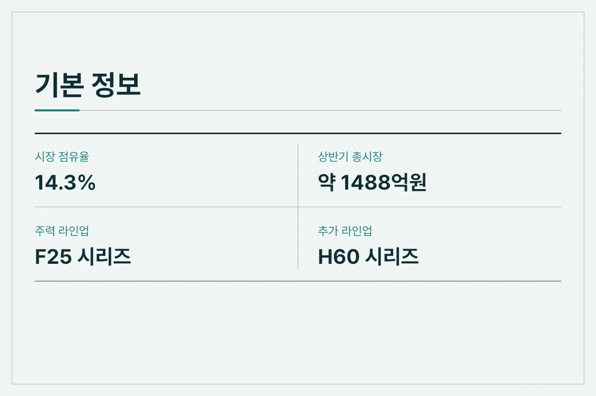
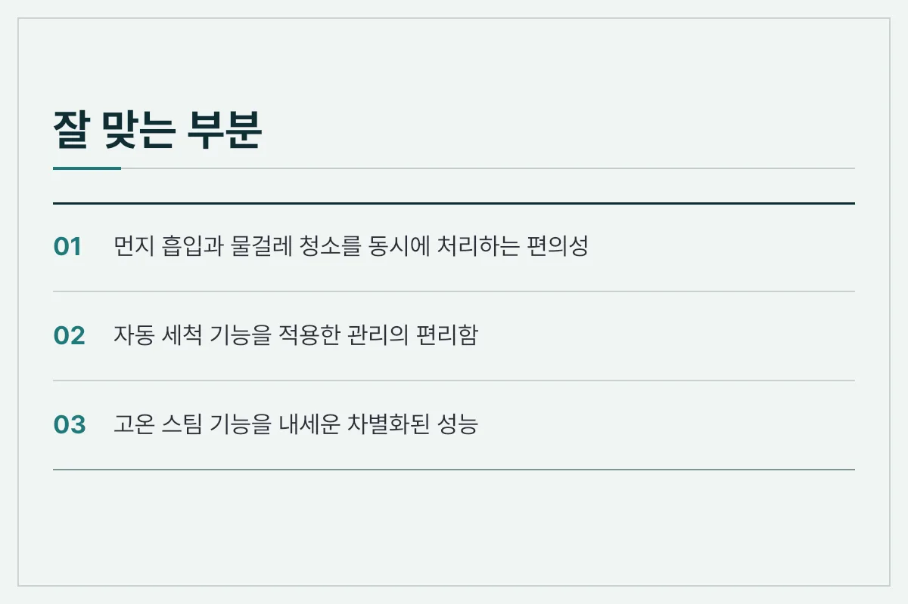
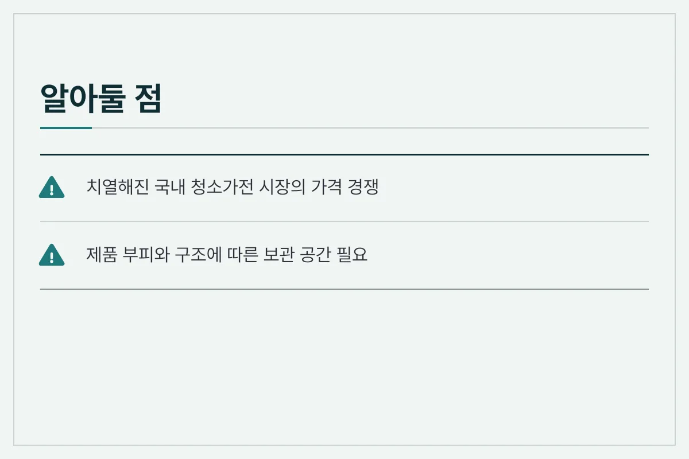
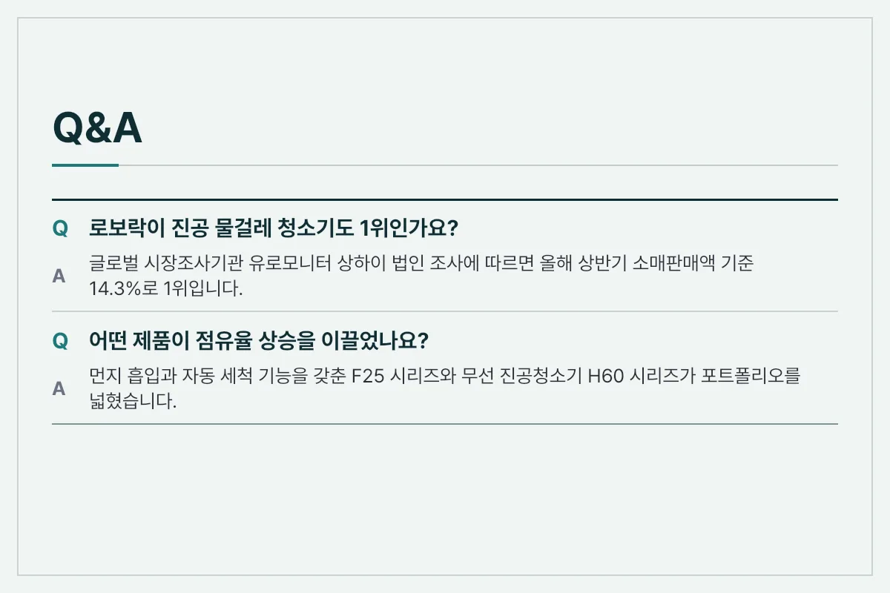
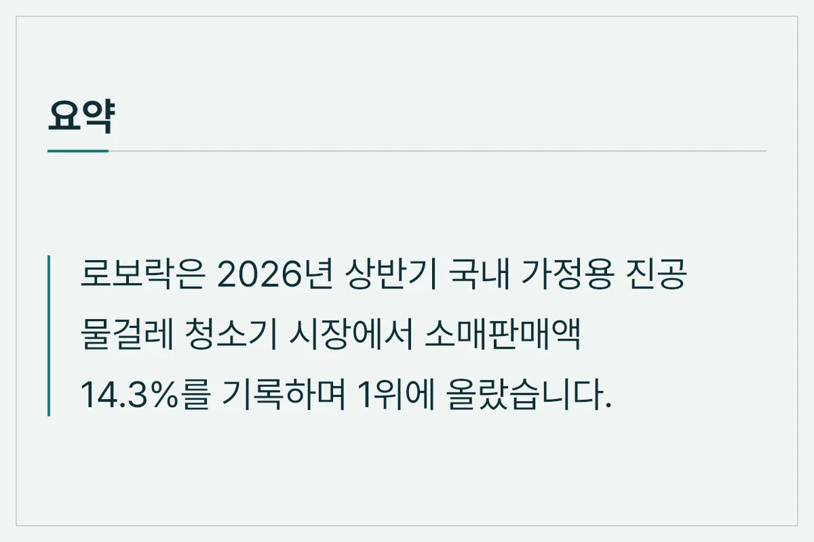

2026년 11월 19일 기준, 로보락이 국내 가정용 진공 물걸레 청소기 시장에서 소매판매액 기준 점유율 1위를 차지하며 청소가전 강자로서의 입지를 확고히 다지고 있습니다. 글로벌 시장조사기관 유로모니터 인터내셔널의 상하이 법인 조사에 따르면, 로보락은 올해 상반기 국내 진공 물걸레 청소기 시장에서 14.3%의 점유율을 기록했습니다. 

<figure>

<figcaption>로보락의 주요 청소가전 제품 및 도킹 스테이션 외형 (사진: https://kr.roborock.com/?utm_source=naver&amp;utm_medium=cpc&amp;utm)</figcaption>
</figure>

## 로보락이 진공 물걸레 청소기 시장 점유율 1위에 오른 배경

연합뉴스 및 블로터 등 주요 매체 보도에 따르면, 로보락은 이미 로봇청소기 분야에서 선두 자리를 선점한 데 이어 진공 물걸레 청소기 부문에서도 정상에 올랐습니다. 올해 상반기 국내 진공 물걸레 청소기 시장의 전체 소매판매액은 약 1,488억 원으로 집계되었습니다. 이 거대한 시장에서 로보락은 주력 제품군을 앞세워 소비자의 선택을 이끌어냈습니다.

로봇청소기로 다져진 기술력과 브랜드 인지도가 일반 가정용 청소가전 영역까지 확장된 결과입니다. 조선일보 보도에 따르면 로보락 관계자는 로봇청소기에 이어 진공 물걸레 청소기에서도 성과를 거두었다고 밝혔습니다. 소비자들이 청소 편의성을 중시하는 트렌드에 발맞추어 고온 스팀 기능을 탑재한 신제품을 꾸준히 선보인 점도 주요 요인으로 꼽힙니다.

<figure>

<figcaption>로보락 상반기 시장 점유율 지표</figcaption>
</figure>

## 주요 제품 포트폴리오 다각화와 기술적 특징

로보락은 단순히 한 가지 제품군에 머무르지 않고 다양한 청소가전으로 라인업을 넓히고 있습니다. 아시아경제 보도에 따르면 로보락은 로봇청소기 외에도 진공 물걸레 청소기 'F25 시리즈', 무선 진공청소기 'H60 시리즈' 등을 판매하고 있습니다.

<figure>

<figcaption>로보락 청소가전 장점 분석</figcaption>
</figure>

이 중에서도 F25 시리즈는 먼지 흡입과 물걸레 청소는 물론 자동 세척 기능까지 갖추어 사용자의 편의를 극대화했습니다. 민주신문 보도에 따르면 올해 출시된 F25 시리즈를 비롯한 주력 제품들이 시장에서 좋은 반응을 얻으면서 전체 점유율 상승을 견인했습니다. 무선 진공청소기 H60 시리즈 역시 포트폴리오 다각화에 기여하며 국내 청소가전 시장 전반에서의 경쟁력을 높이는 중입니다.

<figure>

<figcaption>로보락 청소가전 주의점 분석</figcaption>
</figure>

## 국내 청소가전 시장의 변화와 향후 전망

디지털조선일보 보도에 따르면 로보락은 로봇청소기 시장에서의 성공을 바탕으로 일반 가정용 청소가전으로 제품군을 점차 확대하는 전략을 취하고 있습니다. 유로모니터 조사 결과로 입증된 14.3%라는 점유율은 단발성 성과가 아니라 다각화된 제품 포트폴리오가 시장에서 통하고 있음을 보여줍니다.

<figure>

<figcaption>로보락 시장 1위 관련 FAQ</figcaption>
</figure>

다만 전체 청소가전 시장의 경쟁이 치열해지고 있는 만큼, 소비자들이 실제 사용 환경에서 체감할 수 있는 성능과 사후 관리가 더욱 중요해지고 있습니다. 이뉴스24 등의 보도를 보면 로보락은 고온 스팀 기능을 전면에 내세운 신제품을 잇달아 선보이며 기술적 차별화를 시도하고 있습니다. 앞으로도 이러한 제품 혁신이 지속될지 여부가 시장 지위 유지의 관건이 될 것입니다.

<figure>

<figcaption>로보락 진공 물걸레 청소기 시장 1위 요약</figcaption>
</figure>

## 자주 묻는 질문

**로보락이 진공 물걸레 청소기 시장에서도 1위를 차지했나요?**

글로벌 시장조사기관 유로모니터 인터내셔널의 상하이 법인 조사 결과, 로보락은 올해 상반기 국내 가정용 진공 물걸레 청소기 시장에서 소매판매액 기준 14.3%의 점유율을 기록했습니다.

**어떤 제품들이 시장 1위를 견인했나요?**

먼지 흡입과 물걸레 청소, 자동 세척 기능을 갖춘 F25 시리즈와 무선 진공청소기 H60 시리즈 등 다양한 청소가전 포트폴리오가 함께 기여했습니다.

**국내 해당 시장의 전체 규모는 어느 정도인가요?**

올해 상반기 국내 진공 물걸레 청소기 시장의 전체 소매판매액은 약 1,488억 원으로 집계되었습니다.

아래 추천 제품 링크를 통해 자세한 정보를 확인하고 구매해 보세요.

[로보락 진공 물걸레 청소기 추천 제품 확인하기](https://example.com/roborock-vacuum-recommended)

[추천 제품 확인하기](https://bitl.bz/Kl0u7G)

## 참고한 자료

- [로보락, 상반기 국내 진공 물걸레 청소기 시장 '1위'](https://www.news1.kr/industry/general-industry/6358485) — 뉴스1, 2026-11-18 보도
- [로봇청소기 선두 로보락, 진공 물걸레도 1위…점유율 14.3%](https://www.bloter.net/news/articleView.html?idxno=678979) — bloter.net, 2026-11-18 보도
- [로보락, 상반기 국내 진공 물걸레 청소기 시장 1위](https://www.yna.co.kr/view/AKR20261118040700003?input=1195m) — 연합뉴스, 2026-11-18 보도
- [로보락, 국내 진공 물걸레 청소기 시장 1위…상반기 점유율 14.3%](http://digitalchosun.dizzo.com/site/data/html_dir/2026/11/18/2026111880186.html) — digitalchosun.dizzo.com, 2026-11-18 보도
- [민주 유통가 SK인텔릭스·로보락·세라젬](http://www.iminju.net/news/articleView.html?idxno=172653) — iminju.net, 2026-11-18 보도
- [로보락, 국내 진공 물걸레 청소기 시장 1위 기록](http://www.inews24.com/view/2027796) — inews24.com, 2026-11-18 보도

2026년 11월 19일 기준 내용입니다. 가격과 사양은 판매처와 시기에 따라 달라질 수 있으니 구매 전에 판매 페이지에서 다시 확인해 주세요.
