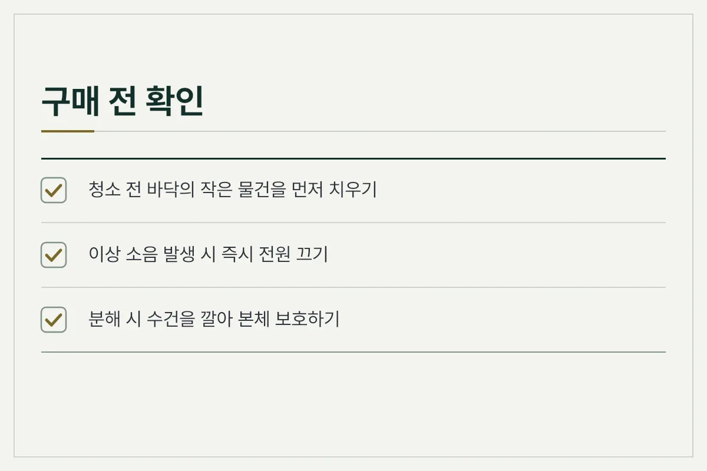
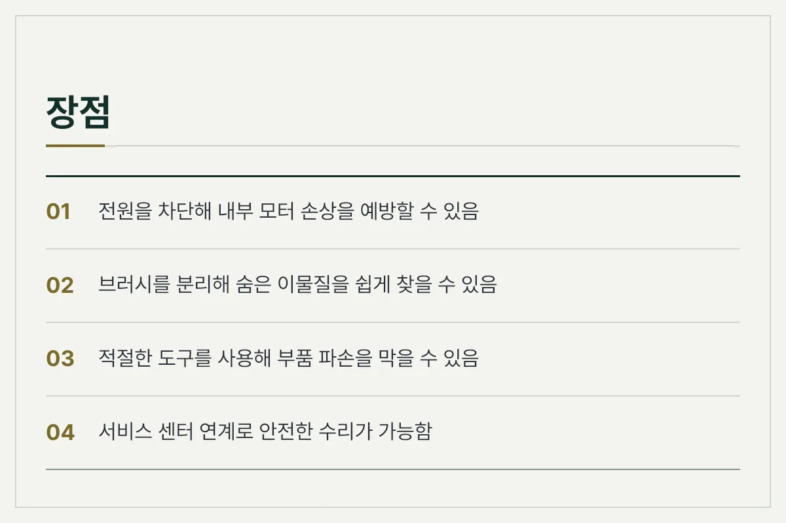
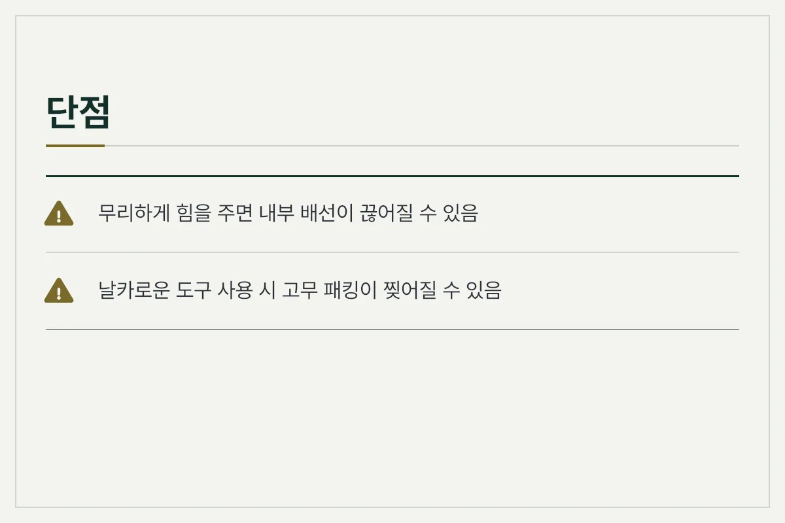
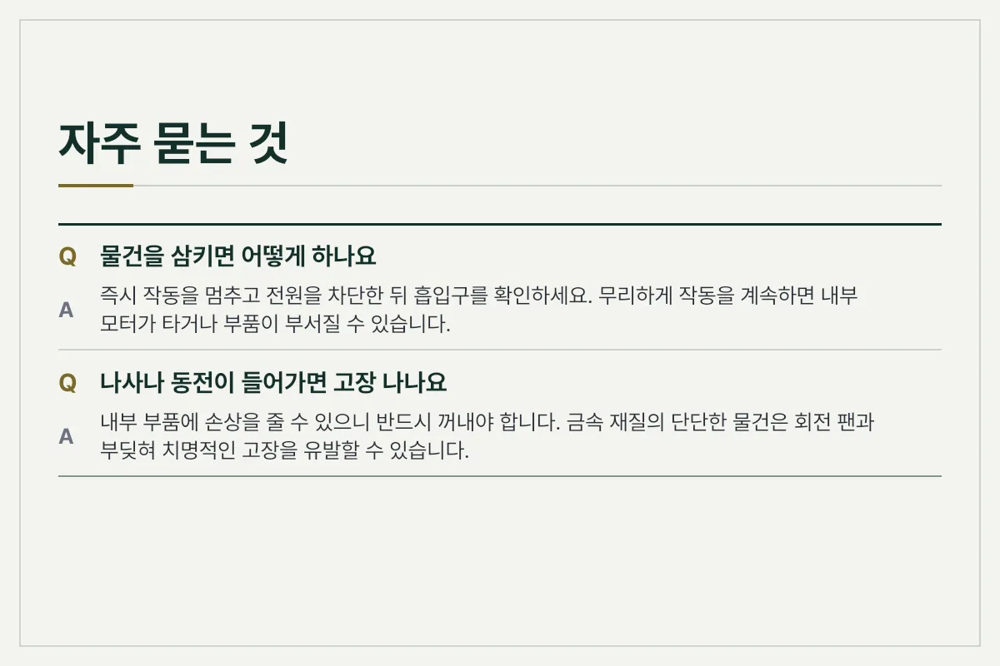

로봇청소기가 작동 중에 동전, 머리핀, 종이 클립 같은 작은 물건을 빨아들였을 때 기기를 고장 내지 않고 안전하게 꺼내는 요령을 알아봅니다. 2026년 11월 20일 기준, 로봇청소기 사용 중 이물질 흡입으로 인한 내부 모터 손상을 막으려면 전원을 완전히 차단한 상태에서 브러시와 흡입구 구조를 정확히 파악하고 대처하는 것이 중요합니다. 

무단으로 이물질을 빼내려 하거나 전원이 켜진 채로 작업을 진행하면 기기 내부의 팬이나 회로에 영구적인 손상이 발생할 수 있습니다. 작은 물건 하나가 기기 전체의 수명을 단축할 수 있으므로 침착하고 올바른 순서대로 이물질을 제거해야 하며, 평소 청소 전 주변 정리를 철저히 하는 습관이 기기 수명을 연장하는 지름길이 됩니다.

<figure>

<figcaption>로봇청소기 이물질 제거 전 필수 확인 사항</figcaption>
</figure>

## 전원 차단과 본체 안전 확보의 중요성

로봇청소기 내부로 이물질이 들어간 소리가 들리거나 기기가 갑자기 이상한 소음을 낼 때는 가장 먼저 청소기 작동을 멈추고 전원을 완전히 꺼야 합니다. 충전 독에 대기 중인 상태라 하더라도 전원 버튼을 길게 눌러 시스템을 완전히 종료하거나 바닥면의 전원 스위치를 내려야 감전이나 모터 오작동을 예방할 수 있습니다. 

본체를 뒤집어 바닥면을 확인할 때는 평평하고 깨끗한 바닥에 수건이나 매트를 깔아 센서나 카메라가 긁히지 않도록 보호해야 합니다. 전원이 켜진 상태에서 본체를 무리하게 뒤집으면 바닥면의 추락 방지 센서가 오작동하여 브러시가 갑자기 회전할 수 있으므로 반드시 전원 차단 여부를 두 번 확인하는 습관이 필요합니다.

## 메인 브러시 분리와 1차 흡입구 확인 요령

전원이 꺼진 로봇청소기의 바닥면에서 메인 브러시 커버를 열고 회전 브러시를 조심스럽게 분리합니다. 머리카락이나 먼지 뭉치와 함께 작은 물건이 브러시 축 사이에 엉켜 있는 경우가 많으므로 브러시를 손으로 천천히 돌려가며 걸려 있는 이물질이 있는지 꼼꼼히 살펴야 합니다. 

브러시를 들어낸 안쪽 공간은 강력한 흡입구와 모터 팬으로 이어지는 핵심 통로입니다. 이 공간에 동전이나 작은 플라스틱 조각 같은 단단한 물건이 걸려 있다면 손가락이나 뭉툭한 도구를 이용해 조심스럽게 바깥쪽으로 밀어내며 꺼내야 합니다. 이때 날카로운 송곳이나 드라이버를 사용하면 내부 플라스틱 부품이나 고무 실링이 쉽게 손상될 수 있으므로 플라스틱 재질의 도구나 핀셋을 사용하는 것이 안전합니다.

<figure>

<figcaption>로봇청소기 이물질 안전 제거 요령의 장점</figcaption>
</figure>

## 흡입구 안쪽 깊은 곳의 이물질 확인 방법

브러시 안쪽이나 먼지통 입구 부근에 물건이 눈에 띄지 않지만 청소기를 켤 때마다 지속해서 달그락거리는 소리가 난다면 흡입구 내부의 역류 방지 플랩이나 덕트 안쪽을 세밀하게 살펴봐야 합니다. 휴대전화 손전등 기능을 켜서 흡입구 안쪽을 환하게 비추면 내부 구조의 음영진 곳까지 선명하게 확인할 수 있습니다.

먼지통을 본체로부터 완전히 분리한 뒤 먼지통 입구와 본체 흡입구가 만나는 고무 패킹 부근을 손가락으로 살짝 벌려 숨겨진 작은 물건이 있는지 체크합니다. 먼지통 내부로 이미 넘어간 작은 물건은 먼지통을 비우는 과정에서 자연스럽게 발견되기도 하므로 먼지통 필터와 내부 공간을 뒤집어 꼼꼼히 털어내는 과정이 필수적입니다.

<figure>

<figcaption>로봇청소기 이물질 제거 시 주의해야 할 점</figcaption>
</figure>

## 무리한 제거를 피해야 하는 상황과 대처 요령

흡입구 깊은 곳에 단단한 금속이나 나사 같은 물건이 박혀서 겉으로 손에 닿지 않거나 억지로 빼내려 해도 꿈쩍하지 않을 때는 무리하게 힘을 주어 빼내지 않는 것이 현명합니다. 깊숙한 곳에 낀 물건을 억지로 꺼내려다 내부 전선이나 고속 회전하는 블레이드 팬을 파손시키는 경우가 적지 않기 때문입니다.

이런 상황에서는 더 이상 기기를 임의로 조작하지 말고 전원을 끈 상태를 유지한 채 제조사 서비스 센터의 전문 점검을 받는 편이 안전합니다. 자가 수리를 무리하게 시도하다 발생한 내부 부품 파손은 보증 수리 대상에서 제외될 수 있으므로, 분해 범위 밖의 이물질은 전문가의 도움을 받는 것이 기기를 오래 쓰는 지름길입니다.

<figure>

<figcaption>로봇청소기 이물질 제거 자주 묻는 질문</figcaption>
</figure>

## 자주 묻는 질문

**로봇청소기가 물건을 삼키면 어떻게 하나요**

즉시 작동을 멈추고 전원을 차단한 뒤 흡입구를 확인하세요. 무리하게 작동을 계속하면 내부 모터가 타거나 부품이 부서질 수 있습니다.

**나사나 동전이 들어가면 고장 나나요**

내부 부품에 손상을 줄 수 있으니 반드시 꺼내야 합니다. 금속 재질의 단단한 물건은 회전 팬과 부딪혀 치명적인 고장을 유발할 수 있습니다.

<figure>

<figcaption>로봇청소기 이물질 제거 요령 요약</figcaption>
</figure>

로봇청소기를 오래 사용하기 위해서는 작은 물건을 흡입했을 때 당황하지 않고 올바른 순서로 대처하는 능력이 필요합니다. 

아래 추천 제품 링크를 통해 더 많은 관련 정보를 확인하고 구매해 보세요.

[추천 제품 확인하기](https://example.com/robot-vacuum-cleaner)

[추천 제품 확인하기](https://bitl.bz/XL8qtk)

2026년 11월 20일 기준 내용입니다. 가격과 사양은 판매처와 시기에 따라 달라질 수 있으니 구매 전에 판매 페이지에서 다시 확인해 주세요.
