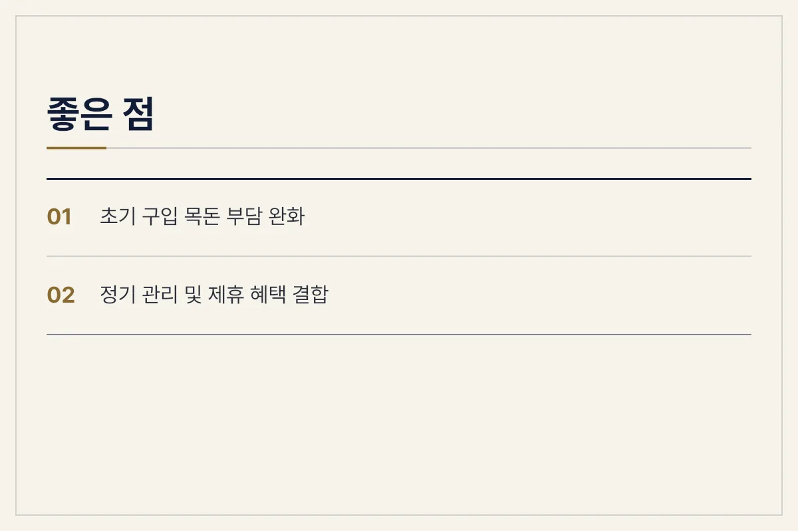
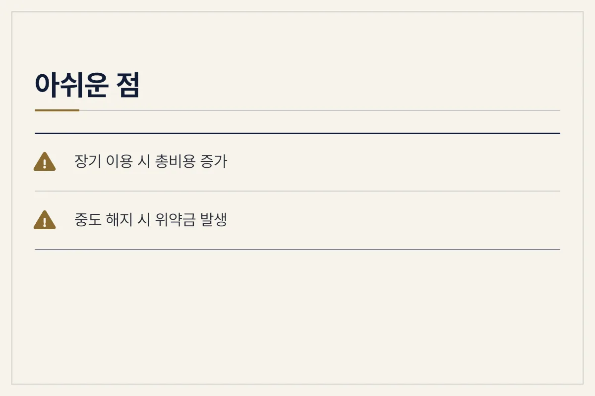
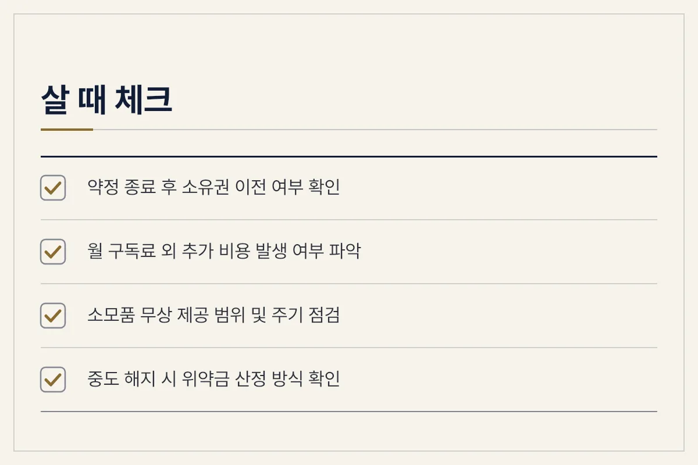
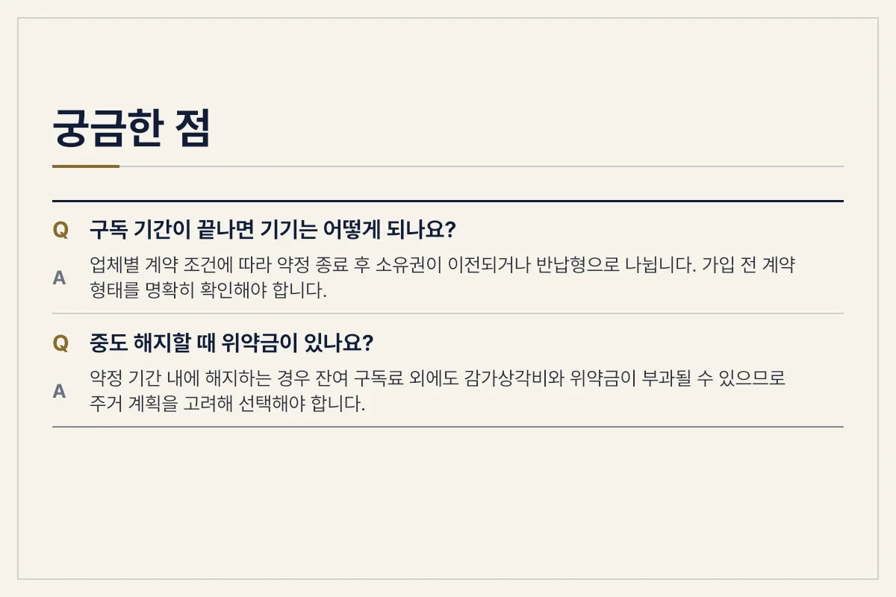
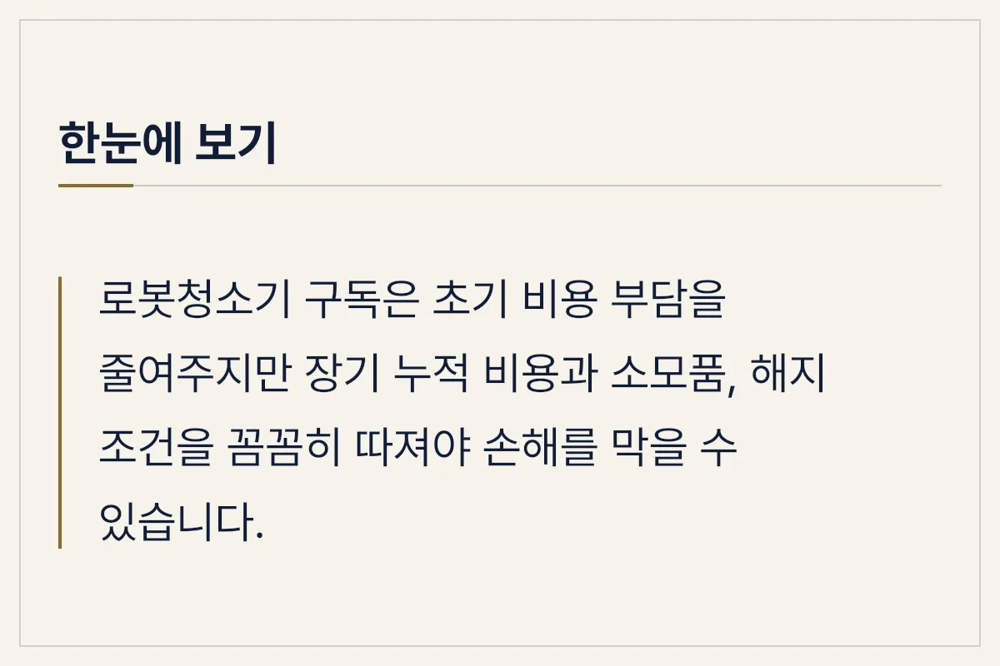
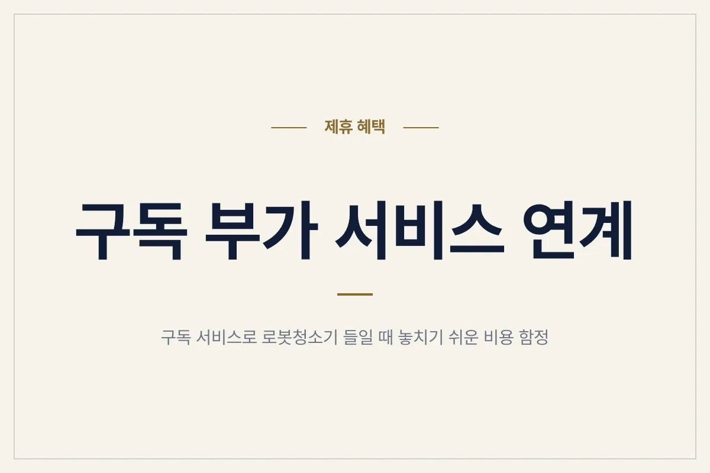

구독 서비스로 로봇청소기를 들일 때 가장 먼저 확인해야 할 점은 초기 비용의 착시에서 벗어나 장기 유지비용과 약정 조건을 면밀히 계산하는 것입니다. 2026년 11월 20일 기준, 다양한 업계에서 월 구독과 제휴 혜택을 결합한 상품을 선보이고 있으나 소비자가 계약 단계에서 세부 조건을 놓치면 예상치 못한 지출로 이어질 수 있습니다. 예를 들어 코웨이가 교보문고와 협력해 고객 500명을 대상으로 전자책 구독 서비스 sam 무제한 1년 이용권을 제공하는 등(코웨이닷컴 정회원 인증 기준, 에스티아르엠 11월 20일 보도), 최근의 구독 시장은 단순 렌털을 넘어 다양한 제휴 부가 혜택을 결합하는 추세입니다. 그러나 이러한 부가 혜택에 현혹되어 정작 기기 자체의 총비용과 관리 조건을 간과하기 쉽습니다.

<figure>

<figcaption>좋은 점</figcaption>
</figure>

## 초기 비용 절감의 이면과 장기 지출 구조

로봇청소기를 일시불로 구매하는 대신 월 구독료를 내는 방식은 목돈이 나가지 않는다는 장점이 있습니다. 가트너가 내다본 2027년 기업 소프트웨어 시장 전망이나 최근 AI 및 구독 서비스 트렌드(ZD넷코리아 11월 20일 보도)에서도 볼 수 있듯, 전통적인 소유 중심에서 서비스 구독 형태로 전환되는 배경에는 초기 도입 비용에 대한 진입 장벽을 낮추려는 의도가 깔려 있습니다. 하지만 로봇청소기 같은 하드웨어 가전은 소프트웨어와 달라서 오랜 기간 구독을 유지할 경우, 누적 구독료가 일시불 정가보다 더 커지는 구간이 발생합니다.

초기 구매 비용이 없다는 점에만 집중하면 몇 년 동안 지불하는 총액이 기기 실제 가치를 훌쩍 넘어서는 상황을 마주하게 됩니다. 특히 약정 기간이 길어질수록 매달 나가는 고정 지출이 가계 경제에 부담으로 작용할 수 있으며, 최신형 모델로 교체하고 싶을 때 잔여 약정 때문에 이러지도 저러지도 못하는 애매한 상황이 연출되기도 합니다. 실시간 번역 자막 기능을 도입한 캠톡이나 KISTI ScienceON 오픈 API 활용 실태 조사(씨씨엔뉴스 11월 20일 보도) 등 각 산업 분야에서 구독 및 API 이용 비용의 효율성을 따지는 것과 마찬가지로, 소비자 역시 자신의 사용 패턴에 맞는 요금제를 선택해야 불필요한 지출을 막을 수 있습니다.

<figure>

<figcaption>아쉬운 점</figcaption>
</figure>

## 소모품 교체 주기와 추가 비용의 발생

로봇청소기는 물걸레, 필터, 사이드 브러시, 먼지 봉투 등 주기적으로 갈아주어야 하는 소모품이 많습니다. 구독 상품에 이러한 소모품 정기 배송이나 방문 케어 서비스가 포함되어 있는지 여부에 따라 체감 비용이 크게 달라집니다. 일부 저렴한 구독 플랜은 기기 대여만 포함하고 소모품 비용을 별도로 청구하는 경우가 있어, 가입 전에 약관을 세심하게 읽어봐야 합니다. 

현대백화점서 VIP 대상 대면 컨설팅을 선보인 레어리 사례(비즈니스코리아 11월 20일 보도)처럼 맞춤형 큐레이션이 중요한 분야가 있는가 하면, 가전 구독은 철저하게 유지 관리 항목이 실속을 좌우합니다. 방문 관리 주기와 소모품 무상 제공 범위가 계약서에 명시되어 있는지 확인하고, 추가로 들어가는 유지비가 얼마인지 계산해 보는 과정이 필수적입니다. 소모품을 개별적으로 구입하는 비용이 생각보다 무시할 수 없는 수준이기 때문에, 구독료 외에 숨겨진 유지비가 얼마나 발생하는지 꼼꼼하게 따져봐야 지출을 방어할 수 있습니다.

<figure>

<figcaption>살 때 체크</figcaption>
</figure>

## 계약 전 반드시 점검해야 할 체크리스트

로봇청소기를 구독 형태로 들일 때는 마케팅 문구에 담긴 사은품이나 이벤트에만 눈을 돌려서는 안 됩니다. 예를 들어 코웨이와 교보문고의 제휴 이벤트처럼 특정 플랫폼의 정회원 인증과 추첨을 거쳐 전자책 구독권을 제공하는 마케팅(파이낸셜뉴스 11월 20일 보도)은 부가적인 즐거움이 될 수 있으나, 본질인 청소기의 성능과 약정 조건을 가려서는 곤란합니다. 계약을 체결하기 전에는 반드시 서비스의 전체적인 구조를 냉정하게 뜯어봐야 합니다.

<figure>

<figcaption>궁금한 점</figcaption>
</figure>

아래의 기준을 차례대로 점검해보는 것이 안전합니다.

- 약정 기간이 끝난 뒤 기기의 소유권이 온전히 소비자에게 넘어오는지 확인하기
- 월 구독료 외에 배송비, 설치비, 혹은 의무 사용 기간 내 등록비가 따로 있는지 따져보기
- 소모품이 무상으로 교체 제공되는 플랜인지, 아니면 소비자가 직접 구매해야 하는지 파악하기
- 중도 해지 시 발생하는 위약금 산정 방식을 계약 전 미리 요구해서 살펴보기

## 자주 묻는 질문

**구독 기간이 끝나면 기기는 어떻게 되나요?**

약정 기간이 종료되면 소유권이 이전되는 경우가 많지만, 업체별 계약 조건에 따라 다를 수 있으니 가입 전에 확인하는 것이 좋습니다. 계약 형태에 따라 반납형과 소유권 이전형이 나뉘므로 이 부분을 명확히 해두어야 나중에 분쟁을 막을 수 있습니다.

**중도 해지할 때 위약금이 있나요?**

약정 기간 내에 해지하는 경우 잔여 구독료 외에도 위약금이 부과될 수 있어 계약서를 꼼꼼히 살펴봐야 합니다. 제품의 감가상각비나 철거 비용 등이 청구될 수 있으므로, 자신의 주거 환경이나 이사 계획 등을 고려해 약정 기간을 신중하게 선택해야 합니다.

<figure>

<figcaption>한눈에 보기</figcaption>
</figure>

로봇청소기 구독은 편리함을 가져다주지만, 계약 조건과 숨겨진 유지비용을 제대로 따지지 않으면 일시불 구매보다 더 큰 비용을 지불할 수 있습니다. 각 업체의 제휴 혜택과 약정 내용을 꼼꼼히 비교하여 본인에게 가장 유리한 방식을 선택하는 것이 현명합니다.

<figure>

<figcaption>제휴 혜택: 구독 부가 서비스 연계</figcaption>
</figure>

[추천 제품 확인하기](https://bitl.bz/XL8qtk)

## 참고한 자료

- [KISTI ScienceON 오픈 API, 연구현장 활용 확산](http://www.ccnnews.co.kr/news/articleView.html?idxno=418135) — ccnnews.co.kr, 2026-11-20 보도
- [AI 리더스 가트너가 내다본 2027년…"AI가 기업 SW 시장 바꾼다"](https://zdnet.co.kr/view/?no=20261119110158) — zdnet.co.kr, 2026-11-20 보도
- [캠톡, 영상통화 실시간 번역 자막 기능 도입… 글로벌 이용자 소통 강화](https://www.etoday.co.kr/news/view/2651005) — etoday.co.kr, 2026-11-20 보도
- [코웨이, 교보문고와 마케팅 제휴 협약 체결…고객 대상 이벤트 진행](https://www.thedailypost.kr/news/articleView.html?idxno=117105) — thedailypost.kr, 2026-11-20 보도
- [레어리, 현대백화점서 VIP 대상 대면 컨설팅 단독 선보여](https://www.businesskorea.co.kr/news/articleView.html?idxno=281832) — businesskorea.co.kr, 2026-11-20 보도
- [캠톡, 영상통화에 실시간 번역 자막 도입… 글로벌 이용자 간 소통 기능...](https://www.itbiznews.com/news/articleView.html?idxno=232274) — itbiznews.com, 2026-11-20 보도

2026년 11월 20일 기준 내용입니다. 가격과 사양은 판매처와 시기에 따라 달라질 수 있으니 구매 전에 판매 페이지에서 다시 확인해 주세요.
