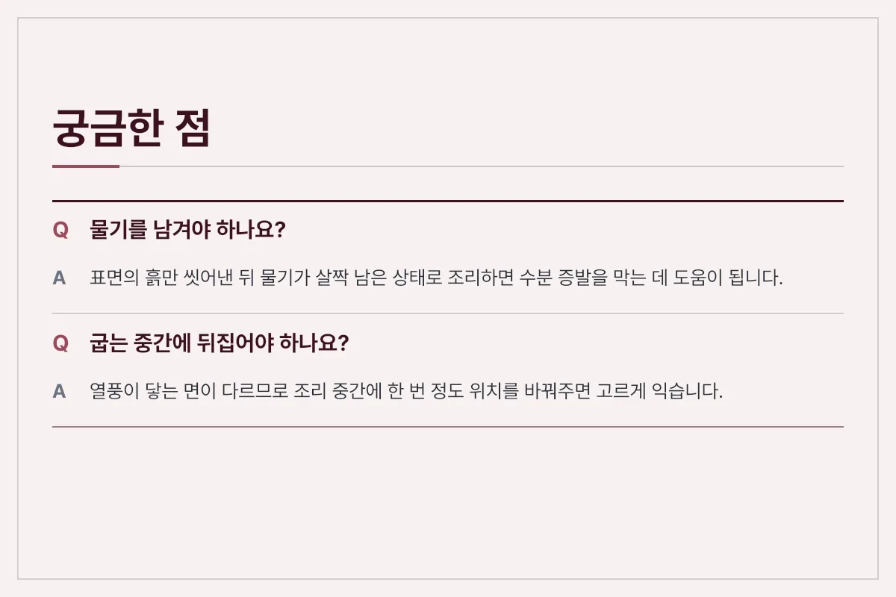

2026년 11월 20일 기준, 고구마를 에어프라이어로 구울 때 속살의 촉촉한 수분을 온전히 지키려면 조리 전 세척 과정부터 껍질의 상태를 관리하는 것이 핵심입니다. 위키트리, 조선일보 등 주요 매체 보도에 따르면 고구마를 조리하기 전 부드러운 스펀지나 전용 세척 솔로 표면의 흙만 가볍게 문질러 씻어낸 뒤 껍질째 조리하는 방식이 정석으로 꼽힙니다. 껍질을 깎아내지 않고 그대로 구우면 고구마 내부의 수분이 바깥으로 빠르게 증발하는 현상을 막아주며, 특유의 단맛과 부드러운 식감을 유지하는 데 큰 도움이 됩니다. 다만 가정에서 사용하는 에어프라이어의 기기 성능이나 내부 수분 상태에 따라 결과물이 미세하게 달라질 수 있으므로 처음 조리할 때는 상태를 수시로 확인하는 과정이 필요합니다.

<figure>

<figcaption>에어프라이어 조리 시 확인해야 할 주요 스펙과 손질법</figcaption>
</figure>

고구마는 풍부한 탄수화물과 식이섬유를 품고 있는 대표적인 구황작물로, 조리하는 방식에 따라 식감과 영양소 유지 형태가 눈에 띄게 달라집니다. 밤고구마와 호박고구마는 한 번에 찜기에 찌거나 에어프라이어로 조리하기 가장 알맞은 품종으로 분류되며, 시중에서 손쉽게 구할 수 있어 홈메이드 간식으로 인기가 높습니다. 껍질째 구워낸 고구마는 껍질 주변에 포함된 유익한 성분까지 함께 섭취할 수 있어 건강 관리를 고려하는 소비자들에게 유리합니다. 바쁜 일상 속에서 프라이팬이나 대형 오븐을 예열하는 번거로운 과정 없이 에어프라이어 바스켓에 고구마를 넣고 버튼을 누르기만 하면 되므로 가정에서 간편하게 즐기기 좋은 조리법으로 자리 잡았습니다.

고구마를 에어프라이어로 구울 때 소비자들이 가장 자주 겪는 고민은 오랜 시간 열풍에 노출되면서 내부 수분이 빠져나가 지나치게 퍽퍽해진다는 점입니다. 이 문제를 해결하기 위해서는 조리 전 표면에 남은 물기를 과도하게 닦아내지 않고 가벼운 정도로만 정리하며, 너무 높은 온도에서 오랜 시간 방치하지 않도록 주의를 기울여야 합니다. 껍질을 미리 깎아내고 조리하면 수분이 순식간에 증발하여 식감이 메말라지므로, 가급적 껍질을 온전하게 유지한 상태로 열을 고르게 전달하는 것이 요령입니다. 기기 내부의 밀폐 정도와 용량에 따라 열풍이 닿는 세기가 제각각 다르므로, 조리 도중에 고구마의 위치를 한 번 정도 뒤집어 주는 세심함이 균일한 익힘을 완성합니다.

<figure>

<figcaption>에어프라이어 조리가 주는 편리함과 영양 유지 장점</figcaption>
</figure>

국제뉴스 등 관련 언론 보도에 따르면 고구마를 껍질째 먹는 방식이 다소 낯설거나 특유의 식감 때문에 목이 메는 느낌이 든다면 곁들이는 부재료를 적극적으로 활용하는 것이 효과적입니다. 뜨겁게 익혀낸 고구마의 퍽퍽한 식감과 강한 당도는 갓 버무린 배추김치의 짭조름한 젓갈 향과 매운맛을 만나 완벽하게 중화되는 특성이 있습니다. 동치미나 아삭한 사과 같은 수분이 풍부한 식품을 함께 섭취하면 입안이 개운해지며 소화를 돕는 긍정적인 역할도 기대할 수 있습니다. 또한 조선일보 등의 보도에서는 남는 채소를 활용할 때 아보카도유 등을 살짝 발라 에어프라이어에 굽는 방식을 소개하기도 했으나, 고구마 본연의 담백한 맛을 즐길 때는 다른 첨가물 없이 굽는 조리법이 가장 대중적입니다.

노점 등 시중에서 판매되는 겨울 간식 가격이 전반적으로 큰 폭으로 상승하면서 가정에서 에어프라이어를 이용해 직접 군고구마를 조리하는 가구가 꾸준히 늘고 있습니다. 직접 조리하면 개인의 취향에 맞게 익힘 정도를 세밀하게 조절할 수 있고, 설탕이나 인공 시럽을 더하지 않아도 고구마가 가진 천연의 단맛을 극한으로 끌어올릴 수 있다는 장점이 있습니다. 브레이크뉴스 및 관련 보도에 따르면 오븐이나 에어프라이어를 활용한 군고구마 만들기는 겨울철 대표적인 홈메이드 간식 조리법으로 손꼽힙니다. 기기 조작법이 비교적 단순하여 요리에 익숙하지 않은 사람도 실패 없이 손쉽게 완성할 수 있다는 점이 가정 내 조리를 부추기는 요인입니다.

<figure>

<figcaption>수분 증발과 기기 성능 차이에 따른 주의점 설명</figcaption>
</figure>

에어프라이어로 고구마를 구울 때 온도는 보통 180도 전후에서 20분에서 30분 사이로 설정하는 경우가 많으나, 고구마의 크기와 굵기에 따라 조절이 필요합니다. 크기가 작은 품종은 내부까지 익는 속도가 빠르므로 중간에 젓가락을 찔러 속까지 부드럽게 익었는지 확인하는 절차가 필수적입니다. 너무 높은 온도에서 급하게 구우면 겉면만 타버리거나 속의 수분이 완전히 말라버릴 수 있으므로, 비교적 안정적인 온도에서 서서히 익히는 방식을 택하는 편이 안전합니다. 기기 사양에 따라 화력의 차이가 발생하므로 레시피에 적힌 시간을 무조건 맹신하기보다는 구우려는 고구마의 크기와 두께를 고려해 조리 시간을 유연하게 대처해야 합니다.

<figure>

<figcaption>조리 전 반드시 점검해야 할 핵심 기준 안내</figcaption>
</figure>

겨울철 대표 간식으로 자리 잡은 고구마는 올바른 세척 과정과 적절한 조리 환경만 갖추면 집에서도 전문점 못지않은 맛과 식감을 충분히 낼 수 있습니다. 껍질을 남겨두어 내부 수분 손실을 줄이고, 사용하는 기기의 특성에 맞는 알맞은 시간 조절을 거치는 것이 성공적인 조리의 열쇠입니다. 김치나 동치미 같은 전통적인 부재료를 곁들이는 식습관은 맛의 조화를 이룰 뿐만 아니라 영양학적으로도 훌륭한 균형을 완성해 줍니다. 

<figure>

<figcaption>에어프라이어 고구마 구이 관련 궁금증 해소</figcaption>
</figure>

## 혈당이 걱정된다면 양을 정해 두세요

코메디닷컴에 따르면 고구마 중간 크기 반 개(70g)에는 탄수화물이 23g 들어 있어, 쌀밥 3분의 1공기(70g)와 비슷한 양입니다. 특히 군고구마는 굽는 동안 수분이 줄면서 단맛이 진해지고 조리 전후 무게도 달라집니다. 혈당을 관리한다면 간식으로 먹는 양을 미리 정해 두고, 밥과 함께 먹는 날은 밥 양을 줄이는 식으로 조절하세요.

## 자주 묻는 질문

**에어프라이어에 고구마를 구울 때 물을 살짝 뿌려야 하나요?**

기기 내부의 수분 상태나 고구마 자체의 신선도에 따라 차이가 있을 수 있으나, 깨끗이 씻은 후 물기가 살짝 남은 상태에서 바스켓에 넣으면 수분 증발을 완화하는 데 도움이 됩니다.

**굽는 도중에 고구마를 반드시 뒤집어야 하나요?**

에어프라이어 바스켓 안에서는 열풍이 닿는 면이 고르지 않을 수 있기 때문에 조리 중간에 한 번 정도 위치를 바꾸어 주면 전체적으로 균일하게 익는 효과를 볼 수 있습니다.

**장기간 보관했던 고구마도 동일하게 구우면 되나요?**

오랫동안 보관하여 수분이 많이 빠져나간 고구마는 굽기 전 물에 잠시 담가 부족한 수분을 보충한 뒤 조리하면 퍽퍽한 식감을 줄이는 데 훨씬 유리합니다.

<figure>

<figcaption>고구마 에어프라이어 조리법 최종 요약</figcaption>
</figure>

[추천 제품 확인하기](https://bitl.bz/QE93RD)

## 참고한 자료
- ["당뇨 있다면 귤·고구마 얼마나?"…혈당 좌우하는 제철 간식의 함정](https://kormedi.com/2899446/) — 코메디닷컴, 2026-11-07 보도, 확인일 2026-11-26

- [밀가루도, 부침가루도 필요 없다…고구마에 '두 가지' 넣어 구워보세요](https://www.wikitree.co.kr/articles/1169283) — wikitree.co.kr, 2026-11-20 보도
- ["껍질 버리면 다이어트 효과 반토막?"… 고구마 100% 건강하게 먹는 법](https://www.gukjenews.com/news/articleView.html?idxno=3752011) — gukjenews.com, 2026-11-14 보도
- [“냉장고 속 남는 채소에 아보카도유 발라 보세요”… 바삭한 ‘한입 간...](https://health.chosun.com/site/data/html_dir/2026/11/12/2026111203222.html) — 조선일보, 2026-11-13 보도
- [“붕어빵 3마리 천원어치 주세요”는 옛말…겨울간식 일제히 ‘껑충’](https://www.kyeonggi.com/article/20261109580131) — kyeonggi.com, 2026-11-09 보도

2026년 11월 20일 기준 내용입니다. 가격과 사양은 판매처와 시기에 따라 달라질 수 있으니 구매 전에 판매 페이지에서 다시 확인해 주세요.
