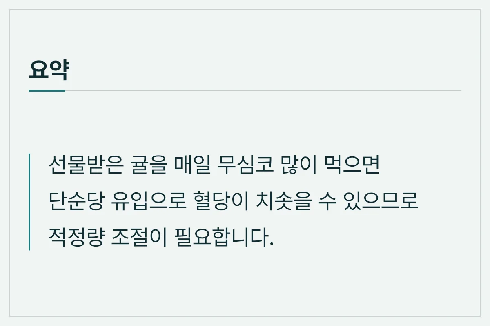
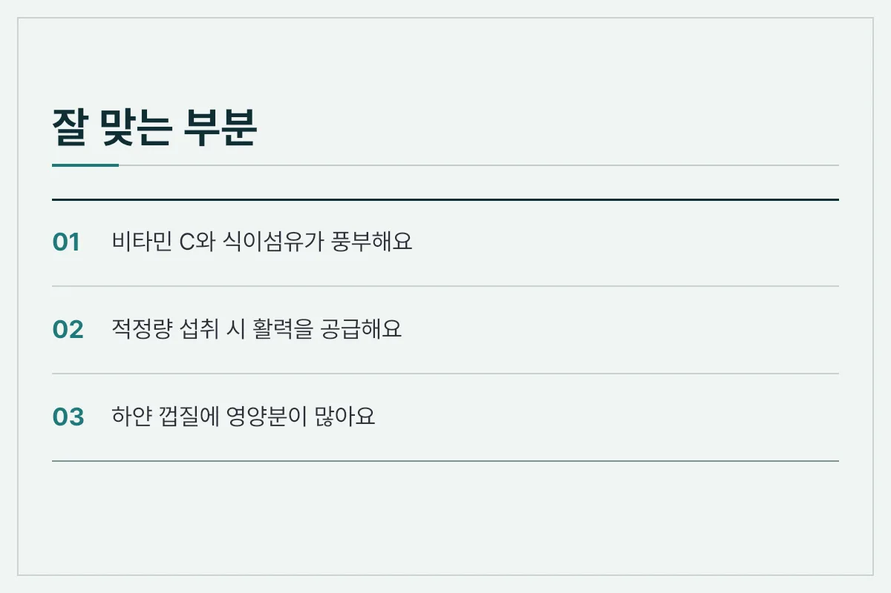
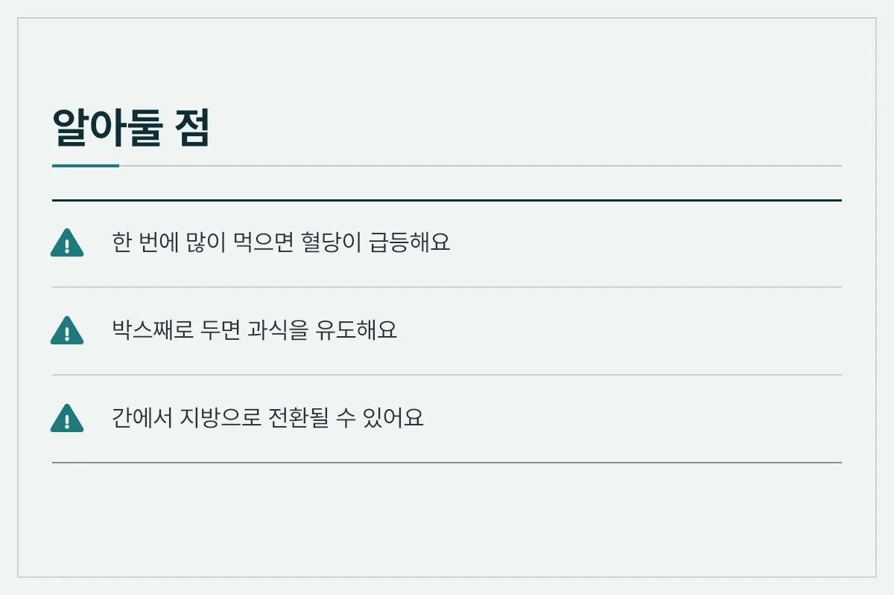
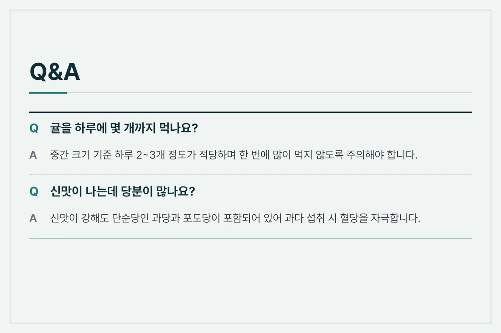

귤 한 박스를 거실에 두고 지나다니며 하나씩 까먹다 보면, 생각보다 많은 당분을 먹게 됩니다. 2026년 11월 21일 기준으로 과일 섭취와 대사 건강의 상관관계에 대한 관심이 높은 가운데, 귤은 크기가 작아 방심하기 쉽지만 누적되는 당분의 양이 상당합니다. 한자리에서 손쉽게 여러 개를 까먹을 수 있는 특성 때문에 단시간에 많은 단순당이 체내로 유입되면서 혈당을 가파르게 끌어올리게 됩니다.

<figure>

<figcaption>선물받은 귤 한 박스를 무심코 먹다 보면 혈당이 빠르게 오를 수 있습니다.</figcaption>
</figure>

## 귤의 영양 구조와 당분 흡수 속도

귤은 비타민 C와 유기산이 풍부한 겨울철 대표 과일이지만, 그 안에는 과당과 포도당 같은 단순당이 다량 포함되어 있습니다. 밥이나 통곡물 같은 복합당과 달리 단순당은 소화와 흡수 과정이 매우 빠르기 때문에 체내에 들어오는 즉시 혈중 포도당 농도에 영향을 줍니다. 귤 한두 개를 가끔 먹을 때는 혈당에 미치는 영향이 미미하지만, 박스 단위로 두고 매일 수 개씩 지속해서 먹으면 혈당 수치가 높은 상태를 유지하거나 급등하기 쉽습니다. 

특히 귤은 껍질을 벗기기 편해 포만감을 느끼기 전에 이미 많은 양을 집어삼키게 되는 경향이 있습니다. 위장에 물리적인 부담을 주지 않는 것처럼 느껴지지만 실제 간에서 대사되어야 하는 과당의 양은 한계를 초과하기 쉽습니다. 음식을 먹을 때 뇌에 도달해야 할 포만감 신호보다 손이 움직이는 속도가 더 빠르기 때문에, 의도치 않게 과도한 당분을 섭취하게 되는 점이 혈당 상승을 부추기는 핵심 요인입니다.

<figure>

<figcaption>귤에 포함된 단순당은 체내에 빠르게 흡수되어 혈당을 자극합니다.</figcaption>
</figure>

## 과일 섭취 방식에 따른 혈당 반응 비교

과일을 먹는 습관과 양에 따라 우리 몸이 대사 반응을 일으키는 양상은 완전히 달라집니다. 아래 표는 섭취 패턴에 따른 혈당 반응의 차이를 보여줍니다.

| 섭취 방식 | 당분 유입 속도 | 혈당 영향 | 권장 여부 |
| :--- | :--- | :--- | :--- |
| 박스째로 두고 수시로 섭취 | 매우 빠름 | 급격한 상승 및 유지 | 지양 |
| 식후 즉시 디저트로 추가 | 빠름 | 기존 식후 혈당과 중첩 | 지양 |
| 하루 2~3개 나누어 섭취 | 완만함 | 안정적 유지 | 권장 |
| 채소와 단백질 섭취 후 간식 | 느림 | 완만한 곡선 유도 | 권장 |

표에서 볼 수 있듯 섭취량을 철저히 조절하고 다른 영양소와 분리해서 먹는 것이 혈당 관리의 출발점입니다. 한 번에 먹는 양을 엄격히 줄이고 시간을 두고 나누어 먹는 습관이 필수적입니다.

<figure>

<figcaption>알아둘 점</figcaption>
</figure>

## 매일 먹는 과일이 몸에 미치는 영향과 주의점

선물받은 귤을 소진하기 위해 매일 박스 단위로 소비하다 보면 체중 증가뿐만 아니라 중성지방 수치 변화에도 직접적인 영향을 받게 됩니다. 과도한 과당은 포도당과 달리 주로 간에서 대사되는데, 처리 용량을 넘어선 과당은 체내에서 지방으로 쉽게 전환되기 때문입니다. 특히 평소 혈당 조절에 유의해야 하는 사람이나 대사증후군 위험이 있는 경우, 과일이라는 이름표만 믿고 무제한으로 먹는 것은 경계해야 합니다. 

새콤달콤한 맛을 내는 유기산이 포함되어 있어 산도가 높으므로 위장이 예민한 사람에게는 속쓰림을 유발할 수 있습니다. 당뇨 전단계나 당뇨병 환자에게는 눈에 보이지 않는 혈당 스파이크를 일으켜 피로감을 가중시키는 원인이 되기도 합니다. 과일은 분명 건강에 이로운 식품이지만 간식이라는 카테고리 안에서 통제되지 않으면 예상치 못한 대사적 부담으로 다가오게 됩니다.

<figure>

<figcaption>고르는 기준</figcaption>
</figure>

## 올바른 귤 섭취와 보관을 위한 가이드

귤을 건강하게 즐기기 위해서는 주방 구석이나 거실 테이블에 박스째로 두는 방식을 과감히 버려야 합니다. 그날 먹을 분량만큼만 작은 접시에 따로 담아두고 박스는 눈에 띄지 않는 곳에 치워두는 물리적인 차단 전략이 필요합니다. 

또한 식사 직후에 디저트로 바로 먹기보다는 식사 후 충분한 시간이 지난 뒤 허기가 질 때 간식으로 소량만 섭취하는 편이 혈당 변동성을 줄이는 데 유리합니다. 귤 껍질을 까면 나오는 하얀색 속껍질에는 식이섬유인 펙틴이 풍부하게 포함되어 있어 당분이 체내로 흡수되는 속도를 늦추는 역할을 합니다. 따라서 껍질을 너무 결벽증적으로 깨끗하게 벗겨내기보다는 적당히 남겨두고 먹는 식습관이 혈당 스파이크를 예방하는 지혜가 됩니다.

<figure>

<figcaption>Q&amp;A</figcaption>
</figure>

## 자주 묻는 질문

**귤을 하루에 몇 개까지 먹어도 되나요?**

개인의 활동량과 건강 상태에 따라 다르지만 일반적으로 중간 사이즈 기준 하루 2~3개 정도가 적당합니다. 한 번에 많이 먹으면 당분 흡수가 지나치게 빨라지므로 나누어 먹어야 합니다.

**새콤한 맛이 나는데 당분이 많은가요?**

신맛이 강하게 느껴져도 그 안에는 과당과 포도당 같은 단순당이 고스란히 포함되어 있습니다. 산도가 높다고 해서 당분이 적은 것은 아니므로 신맛에 속아 과식하지 않도록 주의해야 합니다.

이 글은 일반적인 식습관 정보입니다. 당뇨병이나 당뇨 전단계처럼 혈당 관리가 필요하다면 섭취량은 의사·영양사와 상담해 정하세요.

[추천 제품 확인하기](https://bitl.bz/tjI1hK)

2026년 11월 21일 기준 내용입니다. 가격과 사양은 판매처와 시기에 따라 달라질 수 있으니 구매 전에 판매 페이지에서 다시 확인해 주세요.
