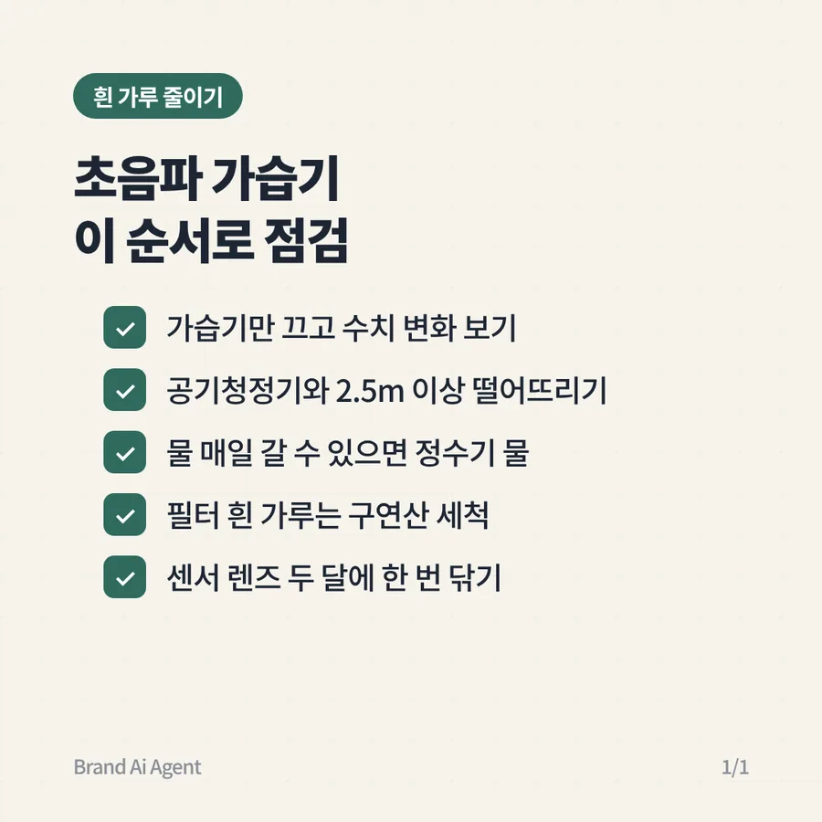

가습기를 켠 뒤 가구 위에 흰 가루가 쌓이거나 공기청정기 미세먼지 수치가 갑자기 오른다면, 원인은 대부분 **초음파 가습기가 뿜어낸 수돗물 속 미네랄(스케일)**입니다. LG전자 고객지원은 수돗물로 초음파 가습기를 쓰면 물속 스케일 성분 때문에 주변에 흰 가루가 생길 수 있고, 공기청정기 먼지 센서가 이 물 입자를 먼지로 읽는다고 설명합니다.

## 흰 가루와 미세먼지 수치, 원인은 같다

초음파 가습기는 물을 끓이거나 증발시키지 않고 진동으로 잘게 부숴 공기 중에 내보냅니다. 이때 물에 녹아 있던 칼슘·마그네슘 같은 미네랄도 물방울과 함께 나갑니다. 물방울이 마르면 미네랄만 남아 책상, TV 위, 공기청정기 표면에 하얗게 내려앉습니다. LG전자는 이 흰 가루를 스케일(백분)이라고 부릅니다.

공기청정기 수치가 오르는 것도 같은 입자 때문입니다. LG전자 고객지원에 따르면 퓨리케어 공기청정기의 먼지 센서는 초음파식·가열식 가습기에서 나오는 물 분자를 먼지 입자로 인식합니다. 삼성전자 뉴스룸(2018년 12월)도 공기청정기가 초음파 가습기에서 나오는 미네랄 물질을 미세먼지로 인식한다고 설명했습니다.

## 실제 미세먼지인지 가습기 탓인지 구분하는 법

수치가 높게 나온다고 바로 실내 공기가 나빠졌다고 볼 필요는 없습니다. 이 글에서 권하는 구분 순서는 다음과 같습니다.

1. **가습기만 끄고 기다리기:** 창문과 다른 조건은 그대로 두고 가습기만 끕니다. LG전자는 가습기 가동 중뿐 아니라 끈 뒤에도 미세먼지 농도가 한동안 높게 나타날 수 있다고 안내하므로, 끄자마자가 아니라 시간을 두고 수치 변화를 봅니다.
2. **흰 가루 위치 보기:** 가습기 분무구 방향의 가구 위에 가루가 몰려 있다면 가습기 영향일 가능성이 큽니다.
3. **센서 렌즈 상태 확인:** LG전자는 PM1.0 센서 렌즈가 오염돼도 수치가 높게 나오거나 잘 내려가지 않을 수 있다며, 렌즈를 두 달에 한 번 물 묻힌 면봉으로 닦으라고 안내합니다.

LG전자 고객지원은 실내 공기의 대류만으로도 수치가 잠깐 오르내릴 수 있고, 같은 장소에 둔 공기청정기끼리도 센서 오차 때문에 수치가 다르게 나올 수 있다고 덧붙였습니다. 잠깐 튀었다가 내려오는 수치는 제품 이상으로 보지 않아도 됩니다.

## 같이 쓴다면 거리 2.5m, 물은 어떻게

LG전자 고객지원은 초음파식 가습기와 공기청정기를 함께 쓰는 것을 권하지 않고, 꼭 써야 한다면 **2.5m 이상 거리를 두라**고 안내합니다. 거리를 두더라도 미세먼지 농도가 높게 표시될 수 있다는 점은 감안해야 합니다. 삼성전자 뉴스룸 역시 두 제품 사이에 거리를 두라고 권했습니다.

물 선택은 조금 복잡합니다. LG전자는 흰 가루를 줄이려면 스케일이 적은 정수기 물(역삼투압 방식)을 쓰라고 안내합니다. 반면 LG전자 고객지원의 '가습기 비릿한 냄새' 안내는 정수기 물이 소독 성분이 빠져 있어 수돗물보다 세균이 빨리 번식할 수 있다며 수돗물 사용을 권장합니다.

두 안내를 함께 보면 판단 기준은 이렇습니다. **물을 매일 갈고 물통을 헹굴 수 있다면 정수기 물로 흰 가루를 줄이고, 물 관리가 들쭉날쭉하다면 수돗물을 쓰되 거리와 세척으로 흰 가루를 관리**하는 편이 안전합니다. 물통 세척 방법은 [가습기 세척 방법](/p/humidifier-cleaning-citric-acid-guide/)에 정리해 두었습니다.

## 필터에 붙은 흰 가루 관리

흰 가루는 공기청정기 필터와 가습공기청정기의 가습 필터에도 쌓입니다. LG전자 고객지원은 초음파·가열식 가습기의 물 입자에 포함된 스케일이 공기청정기 필터 수명을 줄이는 원인이 되고, 필터가 흰 가루로 오염됐다면 새 필터로 교체하라고 안내합니다.

가습공기청정기의 가습 필터에 생긴 흰 가루는 수돗물 속 미네랄이 물만 증발하고 남아 붙은 것으로, LG전자는 가습 중 생길 수 있는 정상적인 현상이라고 설명합니다. 다만 그대로 두면 가습 능력이 떨어질 수 있습니다. LG전자 오브제 공기청정기 기준 세척법은 물 5L에 구연산 15g을 녹인 미지근한 물에 필터를 1~2시간 담갔다가 솔로 닦고 흐르는 물로 충분히 헹구는 것입니다. 모델마다 세척 방법이 다르니 내 제품 설명서를 먼저 확인하세요.

## 가습기를 바꿀 계획이라면

흰 가루와 센서 오작동을 근본적으로 줄이는 방법은 가습 방식을 바꾸는 것입니다. LG전자 고객지원은 공기청정기와 함께 쓸 가습기로 자연기화식을 추천하며, 자연기화식은 물 분자가 작아 자사 공기청정기에 영향을 주지 않는다고 설명합니다.

자연기화식은 대신 필터 관리가 필요합니다. LG전자 하이드로에센셜 가습기 안내는 필터와 케이스를 2주에 한 번 이상 청소하라고 합니다. 초음파식, 가열식, 복합식, 기화식의 장단점은 [가습기 방식별 차이](/p/humidifier-type-comparison-guide/)에서 비교했습니다.

[추천 제품 확인하기](https://bitl.bz/UK0aHQ)

## 자주 묻는 질문

**가습기 흰 가루를 마셔도 괜찮나요?**

흰 가루는 수돗물에 녹아 있던 미네랄이 남은 것이라고 제조사들은 설명합니다. 다만 공기 중에 떠다니는 입자를 줄이는 편이 좋으므로, 정수기 물을 쓰거나 가습기와 사람 사이 거리를 두는 방법을 권합니다.

**공기청정기와 가습기를 한 방에서 쓰면 안 되나요?**

초음파식이라면 LG전자는 함께 쓰지 말 것을 권하고, 꼭 써야 하면 2.5m 이상 떨어뜨리라고 안내합니다. 자연기화식 가습기는 공기청정기 센서에 영향을 주지 않는다고 설명합니다.

**가열식 가습기도 공기청정기 수치를 올리나요?**

LG전자 고객지원은 먼지 센서가 초음파식뿐 아니라 가열식 가습기의 물 분자도 먼지로 인식할 수 있다고 안내합니다. 가열식이라도 공기청정기와 가까이 두지 않는 편이 좋습니다.

**흰 가루가 생기면 가습기가 고장 난 건가요?**

고장이 아닙니다. LG전자는 수분 증발 뒤 남는 스케일이 가습 사용 중 생길 수 있는 정상적인 현상이라고 설명합니다. 다만 필터에 오래 쌓이면 성능이 떨어지니 주기적으로 세척해야 합니다.

**공기청정기 수치가 계속 높게 나오면 무엇부터 확인하나요?**

가습기를 끄고 한동안 수치를 지켜본 뒤, 그래도 높으면 센서 렌즈를 닦아 봅니다. LG전자는 PM1.0 센서 렌즈를 두 달에 한 번 청소하라고 권합니다.

## 핵심 요약

- LG전자 고객지원에 따르면 수돗물로 초음파 가습기를 쓰면 물속 스케일(백분) 성분 때문에 가습기 주변에 흰 가루가 생길 수 있습니다.
- LG전자 퓨리케어 공기청정기의 먼지 센서는 초음파식·가열식 가습기의 물 분자를 먼지로 인식하므로, LG전자는 두 제품을 함께 쓸 경우 2.5m 이상 떨어뜨리라고 안내합니다.
- LG전자는 공기청정기와 함께 쓰는 가습기로 자연기화식을 추천하며, 흰 가루를 줄이려면 스케일이 적은 정수기 물을 쓰라고 안내합니다.

## 참고한 자료

- [공기청정기 제품에 흰 먼지, 흰 가루가 생겨요](https://www.lge.co.kr/support/solutions-20152873283993) — LG전자 고객지원, 2026-05-29 갱신, 확인일 2026-11-28
- [공기청정기에서 갑자기 미세 먼지 수치가 올라가요](https://www.lge.co.kr/support/solutions-20150605999307) — LG전자 고객지원, 확인일 2026-11-28
- [공기청정기와 가습기를 같이 사용해도 되나요?](https://www.lge.co.kr/support/solutions-20150238862806) — LG전자 고객지원, 확인일 2026-11-28
- [가습공기청정기 가습필터에 흰 가루가 생겼어요](https://www.lge.co.kr/support/solutions-20150307436145) — LG전자 고객지원, 2026-04-14 갱신, 확인일 2026-11-28
- [가습기 비릿한 냄새가 날 때 해결 방법](https://www.lge.co.kr/support/solutions-1319083597504) — LG전자 고객지원, 확인일 2026-11-28
- [하이드로에센셜 가습 약함 해결을 위한 필터 청소 및 교체 방법](https://www.lge.co.kr/support/solutions-20155049203497) — LG전자 고객지원, 2026-02-24 갱신, 확인일 2026-11-28
- [공기청정기 '잘' 쓰는 방법에 관한 6가지 궁금증](https://news.samsung.com/kr/%ec%8a%ac%ea%b8%b0%eb%a1%9c%ec%9a%b4-%ea%b3%b5%ec%b2%ad%ec%83%9d%ed%99%9c-%e2%91%a1-%ea%b3%b5%ea%b8%b0%ec%b2%ad%ec%a0%95%ea%b8%b0-%ec%9e%98-%ec%93%b0%eb%8a%94-%eb%b0%a9%eb%b2%95%ec%97%90) — 삼성전자 뉴스룸, 2018-12-07, 확인일 2026-11-28

정보 기준일: 2026-11-28. 제조사 안내는 대표 모델 기준이므로 내 제품의 사용설명서를 함께 확인하세요.
