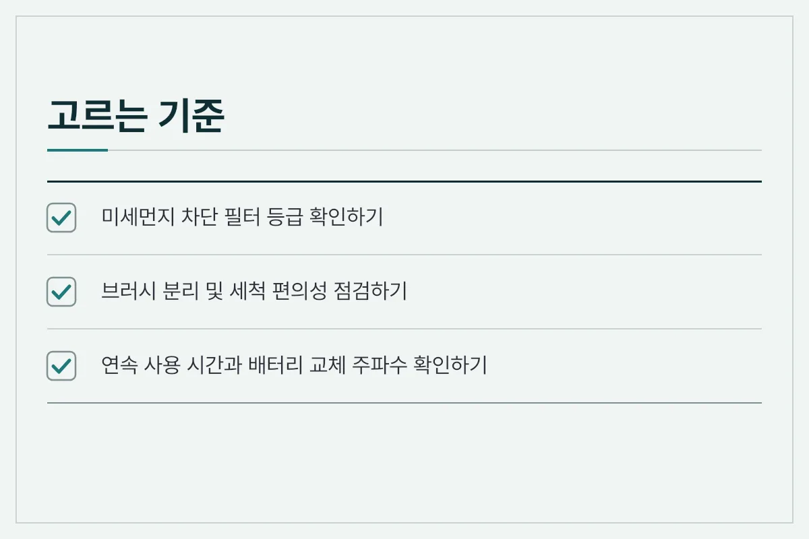
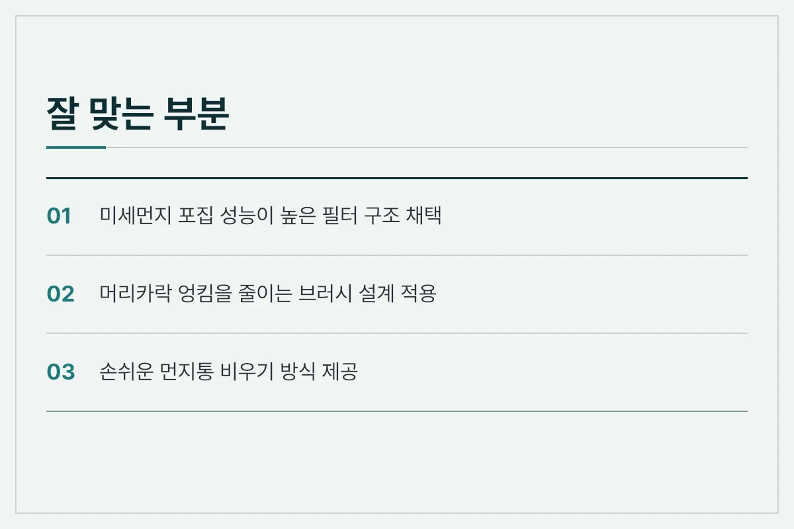
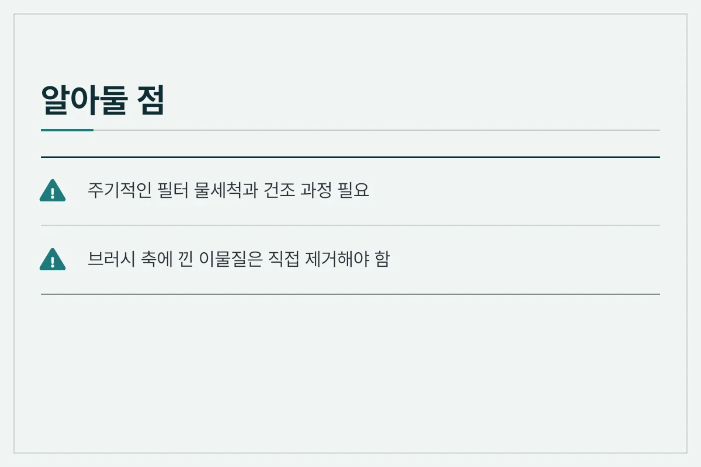
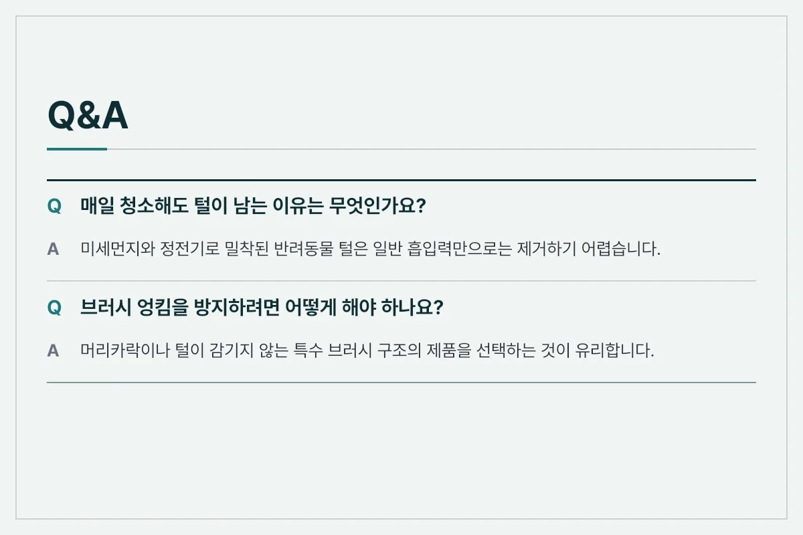
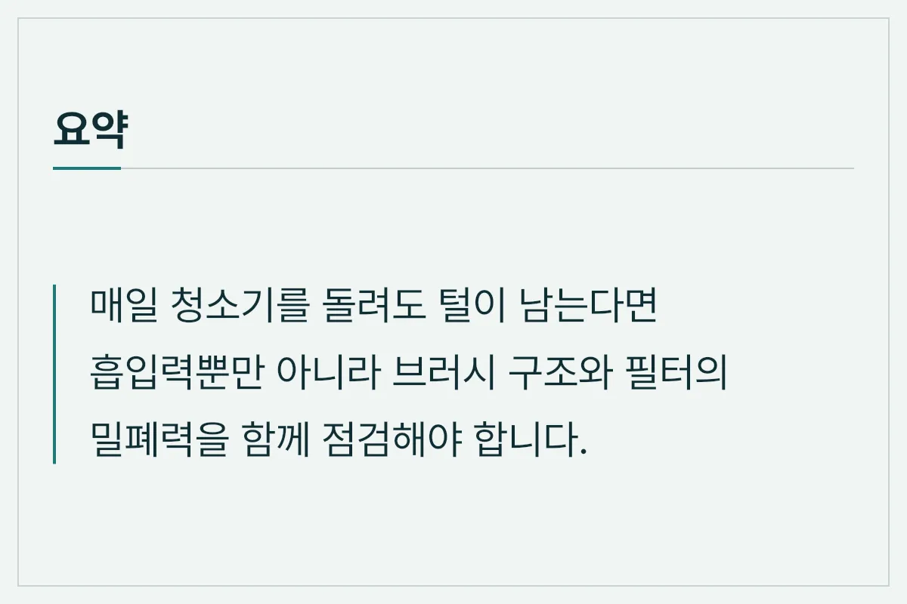
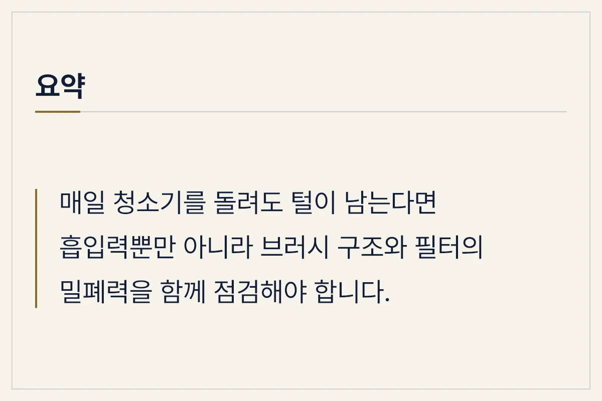

반려동물을 키우거나 긴 머리카락이 많은 가정에서는 매일 청소기를 돌려도 바닥에 털이 남아 있는 현상을 자주 겪습니다. 청소기를 바꿨는데도 털이 깨끗하게 제거되지 않는다면 흡입력 수치보다 브러시의 물리적 구조와 필터의 밀폐력을 먼저 확인해야 합니다.

<figure>

<figcaption>청소기 브러시에 낀 이물질은 흡입력 저하의 주요 원인입니다.</figcaption>
</figure>

## 청소기를 돌려도 털이 남는 근본적인 원인

눈에 보이는 먼지와 달리 미세한 털과 반려동물의 각질은 정전기와 바닥 마찰력 때문에 바닥에 밀착되어 있습니다. 단순히 공기를 빨아들이는 방식만으로는 바닥에 붙은 털을 완전히 떼어내기 어렵습니다. 또한 흡입구 내부의 브러시에 털이 엉키면 공기 흐름이 방해를 받아 제 성능을 발휘하지 못하게 됩니다.

## 털 제거 효율을 높이는 핵심 기능

털 제거가 잘 되는 청소기를 고르거나 현재 사용하는 제품을 점검할 때 살펴봐야 할 핵심 요소는 다음과 같습니다.

* **안티 탱글 브러시 구조:** 머리카락이나 털이 브러시 축에 감기지 않고 먼지통으로 바로 이동하도록 설계된 구조입니다.
* **미세먼지 차단 필터:** 흡입된 털과 미세먼지가 배기 바람을 통해 다시 밖으로 새어나오지 않도록 막아주는 다중 밀폐 시스템입니다.
* **바닥면 밀착 헤드:** 바닥 종류에 따라 높이가 유연하게 조절되어 틈새에 낀 이물질까지 쓸어 올리는 헤드 디자인입니다.

<figure>

<figcaption>고성능 필터는 미세한 털과 먼지의 재배출을 방지합니다.</figcaption>
</figure>

## 청소기 종류별 특성 비교

시중에 판매되는 무선 청소기와 유선 청소기는 각각의 장단점이 있으므로 주거 환경과 청소 주기에 맞춰 선택해야 합니다.

| 구분 | 무선 청소기 | 유선 청소기 |
| :--- | :--- | :--- |
| 장점 | 선이 없어 이동이 자유롭고 수시로 사용하기 편리함 | 배터리 제약 없이 강력한 흡입력을 장시간 유지함 |
| 단점 | 사용 시간이 한정되어 있으며 주기적인 충전 필요 | 이동 시 줄을 1다녀야 하며 보관 공간을 많이 차지함 |
| 주요 용도 | 일상적인 가벼운 청소 및 빠른 먼지 제거 | 대청소 및 깊은 곳의 묵은 먼지 제거 |

<figure>

<figcaption>알아둘 점</figcaption>
</figure>

## 효과적인 털 청소를 위한 실사용 관리 팁

아무리 성능이 좋은 청소기라도 관리를 소홀히 하면 흡입력이 떨어집니다. 털 청소 효율을 유지하려면 다음 사항을 실천하는 것이 좋습니다.

청소를 시작하기 전에 바닥에 큰 이물질이 있다면 먼저 손으로 줍고 청소기를 사용하는 것이 브러시 고장을 막는 방법입니다. 청소 후에는 먼지통을 비우는 것뿐만 아니라 브러시 헤드에 감긴 털을 전용 도구나 가위로 주기적으로 제거해야 합니다. 필터는 물세척이 가능한 구조라면 정기적으로 세척한 뒤 완전히 건조해서 사용해야 냄새와 세균 번식을 막을 수 있습니다.

<figure>

<figcaption>Q&amp;A</figcaption>
</figure>

## 자주 묻는 질문 (FAQ)

**매일 청소해도 털이 남는 이유는 무엇인가요?**

미세먼지와 정전기로 밀착된 반려동물 털은 일반 흡입력만으로는 제거하기 어렵습니다. 브러시의 물리적 쓸어 담기 기능과 필터 성능이 함께 뒷받침되어야 합니다.

**브러시 엉킴을 방지하려면 어떻게 해야 하나요?**

머리카락이나 털이 감기지 않는 특수 브러시 구조를 채택한 제품을 사용하거나, 사용 후 브러시 부품을 분리해 이물질을 자주 제거해 주는 것이 좋습니다.

**필터 세척은 얼마나 자주 해야 하나요?**

사용 빈도에 따라 다르지만, 흡입력이 예전 같지 않거나 배기구에서 냄새가 난다면 즉시 필터를 분리해 세척하고 완전히 건조한 뒤 재장착해야 합니다.

<figure>

<figcaption>요약</figcaption>
</figure>

## 요약

매일 청소기를 돌려도 털이 남는다면 흡입력 수치에만 의존하기보다 브러시의 엉킴 방지 설계와 미세먼지 차단 필터의 상태를 점검해야 합니다. 올바른 부품 관리와 주기적인 세척을 병행하면 털 제거 효율을 높일 수 있습니다.

<figure>

<figcaption>요약</figcaption>
</figure>

추천 제품은 아래 링크에 걸어 두겠습니다.

[추천 제품 확인하기](https://bitl.bz/Wq9kGs)

최종 확인일: 2026-11-13. 가격과 사양은 판매처와 시기에 따라 달라질 수 있으니 구매 전 공식 판매 페이지에서 다시 확인하세요.
