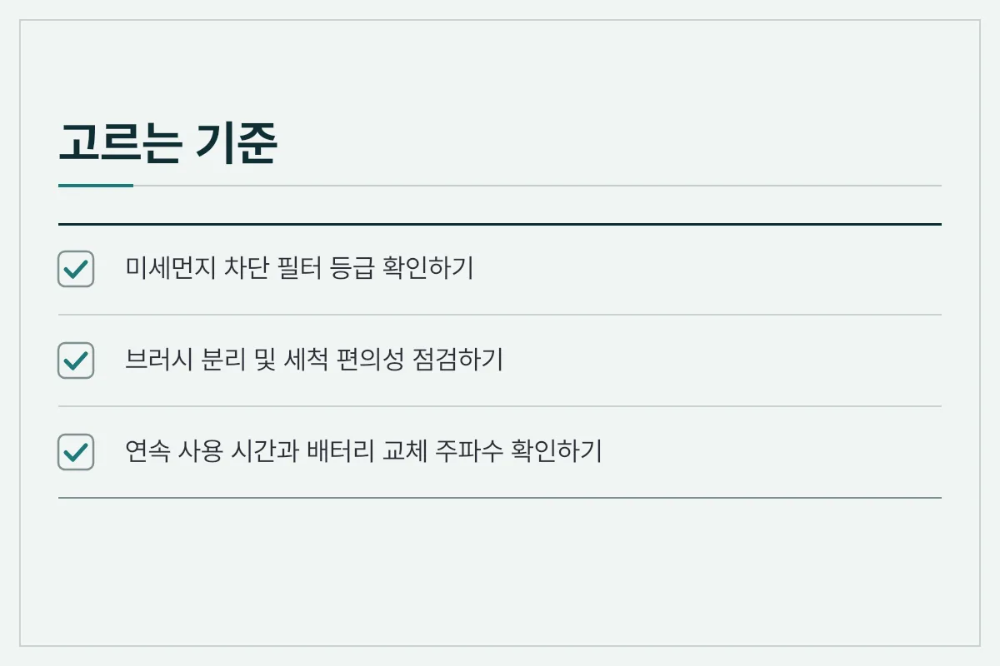
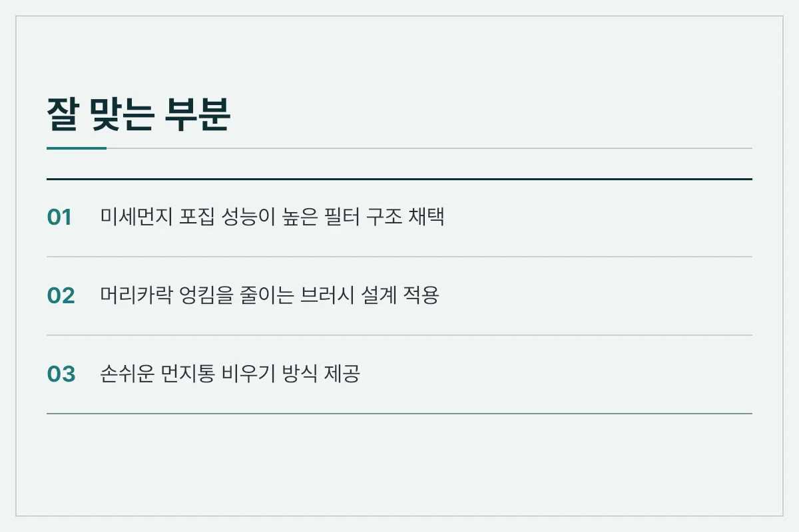
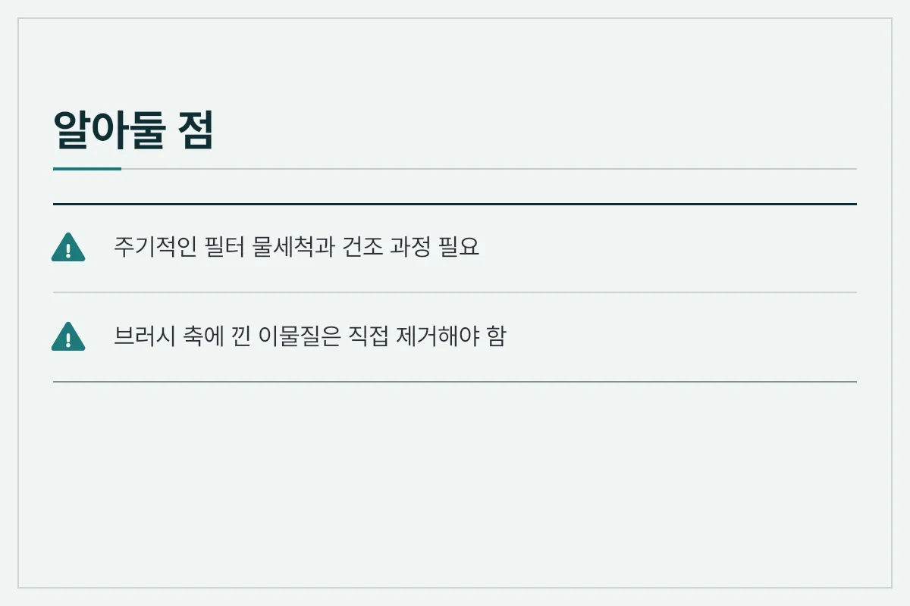
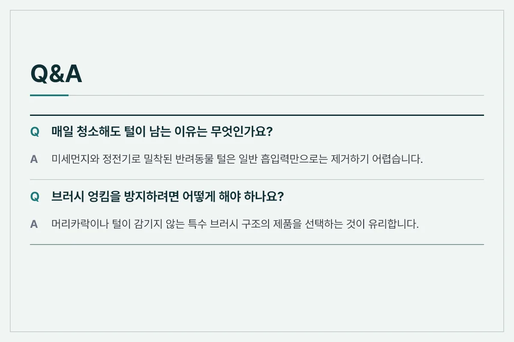
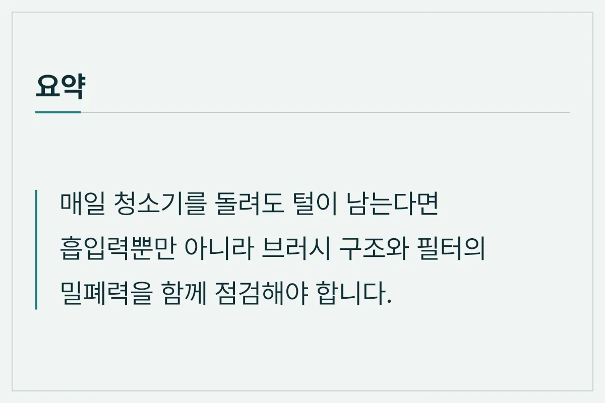
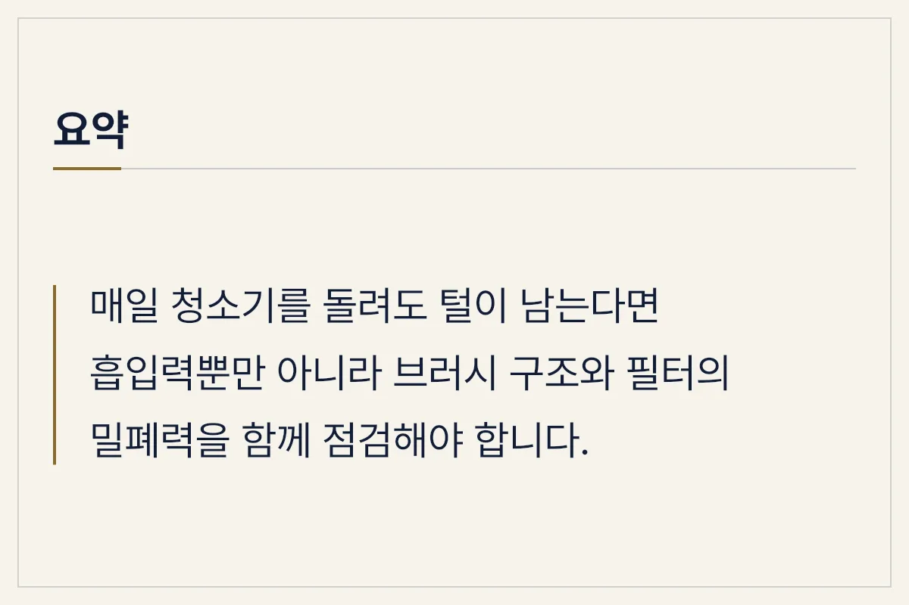

반려동물을 키우거나 긴 머리카락이 많은 가정에서는 매일 청소기를 돌려도 바닥에 털이 남아 있는 현상을 자주 겪습니다. 청소기를 바꿨는데도 털이 깨끗하게 제거되지 않는다면 흡입력 수치보다 브러시의 물리적 구조와 필터의 밀폐력을 먼저 확인해야 합니다.

<figure>

<figcaption>청소기 브러시에 낀 이물질은 흡입력 저하의 주요 원인입니다.</figcaption>
</figure>

## 청소기를 돌려도 털이 남는 근본적인 원인

눈에 보이는 먼지와 달리 미세한 털과 반려동물의 각질은 정전기와 바닥 마찰력 때문에 바닥에 밀착되어 있습니다. 단순히 공기를 빨아들이는 방식만으로는 바닥에 붙은 털을 완전히 떼어내기 어렵습니다. 또한 흡입구 내부의 브러시에 털이 엉키면 공기 흐름이 방해를 받아 제 성능을 발휘하지 못하게 됩니다.

## 털 제거 효율을 높이는 핵심 기능

털 제거가 잘 되는 청소기를 고르거나 현재 사용하는 제품을 점검할 때 살펴봐야 할 핵심 요소는 다음과 같습니다.

* **안티 탱글 브러시 구조:** 머리카락이나 털이 브러시 축에 감기지 않고 먼지통으로 바로 이동하도록 설계된 구조입니다.
* **미세먼지 차단 필터:** 흡입된 털과 미세먼지가 배기 바람을 통해 다시 밖으로 새어나오지 않도록 막아주는 다중 밀폐 시스템입니다.
* **바닥면 밀착 헤드:** 바닥 종류에 따라 높이가 유연하게 조절되어 틈새에 낀 이물질까지 쓸어 올리는 헤드 디자인입니다.

<figure>

<figcaption>고성능 필터는 미세한 털과 먼지의 재배출을 방지합니다.</figcaption>
</figure>

## 틈새와 모서리, 제품마다 차이가 크다

바닥 한가운데는 대부분 잘 치우지만, 털이 남는 곳은 주로 **바닥 틈새와 벽 모서리**입니다. 한국소비자원이 2021년 무선청소기 7개 제품을 비교한 결과에서도 이 부분에서 차이가 컸습니다(ZDNet Korea 보도).

- **일반 바닥:** 7개 중 6개가 '우수', 나머지 1개도 '양호'로 큰 차이가 없었습니다.
- **바닥 틈새:** '우수'는 3개뿐이었고 4개는 틈새 먼지를 잘 제거하지 못해 '보통'이었습니다.
- **벽 모서리:** '우수'는 4개였습니다.
- **큰 이물:** 한 제품은 초콜릿 같은 큰 이물을 일부 빨아들이지 못했습니다.

매일 청소해도 털이 남는다면, 지금 쓰는 청소기가 일반 바닥은 잘 치워도 **틈새·모서리 성능이 약한 제품**일 수 있습니다. 이럴 때는 틈새 노즐이나 모서리용 브러시를 따로 써 보세요. 새로 산다면 틈새·모서리 성능이 공개된 시험 결과를 먼저 찾아보는 게 좋습니다.

## 흡입력 숫자, 단위부터 확인하세요

한국소비자원이 2025년 9월 무선청소기 10개 제품의 최대 흡입력을 시험한 결과, **파스칼(Pa)로 흡입력을 표시한 제품들의 실제 성능이 상대적으로 낮았습니다**(파이낸셜뉴스·뉴스1 보도).

- **Pa(파스칼)**는 작동 중 내부 기압인 진공도를 나타내는 단위로, 흡입력과 직접 관련이 없습니다.
- 흡입력의 국제표준 단위는 **와트(W)**이고, 다이슨이 쓰는 **에어와트(AW)**는 시험 방법이 같아 W와 직접 비교할 수 있습니다.
- 1만 8,000~4만 8,000Pa로 광고한 6개 제품의 실제 최대 흡입력은 **58~160W**였습니다. 반면 W·AW로 표시한 삼성전자, LG전자, 다이슨 제품은 280W·AW를 충족했습니다.
- 150W로 홍보한 한 제품은 실제로 121W였습니다.

Pa 숫자가 크다고 털을 더 잘 빨아들이는 게 아니니, **W 또는 AW로 적힌 흡입력**을 비교하세요. 국가기술표준원은 흡입력을 W로 통일해 비교할 수 있도록 국제표준을 반영한 국가표준(KS)을 만들 계획이고, 청소성능·소음·먼지 재방출량 시험 방법도 함께 마련할 예정입니다.

## 청소기 종류별 특성 비교

시중에 판매되는 무선 청소기와 유선 청소기는 각각의 장단점이 있으므로 주거 환경과 청소 주기에 맞춰 선택해야 합니다.

| 구분 | 무선 청소기 | 유선 청소기 |
| :--- | :--- | :--- |
| 장점 | 선이 없어 이동이 자유롭고 수시로 사용하기 편리함 | 배터리 제약 없이 강력한 흡입력을 장시간 유지함 |
| 단점 | 사용 시간이 한정되어 있으며 주기적인 충전 필요 | 이동할 때 선을 끌고 다녀야 하며 보관 공간을 많이 차지함 |
| 주요 용도 | 일상적인 가벼운 청소 및 빠른 먼지 제거 | 대청소 및 깊은 곳의 묵은 먼지 제거 |

<figure>

<figcaption>알아둘 점</figcaption>
</figure>

## 효과적인 털 청소를 위한 실사용 관리 팁

아무리 성능이 좋은 청소기라도 관리를 소홀히 하면 흡입력이 떨어집니다. 털 청소 효율을 유지하려면 다음 사항을 실천하는 것이 좋습니다.

청소를 시작하기 전에 바닥에 큰 이물질이 있다면 먼저 손으로 줍고 청소기를 사용하는 것이 브러시 고장을 막는 방법입니다. 청소 후에는 먼지통을 비우는 것뿐만 아니라 브러시 헤드에 감긴 털을 전용 도구나 가위로 주기적으로 제거해야 합니다. 필터는 물세척이 가능한 구조라면 정기적으로 세척한 뒤 완전히 건조해서 사용해야 냄새와 세균 번식을 막을 수 있습니다.

<figure>

<figcaption>Q&amp;A</figcaption>
</figure>

## 자주 묻는 질문 (FAQ)

**매일 청소해도 털이 남는 이유는 무엇인가요?**

미세먼지와 정전기로 밀착된 반려동물 털은 일반 흡입력만으로는 제거하기 어렵습니다. 브러시의 물리적 쓸어 담기 기능과 필터 성능이 함께 뒷받침되어야 합니다.

**브러시 엉킴을 방지하려면 어떻게 해야 하나요?**

머리카락이나 털이 감기지 않는 특수 브러시 구조를 채택한 제품을 사용하거나, 사용 후 브러시 부품을 분리해 이물질을 자주 제거해 주는 것이 좋습니다.

**필터 세척은 얼마나 자주 해야 하나요?**

사용 빈도에 따라 다르지만, 흡입력이 예전 같지 않거나 배기구에서 냄새가 난다면 즉시 필터를 분리해 세척하고 완전히 건조한 뒤 재장착해야 합니다.

<figure>

<figcaption>요약</figcaption>
</figure>

## 요약

매일 청소기를 돌려도 털이 남는다면 흡입력 수치에만 의존하기보다 브러시의 엉킴 방지 설계와 미세먼지 차단 필터의 상태를 점검해야 합니다. 올바른 부품 관리와 주기적인 세척을 병행하면 털 제거 효율을 높일 수 있습니다.

<figure>

<figcaption>요약</figcaption>
</figure>

추천 제품은 아래 링크에 걸어 두겠습니다.

[추천 제품 확인하기](https://bitl.bz/Wq9kGs)

## 참고한 자료

- [로보락·샤오미 등 무선청소기 흡입력 'Pa 단위' 표시 제품 성능 낮아](https://www.fnnews.com/news/202509181102062667) — 파이낸셜뉴스(뉴스1), 2025-09-18 보도 (한국소비자원 시험), 확인일 2026-11-26
- [삼성·LG·다이슨 무선청소기 청소성능 별3개 '우수'](https://zdnet.co.kr/view/?no=20211227103126) — ZDNet Korea, 2021-12-27 보도 (한국소비자원 비교시험), 확인일 2026-11-26
- 사진 일부: Pixabay (무료 이용 허가 이미지)

정보 기준일: 2026-11-26. 시험 결과는 발표 시점 기준이며, 제품 사양과 가격은 바뀔 수 있으니 구매 전 제조사·판매처 페이지에서 다시 확인해 주세요.

