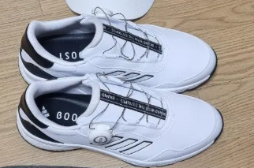
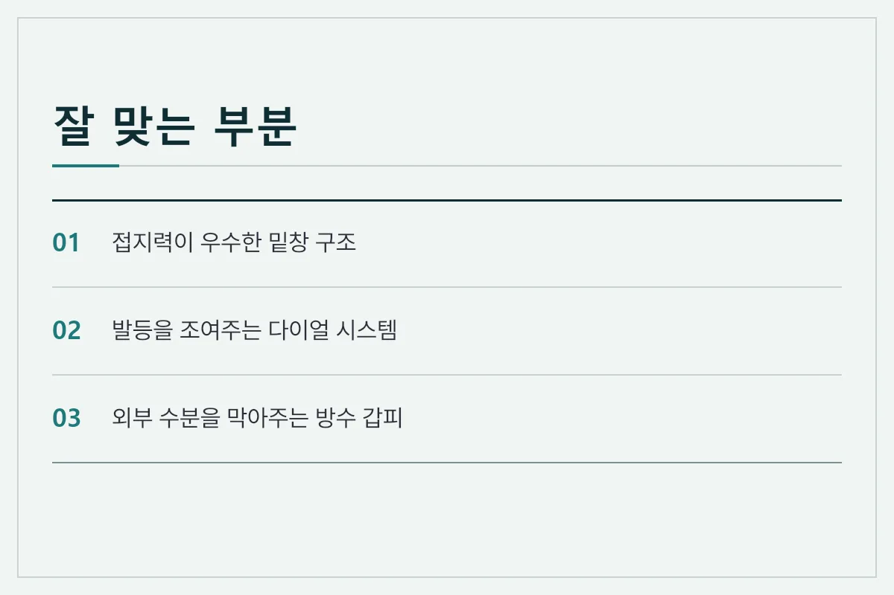
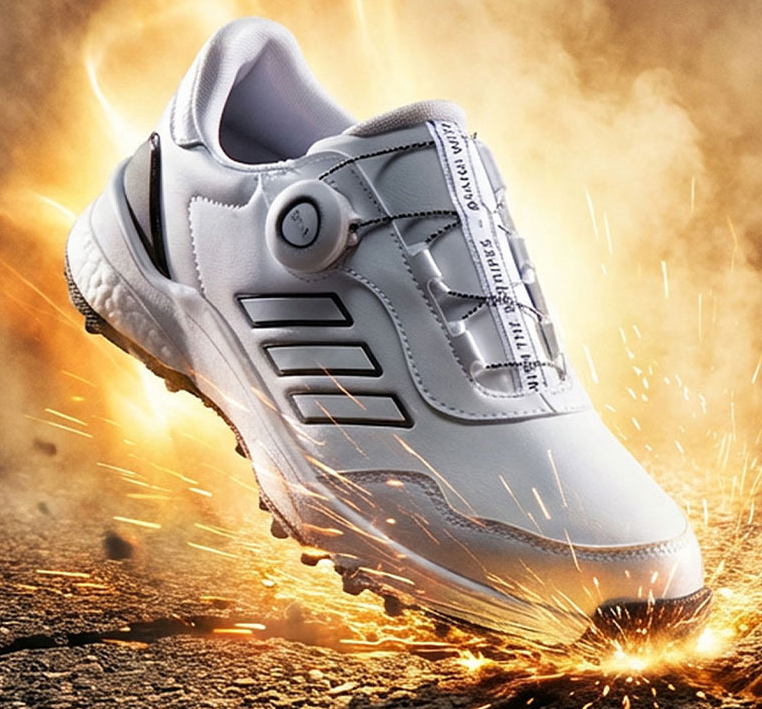
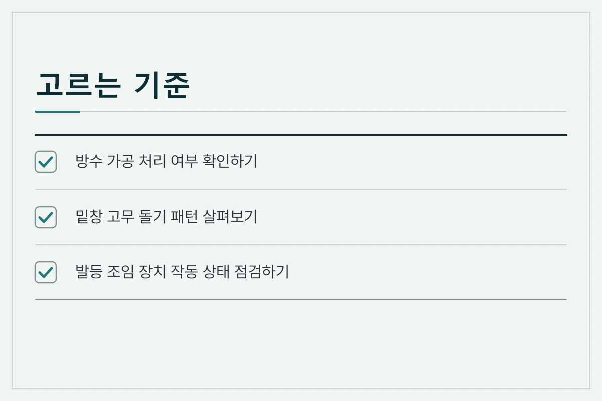
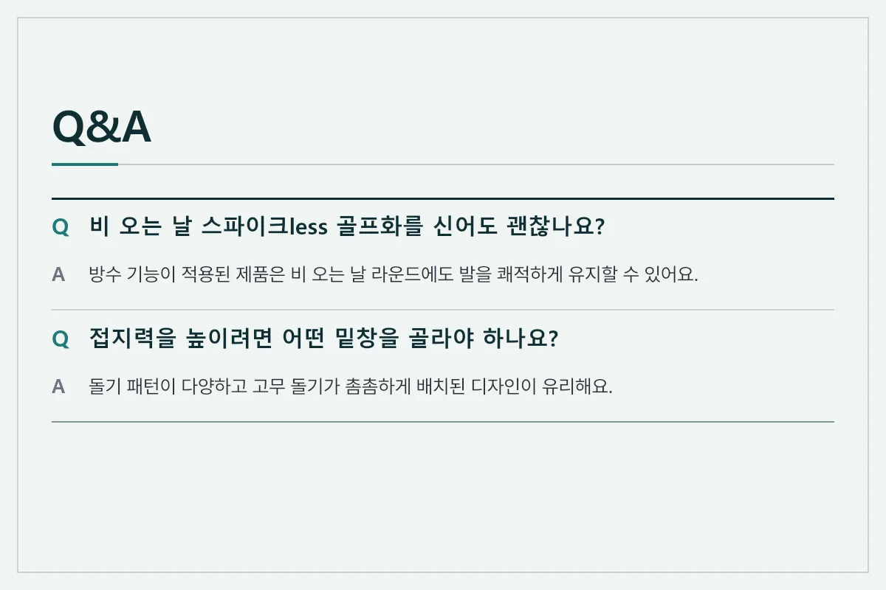

비 오는 날 필드에 나갈 때 가장 신경 쓰이는 부분은 스윙할 때 발이 미끄러지지 않을까 하는 점이에요. 스파이크less 골프화는 밑창에 징이 없어도 특수 패턴과 고무 돌기를 적용해 비 오는 날이나 젖은 잔디에서도 안정적인 접지력을 제공해요. 이번 글에서는 우천 시 라운드에서도 미끄러지지 않고 편안하게 신을 수 있는 스파이크less 골프화의 특징과 선택 기준을 살펴볼게요.

<figure>

<figcaption>위쪽에서 바라본 흰색 스파이크less 골프화 상단 모습 (사진: https://bitl.bz/DhpRoy)</figcaption>
</figure>

## 스파이크less 골프화가 우천 시에도 안정적인 이유

과거에는 비가 오면 무조건 징이 박힌 스파이크 골프화를 찾는 경우가 많았지만, 최근에는 밑창 기술이 발전하면서 스파이크less 제품도 뛰어난 접지력을 보여줘요. 밑창 전체에 다방향 고무 돌기와 홈을 배치해 젖은 잔디나 진흙 속에서도 발을 단단히 잡아주기 때문이에요. 또한 무게가 가볍고 발을 편안하게 감싸주어 장시간 라운드에도 피로감이 적다는 장점이 있어요.

<figure>

<figcaption>스파이크less 골프화의 주요 장점과 특징 안내</figcaption>
</figure>

## 비 오는 날 필드 골프화 선택 기준

우천 시 라운드를 대비할 때는 방수 기능과 밑창 패턴을 꼼꼼히 따져봐야 해요. 갑피 소재가 방수 처리가 되어 있지 않으면 잔디의 물기가 안쪽으로 스며들어 발이 쉽게 젖고 체온이 떨어질 수 있어요. 따라서 가죽이나 특수 방수 코팅 원단으로 마감된 제품을 고르는 것이 중요해요.

*   **방수 및 발수 코팅:** 외부에서 스며드는 빗물을 차단해 발을 쾌적하게 유지해요.
*   **다방향 고무 돌기:** 젖은 잔디 위에서 미끄러짐을 방지하는 핵심 접지력 요소예요.
*   **다이얼 조임 시스템:** 끈 대신 다이얼로 발등을 단단히 고정해 흔들림을 줄여줘요.

<figure>

<figcaption>측면에서 바라본 흰색 스파이크less 골프화의 역동적인 모습 (사진: https://bitl.bz/DhpRoy)</figcaption>
</figure>

## 우천 시 골프화 관리 및 실사용 팁

비 오는 날 필드를 돌고 난 뒤에는 골프화 관리가 수명을 좌우해요. 라운드가 끝난 직후에는 마른 수건으로 겉면에 묻은 흙과 물기를 닦아내고, 깔창을 분리해 통풍이 잘 되는 그늘에서 말려줘야 해요. 직사광선이나 드라이기 열을 이용해 말리면 가죽이나 접착면에 변형이 올 수 있으니 자연 건조를 시키는 것이 안전해요.

<figure>

<figcaption>구매 전 반드시 확인해야 할 체크리스트 안내</figcaption>
</figure>

## 자주 묻는 질문 (FAQ)

**스파이크less 골프화는 비 오는 날 무조건 미끄러지나요?**

모든 제품이 미끄러지는 것은 아니며, 방수 처리와 밑창의 돌기 패턴이 잘 설계된 제품은 젖은 잔디에서도 충분한 접지력을 발휘해요. 다만 일반 스니커즈 형태의 제품은 피해야 해요.

**라운드 후 젖은 골프화는 어떻게 말려야 하나요?**

깔창을 분리한 뒤 신발 안에 마른 신문지나 충전재를 넣어 물기를 흡수시키고, 통풍이 잘 되는 그늘에서 천천히 말려주는 것이 좋아요.

**방수 기능은 영구적으로 지속되나요?**

시간이 지나거나 마찰이 반복되면 방수 기능이 약해질 수 있으므로, 주기적으로 방수 스프레이를 뿌려 관리하는 것이 도움이 돼요.

<figure>

<figcaption>스파이크less 골프화 관련 자주 묻는 질문 안내</figcaption>
</figure>

비 오는 날 필드에서 안정적으로 스윙하려면 우천 시에도 미끄러지지 않는 접지력과 방수 기능을 갖춘 스파이크less 골프화를 선택해야 해요. 평소 라운드 환경과 관리 방법을 고려해 자신에게 알맞은 제품을 골라보세요. 추천 제품은 아래 링크에 걸어 두겠습니다.

[추천 제품 확인하기](https://bitl.bz/DhpRoy)

최종 확인일: 2026-11-09. 가격과 사양은 판매처와 시기에 따라 달라질 수 있으니 구매 전 공식 판매 페이지에서 다시 확인하세요.
