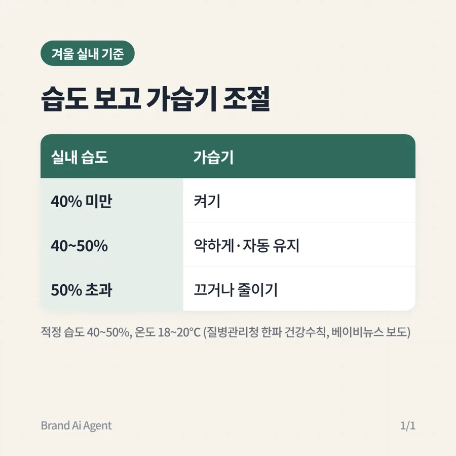
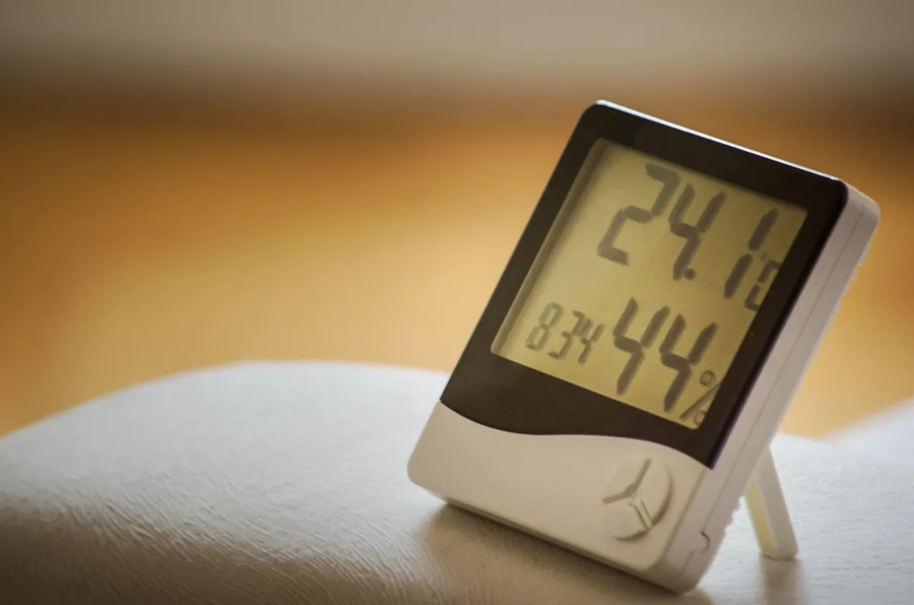

겨울철 실내 적정 습도는 **40~50%**, 적정 온도는 **18~20℃**입니다. 베이비뉴스가 전한 질병관리청 한파 건강수칙과 농민신문 보도가 같은 기준을 제시합니다. 가습기는 습도가 40% 아래로 떨어질 때 켜고, 50%를 넘으면 끄거나 약하게 돌리는 것이 기본입니다.

## 겨울 실내 온도·습도 기준

| 항목 | 기준 | 근거 |
| --- | --- | --- |
| 실내 온도 | 18~20℃ | 질병관리청 한파 건강수칙(베이비뉴스 보도) |
| 실내 습도 | 40~50% | 질병관리청 한파 건강수칙(베이비뉴스 보도) |
| 환기 | 하루 3번, 10~30분 | 농민신문 보도 |

농민신문은 실내 온도 18~20℃가 다소 쌀쌀하게 느껴질 수 있지만, 실내외 온도 차가 커지면 감기에 걸리기 쉬워 내복과 양말로 체온을 높이는 편이 좋다고 설명했습니다. 베이비뉴스에 따르면 질병관리청은 매년 12월부터 2월까지 한랭질환을 집중 감시합니다.

## 습도가 너무 낮거나 높으면 생기는 일

난방을 오래 켜면 실내 공기가 빠르게 건조해집니다. 건조한 공기는 코와 기관지 점막을 마르게 해서 바이러스나 먼지를 막는 힘을 떨어뜨린다고 경남신문 건강 기사는 설명했습니다.

반대로 습도를 너무 높이는 것도 좋지 않습니다. 적정 범위를 50%까지로 잡는 이유는 창가 결로와 곰팡이 때문입니다. 특히 외풍이 있는 창가나 북쪽 방은 습도를 높이면 유리와 벽면에 물이 맺히기 쉬우니, 가습기를 창가에서 떨어뜨려 두는 것이 좋습니다.

## 가습기 켜고 끄는 기준

이 글에서 권하는 운영 기준은 다음과 같습니다.

1. **습도 40% 미만:** 가습기를 켭니다. 아침에 일어났을 때 목이 칼칼하다면 밤사이 습도가 떨어졌을 가능성이 큽니다.
2. **40~50%:** 가장 약한 단계나 자동 모드로 유지합니다.
3. **50% 초과:** 끄거나 가동을 줄이고, 창가 결로가 생기는지 확인합니다.
4. **환기 중:** 가습기를 잠시 끕니다. 환기 직후 습도가 다시 내려가면 그때 켭니다.

가습기에 자동 습도 조절 기능이 있다면 목표 습도를 45% 안팎으로 맞춰 두면 위 범위 안에서 움직입니다. 가습기 방식별 특징은 [가습기 방식별 차이](/p/humidifier-type-comparison-guide/)에서 볼 수 있습니다.

[추천 제품 확인하기](https://bitl.bz/UK0aHQ)

## 습도는 어디서 재야 정확할까

습도는 같은 방 안에서도 위치에 따라 다르게 나옵니다. 가습기 바로 옆에 온습도계를 두면 실제보다 높게 나오고, 창가에 두면 찬 공기 때문에 값이 흔들립니다.

온습도계는 가습기에서 1~2m 떨어진, 사람이 주로 머무는 높이(앉았을 때 얼굴 높이)에 두는 것이 실제 체감과 가깝습니다. 아이 방이라면 아기 침대 근처에서 재는 편이 정확합니다.

습도를 감으로 맞추기는 어렵습니다. 가습기에 습도 표시가 없다면 온도와 습도를 함께 보여 주는 디지털 온습도계를 하나 두는 것이 가장 간단한 방법입니다.

[관련 링크 확인하기](https://bitl.bz/Eekion)

## 환기와 가습기 관리를 함께

농민신문 보도에 따르면 겨울철에는 하루 3번, 10~30분씩 창문을 열어 환기하는 것이 좋습니다. 창문을 닫아만 두면 이산화탄소, 미세먼지, 포름알데히드, 휘발성 유기화합물이 실내에 쌓이기 때문입니다. 미세먼지가 심한 날에는 환기 시간을 줄이고 공기청정기를 함께 쓰되, 공기청정기는 이산화탄소까지 없애지는 못하므로 짧게라도 환기는 해야 합니다.

가습기 물 관리도 같은 기사에서 다뤘습니다. 물은 하루에 한 번 갈고, 2~3일에 한 번은 깨끗이 씻으라고 안내합니다. 물때 제거 방법은 [가습기 세척 방법](/p/humidifier-cleaning-citric-acid-guide/)에 정리해 두었습니다.

## 공기청정기와 환기, 새집이라면 더 자주

겨울에는 가습기와 공기청정기를 함께 켜는 집이 많습니다. 농민신문 보도에 따르면 공기청정기는 환기 직후 닫힌 창가 주변처럼 바깥 공기가 들어오는 곳 가까이에 두면 효과적입니다. 다만 공기청정기는 이산화탄소나 휘발성 유기화합물까지 없애지 못하므로 환기를 대신할 수는 없습니다.

이사한 지 얼마 안 된 새집이라면 환기가 더 중요합니다. 농민신문은 창문을 닫고 보일러로 실내 온도를 35~40℃까지 올렸다가 환기해 건축 자재에서 나오는 포름알데히드와 휘발성 유기화합물을 내보내는 방법을 소개하며, 새집의 유해물질 방출은 수년간 이어질 수 있어 이사 후에도 수시로 환기해야 한다고 전했습니다.

## 가습기 없이 습도 올리는 법

가습기가 없거나 고장 났다면 젖은 수건을 널거나 실내에 화초를 두는 방법이 있습니다. 경남신문 건강 기사도 가습기 사용, 젖은 수건 널기, 화초 기르기를 건조함을 줄이는 방법으로 소개했습니다. 다만 이런 방법은 습도를 정확히 조절하기 어려워, 온습도계로 수치를 함께 확인하는 것이 좋습니다.

## 자주 묻는 질문

**겨울 실내 적정 습도는 몇 %인가요?**

질병관리청 한파 건강수칙을 전한 보도 기준으로 40~50%입니다. 온도는 18~20℃가 적정합니다.

**가습기는 밤새 켜 둬도 되나요?**

자동 습도 조절 기능이 있다면 목표 습도를 45% 안팎으로 맞추고 켜 둬도 됩니다. 수동 가습기라면 약하게 돌리고 아침에 창가 결로를 확인하세요.

**습도가 60%를 넘으면 문제가 되나요?**

창가 결로와 곰팡이가 생기기 쉬워집니다. 겨울에는 50%를 넘으면 가습기를 끄거나 줄이는 것이 좋습니다.

**겨울에도 환기를 해야 하나요?**

해야 합니다. 농민신문 보도는 하루 3번, 10~30분씩 환기하라고 안내합니다. 환기할 때는 가습기를 잠시 끄세요.

**아이 방은 기준이 다른가요?**

기준은 같습니다. 베이비뉴스가 전한 질병관리청 수칙은 만 1세 이하 영아를 차가운 방에서 재우지 말고 체온과 실내 온도를 자주 확인하라고 안내합니다.

## 핵심 요약

- 질병관리청 한파 건강수칙(베이비뉴스 2026년 11월 보도)에 따르면 겨울철 실내 적정 온도는 18~20℃, 적정 습도는 40~50%입니다.
- 가습기는 실내 습도가 40% 아래로 내려가면 켜고 50%를 넘으면 끄거나 줄이는 것이 겨울 결로와 건조를 함께 막는 기준입니다.
- 농민신문 보도에 따르면 겨울철 실내는 하루 3번, 10~30분씩 환기하고 가습기 물은 하루 한 번 갈아야 합니다.

## 참고한 자료

- [아이 방 난방, 몇 도가 좋을까요? 실내 18~20℃·습도 40~50%](https://www.ibabynews.com/news/articleView.html?idxno=156716) — 베이비뉴스, 2026-11-10 보도 (질병관리청 한파 건강수칙 인용), 확인일 2026-11-27
- ['집콕' 늘어나는 겨울철…건강한 실내환경 조성 '꿀팁'](https://v.daum.net/v/20251118080015091) — 농민신문, 2025-11-18 보도, 확인일 2026-11-27
- [적절한 실내온도 질병예방 첫걸음](https://knnews.co.kr/news/articleView.php?idxno=546442) — 경남신문, 2006-01-17, 확인일 2026-11-27
- 사진 일부: Pixabay (무료 이용 허가 이미지)

정보 기준일: 2026-11-27. 아이나 호흡기 질환이 있는 가족이 있다면 담당 의사의 안내를 함께 따르세요.
