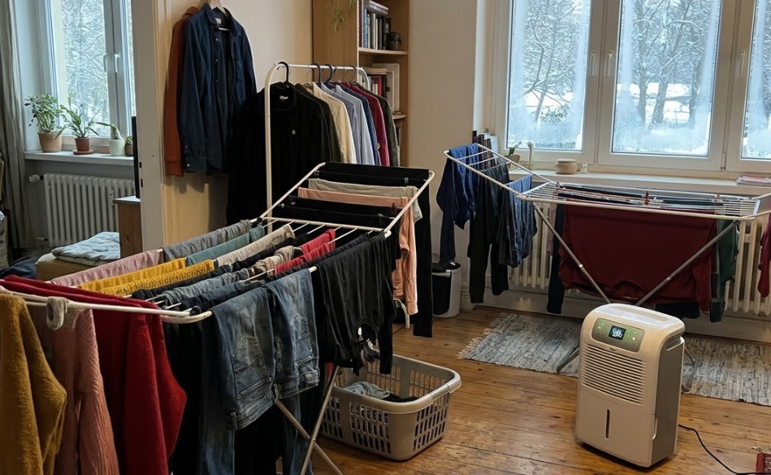
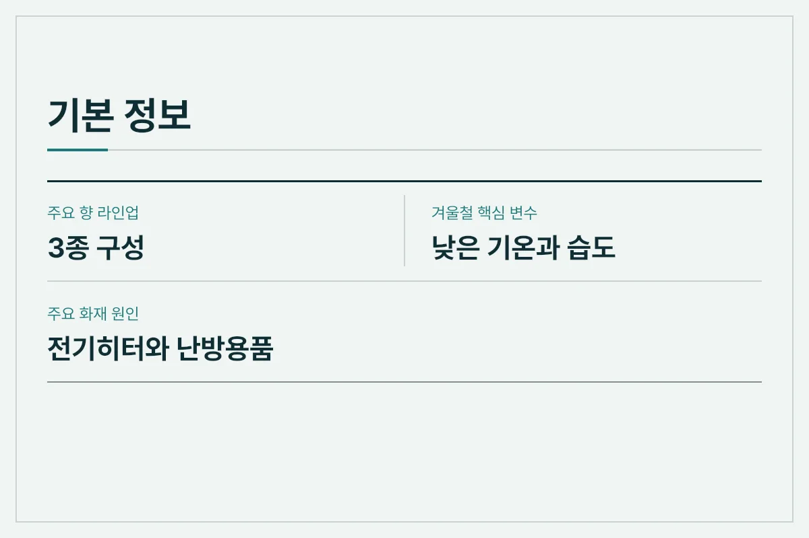
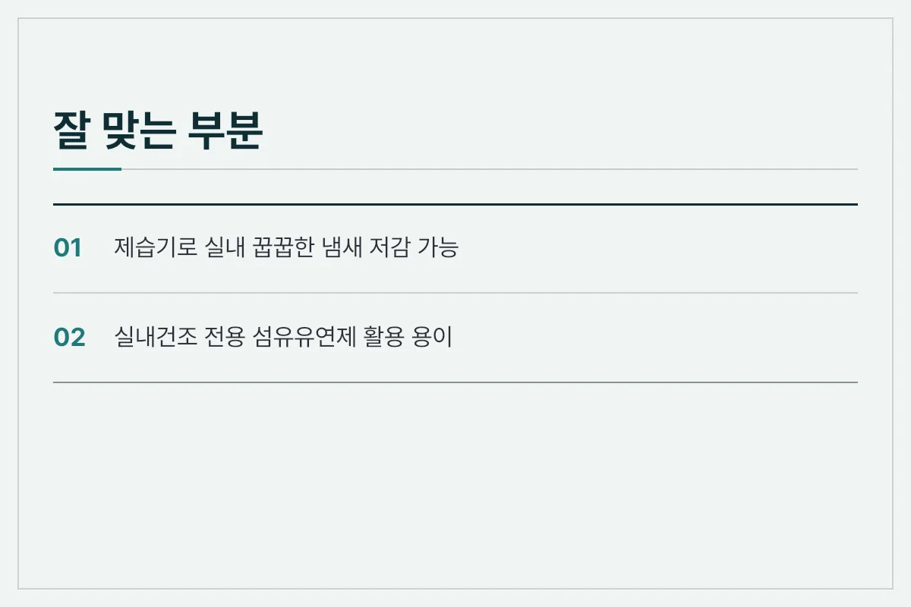
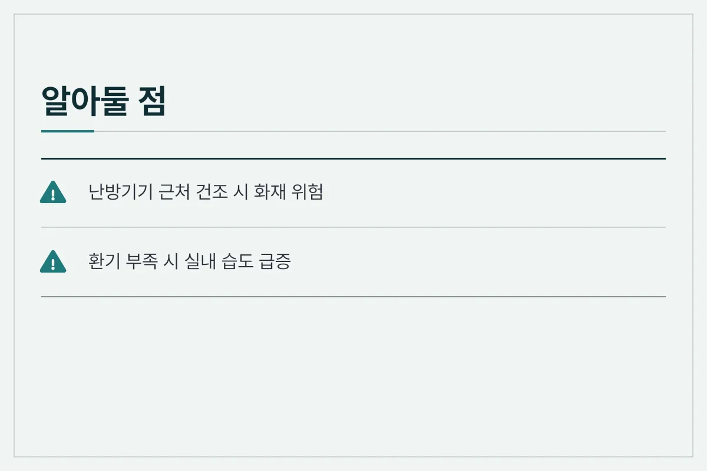
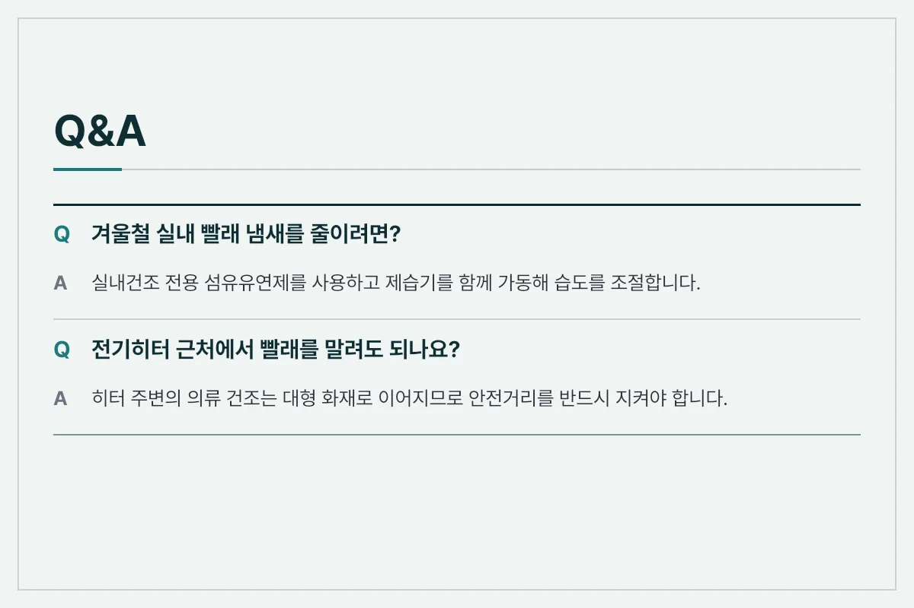
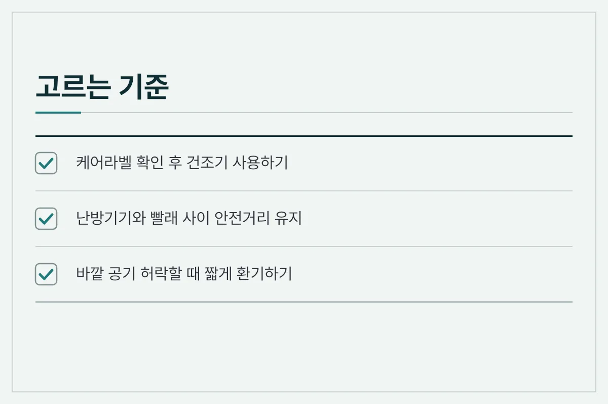

2026년 11월 19일 기준, 겨울철 빨래를 실내에 널어두고 제습기를 함께 가동하는 방식은 일조량이 적고 환기가 어려운 계절에 꿉꿉한 냄새를 줄이는 현실적인 대안으로 주목받고 있습니다. 이지경제 등 주요 언론 보도에 따르면, 겨울철은 낮은 기온과 짧은 일조 시간으로 인해 세탁물 건조가 지연되기 쉽고 이로 인해 실내 습도 관리와 냄새 저감 제품에 대한 관심이 커지는 시기입니다. 

여름철 장마 기간에만 실내 건조가 주목받는 것이 아니며, 추운 계절에도 가정 내 주요 세탁 환경으로 완전히 자리 잡았습니다. 동아일보와 뉴스프라임 등의 11월 18일 및 19일 보도에 따르면 한국P&G 다우니 등은 겨울철 실내건조 공략을 위해 코튼 앤 프레시 비누, 프레시 클린, 플로럴 블로썸 등 세 가지 향으로 구성된 제품군을 선보였습니다. 이러한 제품들은 건조기 사용 후에도 햇볕에 말린 듯한 보송한 향기를 오래 유지하도록 돕는 역할을 합니다.

<figure>

<figcaption>겨울철 실내 빨래 건조와 제습기 병행 사용 모습 (사진: AI생성)</figcaption>
</figure>

<figure>

<figcaption>겨울철 빨래 건조 관리 스펙</figcaption>
</figure>

## 겨울철 실내 빨래 건조와 습도 관리

위키트리 11월 19일 보도에 따르면 실내 빨래 건조는 실내 습도를 급격히 올리는 주요 요인 중 하나입니다. 질병관리청은 겨울철 호흡기 감염 예방을 위해 실내 환기와 손 위생을 권고하고 있으며, 바깥 공기 조건이 허락할 때 짧게라도 환기를 병행하는 것이 바람직합니다. 침실이나 거실에 빨래를 널어둘 때는 이러한 습도 상승 요인을 고려해 공간을 적절히 나누어 관리해야 합니다.

겨울철 침실에 빨래를 널어두면 건조한 밤의 원인이 되는 습도 불균형을 해소하는 데 도움을 줄 수 있지만, 반대로 과도한 습기로 인해 결로 현상이 발생할 수도 있습니다. 이때 제습기를 동시에 가동하면 빨래에서 나오는 수분을 빠르게 흡수하여 실내 습도를 쾌적하게 유지할 수 있습니다. 환기가 어려운 아파트나 다세대 주택에서는 제습기 활용이 꿉꿉한 냄새를 방지하는 실질적인 해결책이 됩니다.

<figure>

<figcaption>겨울철 빨래 냄새 및 습도 관리 장점</figcaption>
</figure>

## 겨울철 빨래 건조 시 반드시 피해야 할 화재 위험

FPN119와 전라일보 등의 11월 18일 보도에 따르면 겨울철은 사계절 중 화재와 인명피해가 가장 빈번하게 발생하는 계절입니다. 특히 전기히터, 전기장판, 열선 등 난방용품 사용이 늘어나는 시기인 만큼 각별한 주의가 필요합니다. 난로 위나 주변, 혹은 전기히터 바로 앞에서 빨래나 패딩 등 의류를 건조하는 행위는 대형 화재로 이어지는 지름길입니다.

소방청의 겨울철 화재 통계와 관련 기사들에 따르면, 널어둘 빨래나 이불에 난방기기의 불씨가 옮겨붙거나 제품이 기울어져 전원이 차단되지 않는 사고가 발생할 수 있습니다. 하나의 멀티탭에 여러 개의 난방기기를 문어발식으로 꽂은 채 주변에 빨래를 널어두는 습관은 매우 위험합니다. 따라서 제습기를 활용해 안전한 위치에서 건조 환경을 조성하거나 건조기를 올바르게 사용하는 지혜가 필요합니다.

<figure>

<figcaption>겨울철 빨래 건조 주의점 및 화재 위험</figcaption>
</figure>

## 겨울철 의류 및 장갑 건조 요령

위키트리 11월 18일 생활꿀팁 보도에 따르면 겨울 장갑처럼 두꺼운 의류를 세탁하고 말릴 때는 건조 순서와 방법에 신경을 써야 합니다. 가죽이나 코팅 소재의 장갑은 세탁 시 주의가 필요하며, 마르는 중간에 한 번 뒤집어 주어야 안쪽까지 고르게 건조됩니다. 빨래집게로 손가락 끝을 집어 건조대에 매달아 두는 방식이 일반적입니다.

또한 건조기를 사용할 때 케어라벨에 건조기 사용 가능 표시가 없다면 기계 건조를 피하는 편이 안전합니다. 전기장판 위에 두꺼운 이불을 장시간 방치하거나 난로 옆에 빨래를 걸쳐두는 행동은 화재를 부르는 나쁜 습관으로 지적됩니다. 의류를 말릴 때는 반드시 난방기기와 충분한 안전거리를 유지하고, 환기와 제습을 조화롭게 이용하는 것이 좋습니다.

<figure>

<figcaption>겨울철 실내 빨래 건조 FAQ</figcaption>
</figure>

<figure>

<figcaption>겨울철 빨래 건조 구매 전 체크리스트</figcaption>
</figure>

## 제습기와 함께 빨래 말리는 요령

제습기를 함께 켤 때 효과를 높이는 기본 요령입니다.

1. **좁은 방에서 문 닫고:** 넓은 거실보다 문을 닫은 작은 방에서 제습기를 돌리면 습기를 더 빨리 잡습니다.
2. **빨래 간격 띄우기:** 옷끼리 겹치지 않게 주먹 하나 정도 간격을 두고 널면 마르는 시간이 줄어듭니다.
3. **바람 길 만들기:** 제습기 바람이 빨래 쪽으로 가도록 두고, 선풍기나 서큘레이터를 함께 쓰면 공기가 돌아 더 잘 마릅니다.
4. **물통 확인:** 물통이 가득 차면 자동으로 멈추는 제품이 많습니다. 자기 전에 비워 두세요.
5. **난방기기와 거리 두기:** 빨리 말리려고 전기히터 가까이에 빨래를 두면 화재 위험이 있습니다.

## 다 마른 뒤에도 꿉꿉하다면

빨래가 마른 뒤에도 냄새가 남는다면 젖은 상태로 오래 있었던 시간이 길었기 때문일 수 있습니다. 세탁이 끝나면 바로 꺼내 널고, 세탁조 청소를 주기적으로 하는 것도 도움이 됩니다.

## 자주 묻는 질문

**겨울철 실내 빨래 꿉꿉한 냄새를 줄이려면 어떻게 해야 하나요?**

일조량이 적고 환기가 어려운 겨울철에는 실내건조 전용 섬유유연제를 활용하거나 제습기를 함께 가동해 습도를 조절하는 방법이 도움이 됩니다. 세탁 후 젖은 상태로 방치되는 시간을 줄이고 환기를 병행하는 것이 좋습니다.

**겨울철 전기히터 근처에서 빨래를 말려도 되나요?**

전기히터나 난로 주변에 빨래나 패딩을 널어두는 행위는 화재를 유발하는 대표적인 부주의 사례입니다. 소방 당국은 난방용품 주변에서의 의류 건조를 엄격히 금지하며, 안전거리를 반드시 확보해야 한다고 당부합니다.

겨울철 빨래를 널어두고 제습기를 같이 돌리는 방식은 일조량 부족과 환기 제약 속에서 꿉꿉한 냄새를 잡는 효과적인 방법입니다. 다만 난방기기 주변을 피해 안전한 위치에 건조대를 배치하고, 세탁 환경에 맞는 제품을 선택하는 것이 무엇보다 중요합니다. 하단의 추천 제품 링크를 통해 관련 용품들을 살펴보실 수 있습니다.

[추천 제품 확인하기](https://bitl.bz/r4bQ7V)

## 참고한 자료

- [“실내건조+5성급 호텔 컬렉션” 한국P&G ‘다우니’, 겨울철 ‘향기 소...](https://sports.donga.com/economy/article/all/20261119/135054133/1) — 동아일보, 2026-11-19 보도
- [겨울 침실에 '이것' 두고 적어 보세요…건조한 밤의 원인이 보입니다 ...](https://www.wikitree.co.kr/articles/1175937) — wikitree.co.kr, 2026-11-19 보도
- [생활꿀팁 겨울 장갑 세탁하는 법과 말리는 순서, '가죽·코팅'은 세탁...](https://www.wikitree.co.kr/articles/1175758) — wikitree.co.kr, 2026-11-18 보도
- [119기고 겨울의 문턱 11월, 난방용품 ‘작은 방심’이 ‘큰 불씨’ 된...](http://fpn119.co.kr/259672) — fpn119.co.kr, 2026-11-18 보도
- [119기고 사소한 부주의가 불러오는 겨울철 화재 예방, 안전수칙 준수...](http://fpn119.co.kr/259662) — fpn119.co.kr, 2026-11-18 보도
- [빨래 냄새 넘어 '향' 따진다…다우니, 겨울 실내건조 공략](http://www.newsprime.co.kr/news/article.html?no=755486) — newsprime.co.kr, 2026-11-18 보도

2026년 11월 19일 기준 내용입니다. 가격과 사양은 판매처와 시기에 따라 달라질 수 있으니 구매 전에 판매 페이지에서 다시 확인해 주세요.
