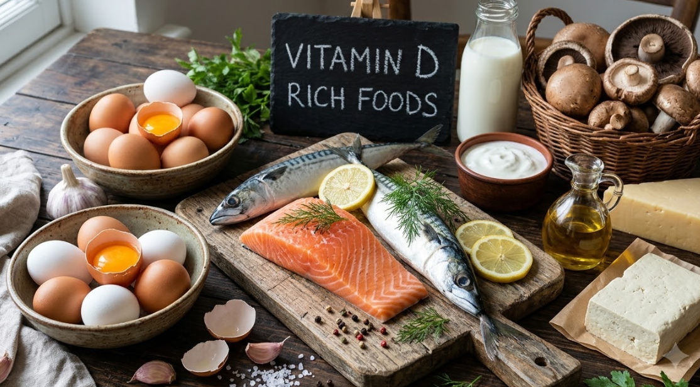
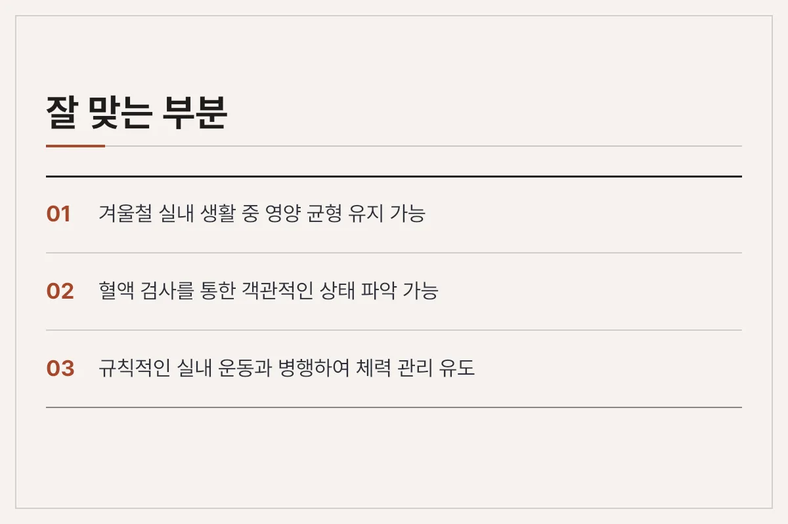
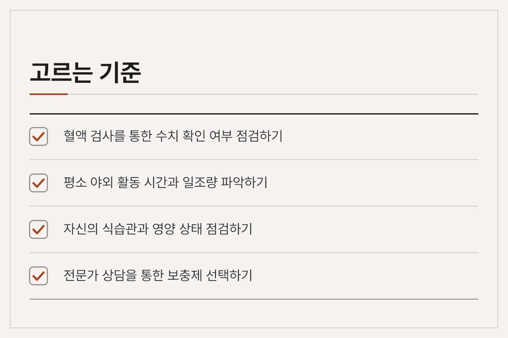
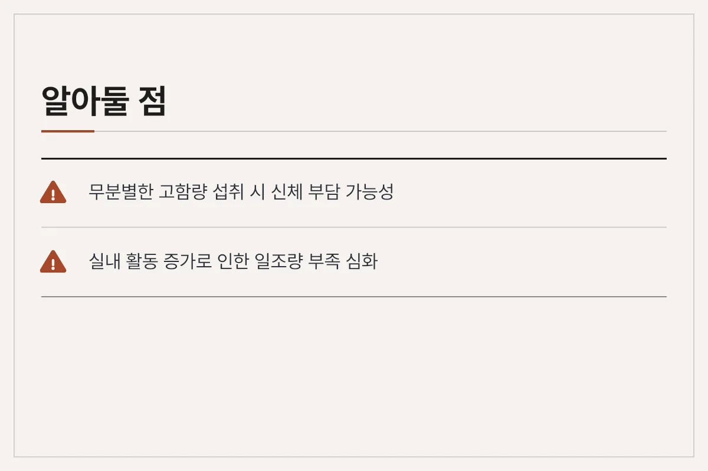
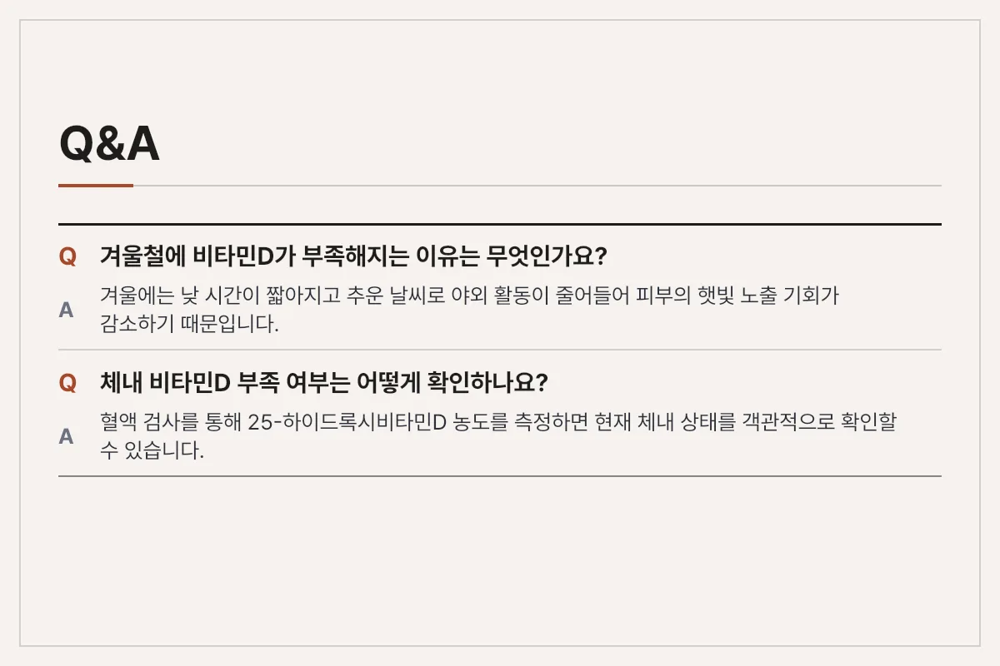
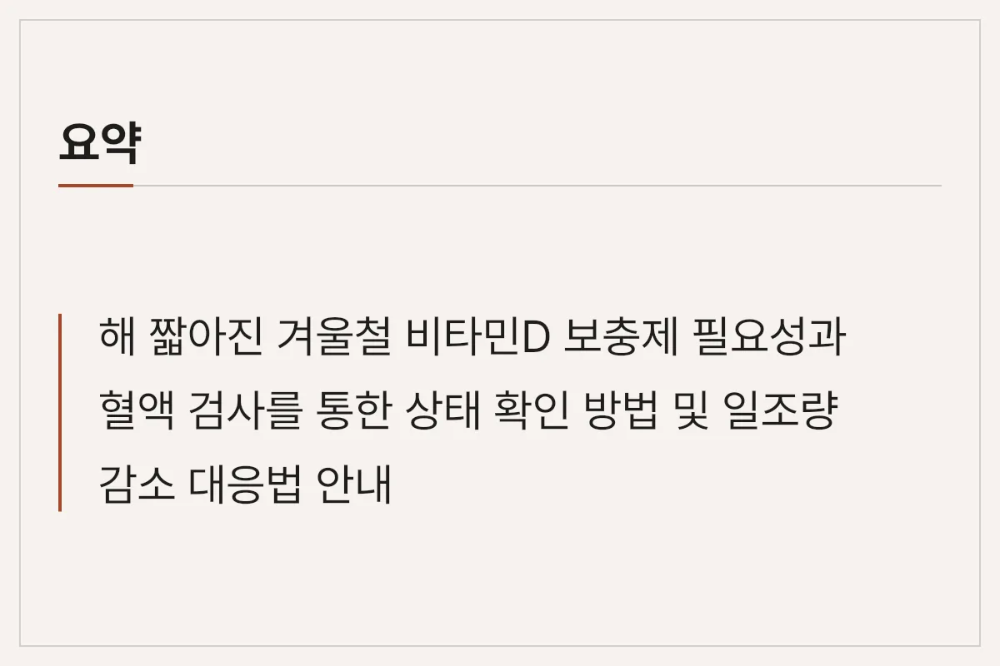
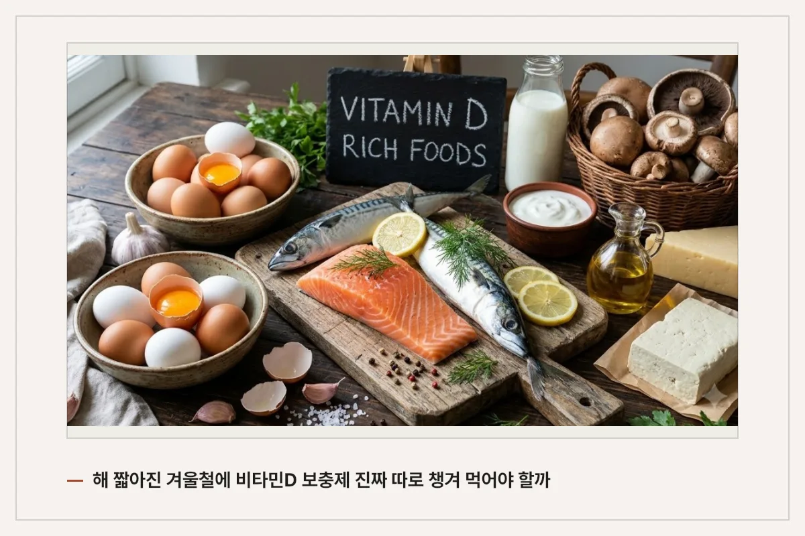

2026년 11월 19일 기준, 겨울철이 본격적으로 시작되면서 해가 짧아지고 야외 활동이 줄어들어 비타민D 부족을 걱정하는 사람들이 늘고 있습니다. 동아일보의 11월 18일 보도에 따르면, 비타민D는 햇빛을 통해 피부에서 합성되지만 계절적 변화로 인해 체내 합성이 줄어들 수 있어 보충제 섭취 여부를 진지하게 고민하게 되는 시기입니다. 

<figure>

<figcaption>겨울철 식단을 통해 비타민D와 영양을 보충할 수 있는 다양한 식재료 (사진: AI생성)</figcaption>
</figure>

## 겨울철 일조량 감소가 신체에 미치는 영향

가을과 경향신문 등 여러 매체에서 지적하듯 해가 짧아지고 밤이 길어지는 계절에는 우리의 생활 리듬과 생체 시계에 뚜렷한 변화가 생깁니다. 아침에는 어두운 시간에 일어나고 야외 활동량이 자연스럽게 줄어들면서 태양광을 마주하는 시간이 급격히 감소합니다. 이러한 환경 변화는 수면 호르몬인 멜라토닌 분비 주기에도 직접적인 영향을 미칩니다. 

북반구의 겨울철에는 수면 시간이 여름보다 약 15분에서 25분 정도 길어지는 경향이 확인되기도 했습니다. 일조량이 부족해지면 신체 리듬이 흐트러지고, 피로감이 쉽게 찾아오며 계절성 우울증을 유발할 수 있는 조건이 만들어집니다. 미국 피츠버그대학교 연구진의 연구에 따르면 계절성 우울증 환자는 겨울철 청색광에 대한 민감도가 높아지는 특성을 보입니다.

<figure>

<figcaption>잘 맞는 부분</figcaption>
</figure>

## 혈액 검사로 확인하는 내 몸의 비타민D 상태

자신의 몸에 비타민D가 실제로 부족한지 객관적으로 알아보려면 막연히 추측하기보다 정확한 검사를 거치는 것이 안전합니다. 동아일보 보도에 따르면 혈액 속의 25-하이드록시비타민D 농도를 측정하는 방식으로 체내 비타민D 상태를 명확하게 파악할 수 있습니다. 

건강한 성인이라도 겨울철에는 햇빛 노출이 줄어들면서 수치가 낮아질 가능성이 존재하지만, 무작정 남들이 먹는다고 해서 보충제를 대량으로 구매하기보다는 자신의 평소 야외 활동량과 식습관을 먼저 점검해야 합니다. 필요하다면 의료기관을 방문해 수치를 확인하고 적절한 조치를 취하는 과정이 현명한 건강 관리법입니다.

<figure>

<figcaption>겨울철 비타민D 섭취 전 확인 사항</figcaption>
</figure>

## 추운 날씨와 활동량 저하가 부르는 생활 리듬의 변화

조선일보와 코메디닷컴 등의 보도에 따르면, 추운 날씨와 짧아진 낮 시간 때문에 산책이나 야외 운동을 미루기 쉽고 실내에 머무는 시간이 길어집니다. 활동량이 줄어든 상태에서 겨울철 특유의 기름지고 단 간식이나 섭취 열량이 늘어나면 체중 관리와 면역 기능 유지에도 적신호가 켜질 수 있습니다. 

실내 운동을 꾸준히 하거나 햇빛이 잘 드는 시간대에 가벼운 산책을 병행하는 것이 도움이 됩니다. 하지만 현실적으로 외부 활동이 여의치 않은 날이 많기 때문에, 식단이나 보충제를 통한 영양 관리가 자연스럽게 대안으로 거론되는 것입니다.

<figure>

<figcaption>알아둘 점</figcaption>
</figure>

## 겨울철 영양 관리와 보충제 섭취 시 주의해야 할 점

비타민D 보충제나 영양제를 선택하고 섭취할 때는 몇 가지 주의할 점이 있습니다. 무조건 고함량을 섭취하기보다는 권장 섭취량을 지키는 것이 중요하며, 개인의 건강 상태나 평소 식습관에 따라 흡수율이나 필요량이 다를 수 있습니다. 

또한 날씨가 춥다고 해서 실내 환기를 소홀히 하거나 히터 바람에만 의존하면 호흡기 건강이나 피부 컨디션에 나쁜 영향을 줄 수 있으므로 균형 잡힌 생활 습관을 유지해야 합니다. 보충제는 어디까지나 보조적인 수단이므로 일상적인 식단 관리와 가벼운 실내 신체 활동을 함께 병행하는 자세가 필요합니다.

<figure>

<figcaption>Q&amp;A</figcaption>
</figure>

## 자주 묻는 질문

**겨울철에 비타민D가 부족해지는 이유는 무엇인가요?**

겨울에는 낮 시간이 짧아지고 추운 날씨로 인해 야외 활동이 줄어들면서, 피부가 햇빛에 노출되는 기회가 줄어들어 체내 비타민D 합성량이 자연스럽게 감소하기 때문입니다.

**체내 비타민D 부족 여부는 어떻게 확인하나요?**

혈액 검사를 통해 25-하이드록시비타민D 농도를 측정하면 현재 체내에 비타민D가 충분한지 객관적인 수치로 확인할 수 있습니다.

<figure>

<figcaption>요약</figcaption>
</figure>

<figure>

<figcaption>해 짧아진 겨울철에 비타민D 보충제 진짜 따로 챙겨 먹어야 할까 (사진: AI생성)</figcaption>
</figure>

[추천 제품 확인하기](https://bitl.bz/Cwpa3y)

## 참고한 자료

- [해 짧아진 겨울철, 한국인도 비타민D 보충제 먹어야 할까? 건강팩트체...](https://www.donga.com/news/Health/article/all/20261118/135044235/2) — 동아일보, 2026-11-18 보도
- [뉴공 아카이브트렌드를 읽어주마: 공개 12시간 만에 조회수 1억 회 돌...](http://www.ddanzi.com/898990389) — ddanzi.com, 2026-11-16 보도
- [개코 전처 김수미, 겨울에 쇼트 커트 '변신은 무죄'](https://www.mediafine.co.kr/news/articleView.html?idxno=95357) — mediafine.co.kr, 2026-11-16 보도
- [생활꿀팁 꽃다발 줄기 끝을 '이렇게' 잘라 보세요…물만 갈던 사람은...](https://www.wikitree.co.kr/articles/1174463) — wikitree.co.kr, 2026-11-13 보도
- [겨울에는 살이 더 잘 빠진다는 말, 사실일까?](https://www.allurekorea.com/2026/11/11/%ea%b2%a8%ec%9a%b8%ec%97%90-%ec%82%b4%ec%9d%b4-%eb%8d%94-%ec%9e%98-%eb%b9%a0%ec%a7%84%eb%8b%a4-%eb%aa%a8%eb%91%90%ea%b0%80-%ec%9e%98%eb%aa%bb-%ec%95%8c%ea%b3%a0-%ec%9e%88%eb%8d%98-%ec%b6%a9/?utm_source=naver&utm_medium=partnership) — allurekorea.com, 2026-11-11 보도
- [추워서 밖에 못 나간다면?⋯집에서 살 빼고 근육 만드는 운동 4가지](https://kormedi.com/?p=2902925) — kormedi.com, 2026-11-11 보도

2026년 11월 19일 기준 내용입니다. 가격과 사양은 판매처와 시기에 따라 달라질 수 있으니 구매 전에 판매 페이지에서 다시 확인해 주세요.
