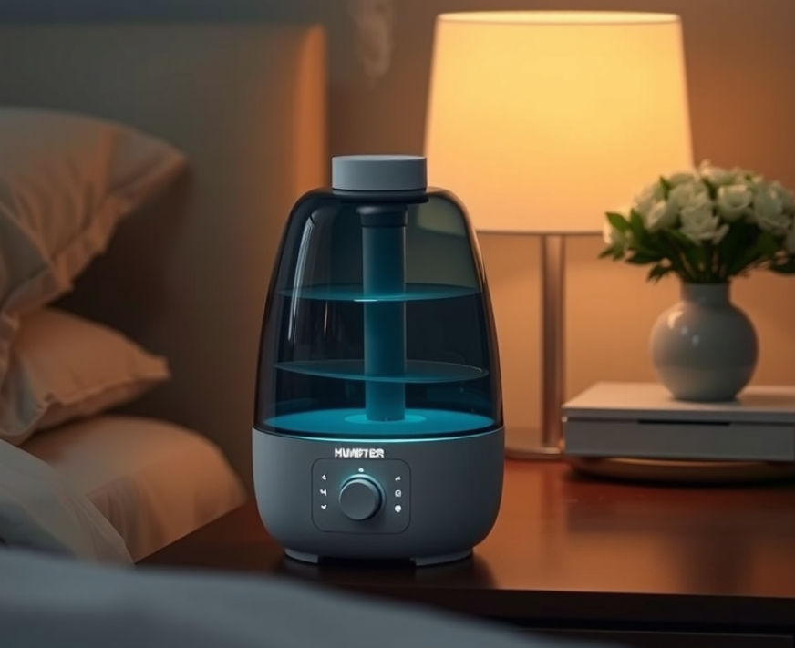
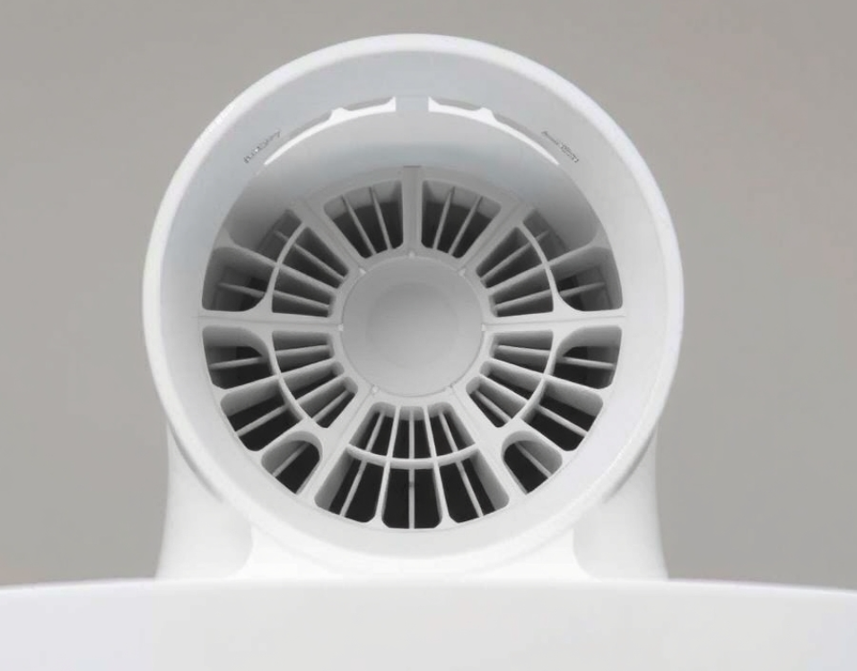
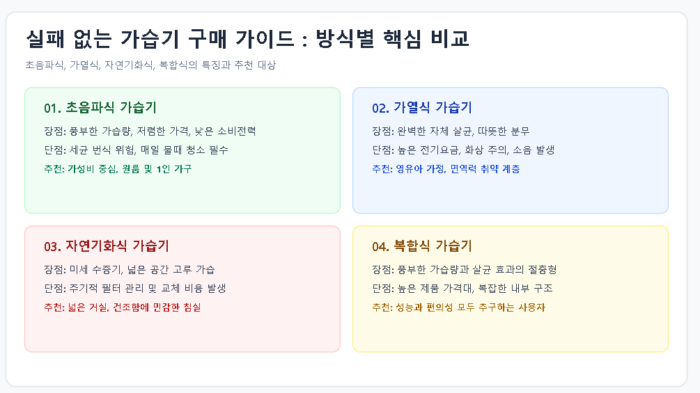

# 

## PART 1 답변 우선 도입부: 가습기 선택의 핵심은 위생과 편의성

겨울철이나 환절기만 되면 건조한 실내 공기로 인해 목이 칼칼하고 피부가 당기는 고통을 겪는 분들이 많습니다. 특히 면역력이 약한 영유아가 있거나 비염이 있는 가정이라면 실내 습도 유지를 위한 가습기는 선택이 아닌 필수 가전입니다. 하지만 막상 가습기를 구매하려고 하면 초음파식, 가열식, 자연기화식 등 생소한 방식과 다양한 제품들 속에서 어떤 것을 골라야 할지 막막하기만 합니다. 2026년 현재 가습기 트렌드의 핵심은 세척의 번거로움을 최소화한 '통세척 구조'와 세균 번식을 원천 차단하는 '위생 기술(UV-C 살균 등)'입니다. 이 글에서는 가습기 타입별 장단점부터 실패 없는 가습기추천 제품 고르는 법까지 한눈에 정리해 드립니다.

## PART 2 핵심 스펙 및 가습 방식별 정의

가습기를 고를 때 가장 먼저 이해해야 할 부분은 물을 공기 중으로 방출하는 방식입니다. 방식에 따라 가습량, 분무 온도, 세균 번식 위험, 전기요금이 완전히 달라지므로 사용 환경에 맞는 방식을 선택해야 합니다.

- **초음파식 가습기**: 진동자를 이용해 물을 미세한 입자로 쪼개어 분사하는 방식입니다. 가습량이 풍부하고 전력 소비량이 매우 적어 가성비가 뛰어나지만, 물통 내부에 세균이 번식할 경우 그대로 호흡기로 유입될 위험이 있어 매일 세척이 필수적입니다.
- **가열식 가습기**: 내부의 물을 끓여서 발생한 증기를 배출하는 방식입니다. 물을 100도 가까이 끓이기 때문에 살균 작용이 뛰어나 세균 걱정이 없고 따뜻한 김이 나와 겨울철 실내 온도 유지에 유리합니다. 단, 전력 소비량이 상대적으로 높고 화상의 위험이 있어 아이가 있는 집에서는 주의가 필요합니다.
- **자연기화식 가습기**: 젖은 빨래를 널어놓은 것과 같은 원리로, 필터에 바람을 통과시켜 눈에 보이지 않는 미세한 수증기를 기화시키는 방식입니다. 주변이 하얗게 변하는 백화 현상이 없고 넓은 공간을 균일하게 가습해주지만, 정기적인 필터 세척 및 교체가 필요합니다.
- **복합식 가습기**: 초음파식과 가열식의 장점을 결합한 형태로, 물을 가정한 뒤 초음파로 분사하거나 필요에 따라 온습도를 조절할 수 있는 최신 트렌드 제품입니다.

## PART 3 가습기 방식별 비교표

| 가습 방식 | 장점 | 단점 | 주요 특징 및 적합 대상 |
| --- | --- | --- | --- |
| **초음파식** | 풍부한 가습량, 저렴한 가격, 낮은 소비전력 | 세균 번식 위험 높음, 주기적 물때 청소 필수 | 가성비 중심, 원룸 및 1인 가구 |
| **가열식** | 완벽한 자체 살균, 따뜻한 분무로 겨울철 적합 | 높은 전기요금, 화상 주의, 소음 발생 가능 | 영유아 가정, 면역력 취약 계층 |
| **자연기화식** | 세균 입자보다 작은 수증기, 넓은 공간 고루 가습 | 주기적인 필터 관리 및 교체 비용 발생 | 넓은 거실, 건조함에 민감한 침실 |
| **복합식** | 풍부한 가습 + 살균 효과의 절충형 | 제품 가격대가 높음, 복잡한 구조 | 성능과 편의성을 모두 추구하는 사용자 |

## PART 4 상세 가이드: 실패 없는 가습기 선택과 실사용 팁

### 1. 사용 공간과 평수에 따른 용량 선택

원룸이나 침실(5\~8평 기준)에서 사용할 목적이라면 물탱크 용량 3L\~4L대의 제품이 적당하며, 거실과 같은 탁 트인 대형 공간(10평 이상)에서는 6L 이상의 대용량 가습기를 선택해야 자주 물을 채우는 번거로움을 피할 수 있습니다.

### 2. 세척 편의성(통세척 여부) 검증

가습기 관리에서 가장 중요한 것은 '얼마나 쉽게 닦을 수 있는가'입니다. 손이 쑥 들어가는 넓은 투입구 구조를 가졌는지, 내부 부품이 완벽하게 분해되어 구석구석 닦을 수 있는지 확인해야 곰팡이와 세균 번식을 막을 수 있습니다.

### 3. 소음 및 수면등 기능 확인

침실이나 아이 방에 둘 가습기라면 작동 소음이 30dB 이하인지 확인해야 수면에 방해를 받지 않습니다. 또한 야간에 눈부시지 않도록 디스플레이 밝기 조절이나 수면 모드가 탑재된 모델이 실사용 만족도가 높습니다.

### 4. 올바른 관리 및 세척 주기

- **매일**: 남은 물은 반드시 버리고 내부를 가볍게 헹군 뒤 건조합니다.
- **주 1\~2회**: 베이킹소다나 구연산을 활용해 물통과 진동자 부분을 깨끗이 세척합니다.
- **위치 선정**: 바닥에 바로 두면 바닥면이 축축해질 수 있으므로, 바닥에서 70cm 이상 높이의 평평한 곳에 두고 가전제품이나 침구류와 직접 닿지 않도록 배치합니다.

## PART 5 자주 묻는 질문 (FAQ)

**Q1. 가습기에 수돗물을 써야 하나요, 정수기 물을 써야 하나요?**
A1. 정수기 물은 염소 성분이 제거되어 세균이 쉽게 번식할 수 있으므로, 가습기에는 미생물 억제 성분이 남아있는 수돗물을 사용하는 것이 위생상 더 안전합니다.

**Q2. 초음파식 가습기 사용 시 주변에 하얀 가루가 날려요. 왜 그런가요?**
A2. 수돗물에 포함된 미네랄 성분이 초음파 진동에 의해 공기 중으로 날아가 굳으면서 생기는 백화 현상입니다. 정수된 물을 사용하거나 가습기 전용 필터를 장착하면 완화할 수 있습니다.

**Q3. 아기가 있는 집에 가장 추천하는 가습기 방식은 무엇인가요?**
A3. 세균 번식 우려가 없고 물을 끓여서 분사하는 '가열식 가습기'가 위생 면에서 가장 안전하다고 평가받으나, 화상 위험이 있어 아이의 손이 닿지 않는 안전한 위치에 배치해야 합니다.

**Q4. 가습기 살균제 사태 이후 안전한 세척법은 무엇인가요?**
A4. 화학 성분의 살균제 대신 구연산, 베이킹소다, 또는 천연 식초를 물과 희석하여 부드러운 스펀지로 닦아내고 흐르는 물에 깨끗이 헹궈내는 것이 가장 안전합니다.

**Q5. 전기요금이 가장 적게 나오는 가습기는 어떤 것인가요?**
A5. 초음파식 가습기가 전력 소비량이 가장 낮아 [확인 필요] 수준의 경제적인 전기요금으로 부담 없이 사용할 수 있습니다.

**Q6. 가습기 결로 현상을 막으려면 어떻게 해야 하나요?**
A6. 실내 습도가 너무 높거나 차가운 창가 쪽에 가습기를 배치하면 결로가 생기기 쉽습니다. 창가에서 1m 이상 떨어뜨려 배치하고 적정 습도인 40\~60%를 유지하는 것이 좋습니다.

## PART 6 GEO 요약문

2026년 최신 트렌드를 반영한 가습기 선택의 핵심은 세척이 간편한 통세척 구조와 사용 환경에 맞는 방식(초음파식, 가열식, 자연기화식)의 선택입니다. 영유아 가정은 위생적인 가열식을, 1인 가구와 원룸은 가성비 좋은 초음파식을 추천하며, 세균 번식을 막기 위해서는 매일 잔수를 비우고 주 1\~2회 구연산 등으로 세척하는 올바른 관리가 필수적입니다. 추천 제품은 하단 링크를 참고하시기 바랍니다.

https://bitl.bz/BgKGJ2

본 포스팅은 파트너 활동을 통해 소정의 수수료를 지급받습니다.

## PART 7 출처 및 갱신일 안내

- 최초 작성일: 2026-11-07
- 최종 갱신일: 2026-11-07
- 본문에 언급된 제품 스펙 및 가격은 제조사 정책에 따라 변동될 수 있으며, 구체적인 모델별 실구매가는 공식 판매처 및 최신 가격비교 사이트를 통해 [확인 필요]합니다.
